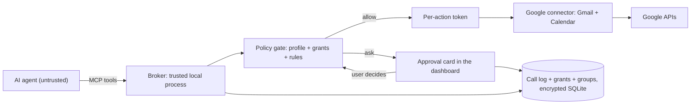

# Agent Sandbox — A Permission Broker Between AI Agents and Your Accounts

**Status:** draft proposal, version 0.2. Section 11's additions to the PRD and the architecture document were approved and applied on 2026-10-26. Section 2 lists what it takes from the Design Document; section 3 lists the decisions D1 to D13 that still need your confirmation (gate G0).

**Prepared:** 2026-10-26, from "Design Document.docx" (Sandbox for AI Agents, 2026-10-25, not in the repository)

**Scope:** a prototype that sits between one AI agent and one provider (Google: Gmail and Calendar), lets the user grant the agent bounded, explained, revocable, time-limited permissions through profiles and per-request approval cards, and records every call the agent makes
**Related:** [Product requirements](PRD.md) §6.5, §7.4 · [Technical architecture](architecture.md) §9.1, §12.3, §12.4, §13, §14.1 · [Isabelle-gated calendar demo](isabelle-calendar-demo.md) · [ADR-007](adr/ADR-007-operation-log-and-sync-evolution.md) · ADR-008 (agent/MCP permission model, open)

---

## 1. What the Design Document asks for

The document's goals, in its own order:

1. Prevent an AI agent from causing irreversible damage to the user's assets (reputation, data, money).
2. Let the user revoke the agent's access to their identity and assets at any time.
3. Make the user aware of unauthorized or unexpected consequences of the agent's actions.

Its non-goals: anonymity toward the agent, and (undecided) being a second agent that monitors the first.

Its design principle is a three-question check before any action runs: **agent policy** (should it do this?), **authority** (may it do this?) and **data rules** (is it doing this with valid data?), followed by execute, then verify and audit. The worked example: "email my accountant the tax return" passes policy and authority but fails data rules because the accountant's address was inferred from an old document rather than an authoritative contact record.

Its first-pass product shape:

- **Profiles** that set defaults, always adjustable: Flexible and Careful in the mockups, Vigilant and Relaxed in the tables.
- **Modes** per action: Allow, Ask, Block.
- **Boundaries** in plain language ("can create meetings but cannot delete them"), safe defaults, incremental authorization (ask for read access when a task needs it, never deletion at onboarding), and explicit duration on every grant.
- **Usability levers:** progressive trust ("always allow similar actions"), rule suggestions after repeated approvals, relationship-based permissions (contacts versus strangers), permission bundles, batch approvals by category, exceptions rather than lists, and autonomy boundaries (the agent may only modify events it created).
- **Email profile:** read allowed; send always asks (Vigilant) or is limited to whitelisted recipients with a prompt for new recipients, lists, attachments or Drive links (Relaxed); label, star, read and important flags allowed; delete, archive, spam and forward never (Vigilant) or to trash with a review period and to whitelisted addresses (Relaxed).
- **Calendar profile:** read allowed; always ask before accepting or declining an invite; create, edit and delete only non-invite events the agent itself created, and ask before finalizing if others are on the event; never delete calendars or change ACLs. Time itself is named as a protected resource, with the scheduling intelligence left to the agent and enforcement to the sandbox.
- **Prototype stage:** a fine-grained OAuth broker for email and calendar between one provider (Google) and one agent, plus traceability, which the document defers but the author wants from the start.
- **Traceability:** OpenTelemetry GenAI spans for "what happened" and W3C PROV-O for "where did the information come from and go", with person-and-fact-level disclosure tracking marked as future; start with API-level tracking.

Its open issues: how to become the layer between the agent and OAuth without friction; an agent with browser access can edit OAuth settings itself; per-contact allow and block lists are too much overhead; revocation cannot erase what the agent already learned; and leakage through drafted replies or injected instructions.

## 2. How it relates to Fabric

The document describes, as a standalone product, the boundary Fabric already specifies for its own agents. Almost every element has a home; what is new is the deployment shape and the product surface.

| Design Document | Fabric today | Verdict |
|---|---|---|
| Authority check before execution; execute, verify, audit | Invariant 7 (policy outside the model); per-action tokens minted only from a successful policy check, single-use, bound to the action's exact arguments and the agent's key (`fabric-policy`, `fabric-token`, demo §9) | Exists, as working code |
| Agent policy as the agent's own reasoning | The agent runtime is untrusted and proposes plans; the trusted host decides (demo §5.3, architecture §12.3) | Same split |
| Data rules: authoritative contact record versus inferred fact | PRD §4.2 epistemic status: a source-attested statement is not an observation; assertions carry origin, verification and lifecycle | Exists as a data model; not yet used as a precondition of actions |
| Allow, Ask, Block | AIA-006: auto, suggest, confirm; destructive or external actions cannot be auto (architecture §13.1 policy tiers) | Same three tiers; "Block" is "never" in rule policy |
| Profiles as bundles with fine-grained controls underneath | Not specified. PRD §2.2 item 9 asks what scope of automated actions is acceptable; the profiles are an answer to it | New |
| Incremental authorization with explicit duration | Grants carry purpose and expiry (architecture §12.3, AIA-008); `schedule.negotiate` capabilities are short-lived (calendar §23.5) | Exists for grants; the user-facing "ask at the moment of need, with a duration choice" is new |
| Relationship-based permissions (contacts versus strangers) | Contact-list authorization and TOFU for scheduling peers (PRD §2.1); no equivalent for email recipients | Partly; extend to recipients |
| Progressive trust and rule suggestions | §13.3 candidate-rule learning, with the rule that external actions are never learned from behavior alone | Exists; the document's "always allow similar actions" must respect that rule |
| Autonomy boundary: edit only what the agent created | Calendar extended properties proposed in the document; Fabric records `actor_agent_id` on every operation (ADR-007 envelope) | Fabric's log is the source of truth; provider labels are a mirror, as the document itself says |
| Revoke at any time | Grants have expiry; revocation of agent capability is in the threat model (§14.1) | Exists in principle; no revocation UI specified |
| Awareness of consequences; review agent actions | Audit log of grant, tool arguments, decision and result by default (§12.4); replay capsule opt-in | Exists; the document's OTel span shape is a good concrete format for it |
| Person-and-fact disclosure tracking (PROV-O) | AIA-003 processing provenance; `processing_run` and assertion evidence tables; calendar disclosure receipts | Exists for Fabric's own processing; deferred by the document for the broker, rightly |
| Standalone broker between a third-party agent and Google OAuth | Fabric's connectors hold provider tokens and call `authorized_fetch` on behalf of sandboxed code (§9.1); the agent gateway is MCP (§12.3) | The broker is those two boundaries composed and deployed without the vault. New as a product slice, not as architecture |
| Agent with browser access can bypass the sandbox | Not stated | Add to the threat model as a stated limit |

Two tensions to decide rather than paper over:

- **Where does the agent connect?** Fabric's agent surface is MCP. The document's agents (Instinct, Muse) are third-party products that talk to Google directly over OAuth. A broker can be an MCP server the agent is pointed at, or an OAuth-shaped proxy that stands in for Google. The first is clean and fits §12.3; the second is what "frictionless" means in the document's open issue, and it is hard (D1).
- **Live proofs or a deterministic evaluator?** The calendar demo proves every action in Isabelle before minting a token. That is right for a demo of semantics and slow for an interactive mail assistant. The rules can stay in HOL and be checked offline against a corpus while a Rust evaluator decides at run time, or proofs can stay live (D2).

## 3. Decisions that need your confirmation

| # | Decision | Proposed default | Alternative |
|---|---|---|---|
| D1 | Agent integration surface | **MCP server** exposed by the broker: the agent gets tools like `email.search`, `email.draft`, `email.send`, `calendar.create`; the broker holds the Google token. First agent: a Claude-backed agent in this workspace as the stand-in (the document leaves Instinct or Muse "TBD"). | An OAuth-compatible proxy that impersonates Google's endpoints, so an unmodified third-party agent can be pointed at it. Spike first; likely blocked by TLS pinning and token formats. |
| D2 | Policy evaluation | **Rules in HOL, evaluated in Rust.** `Fabric_Policy.thy` grows email and calendar rules; Isabelle proves the rule theory's properties and checks a generated corpus in CI; a deterministic Rust evaluator (same datatypes, `fabric-policy` model) decides each call at run time and mints the token. | Live proofs per action as in the demo; acceptable for a demo, seconds per action. |
| D3 | Profiles | **Two shipped profiles, Careful (default) and Flexible, plus custom.** Careful is the document's Vigilant column; Flexible is its Relaxed column. Names follow the mockups. | The document's Vigilant and Relaxed names. |
| D4 | Modes per action | **Allow, Ask, Block**, with Block the default for delete, archive-to-trash, spam, forward, calendar delete, ACL change, and for send to anyone not in an allowed set; Ask the default for send, invite responses and edits of events with other attendees; Allow for read and labels. | Only Ask and Block at first (the document's "start with only the authority layer"). |
| D5 | Grant duration choices | **This request only, while this session lasts, until revoked**, as in the calendar mockup. Every grant records its expiry; "until revoked" is shown as such, never as the silent default. | Fixed durations (24 hours, 30 days). |
| D6 | Recipient rules | **Sets, not per-contact lists:** my contacts, a named group (saved from a previous approval, "save recipients as group tag"), exact addresses, an entire domain. Strangers always Ask. This answers the document's "individual whitelisting is too much overhead". | Per-contact allow and block lists. |
| D7 | Traceability level | **API-level first**, as the document says: one record per tool call with agent identity, session, tool, argument digest, grant and policy decision, result, timing, in the OpenTelemetry GenAI attribute names. Person-and-fact disclosure is a later phase. | PROV-O from the start. |
| D8 | Where the broker runs | **A local process on the user's Mac**, like every Fabric service: loopback only, the Google refresh token in the OS keychain, no cloud component. | A hosted broker; out of scope for a prototype and conflicts with PRD §8.3. |
| D9 | Relationship to the vault | **Standalone**: the broker keeps profiles, grants, groups and the call log in its own encrypted SQLite file, with the ADR-007 envelope for its log so it can become a Fabric space later. It does not read `vault.db`. | Build inside the Fabric desktop app; too early, the kernel does not exist yet. |
| D10 | Undo and revert | **Prevent and log, do not revert.** Deletes go to trash only, with a review period; sends and forwards are never reversible and are shown as such before approval. The document's "revert lost or corrupt data" stays a later decision. | Snapshot mail and calendar state before each write to allow restore. |
| D11 | Approval interface | **A local web dashboard served by the broker**, as the calendar demo's dashboard, rendering the request card, the profile screen and the review log from the mockups. | A native macOS app; later, when the Fabric desktop shell exists. |
| D12 | Language and location | **Rust crates in this workspace**, reusing `fabric-policy`, `fabric-token`, and the demo's host, audit and dashboard code. | A TypeScript service; rejected for the same reason as ADR-014 Option B. |
| D13 | Google account and scopes | **A personal Google account in OAuth testing mode**, with Gmail and Calendar scopes requested at the narrowest level each tool needs; the broker never asks for a scope a profile forbids. Restricted Gmail scopes need Google's verification only for a published app. | A Workspace account; its admin policies differ. |

## 4. System overview

The agent never holds a Google token. Every tool call becomes a request the gate answers with allow, ask or block. Allow and an approved ask both mint a per-action token that the connector requires; block returns the rule and the failed condition to the agent, which may re-plan a bounded number of times, as in the calendar demo (Q19). Every request, decision and result is one record in the call log.

The colors in the document's legend (agent blue, sandbox amber, external services green) are kept in the dashboard so a screen always shows which party is speaking.

## 5. Components

| Component | Responsibility | Explicitly absent |
|---|---|---|
| Broker (`fabric-broker`, Rust) | Runs the MCP server for the agent, the policy gate, token minting, the connector and the dashboard; one process, loopback only | Any agent logic; any model |
| Policy gate (`fabric-policy`, extended) | Decides allow, ask or block from the active profile, the grants in force, the recipient sets and the rules; explains every denial | Learning or suggesting rules in the prototype |
| Grants store | Grants with scope, purpose, duration and the approval that created them; revocation marks a grant ended and invalidates its tokens | Grants that outlive their stated duration |
| Google connector | Gmail and Calendar calls with the broker's OAuth token, the narrowest provider scope per operation, idempotency keys on writes, trash-only deletes | Direct access by the agent; any other provider in the prototype |
| Dashboard | Setup (profile choice), detailed settings, approval cards, contacts and groups, review of agent actions, revoke | Being an email or calendar client |
| Call log | One record per tool call in the OpenTelemetry GenAI attribute names, inside an ADR-007 envelope, with the policy decision and grant ID | Message bodies, attachments, or personal facts in the prototype (D7) |
| Agent stand-in (`fabric-demo`, extended) | A Claude-backed agent that talks MCP to the broker for the demo scenarios | Being the product's agent |

## 6. Data model

- **Profile:** name, built-in or custom, and a table of (resource, action) to mode. Resources and actions for the prototype: email `read`, `draft`, `send`, `label`, `organize`, `forward`; calendar `read`, `create`, `update`, `delete`, `respond_invite`. Send, forward and respond carry a recipient or attendee set rule.
- **Recipient set:** my contacts, a named group, exact addresses, a domain. Groups are created from approvals ("save as group") or by hand.
- **Grant:** resource, action, scope (sender groups, email age, calendar, fields), purpose text shown to the user, duration (this request, this session, until revoked), created by which approval, revoked at.
- **Request:** what the agent asked, as typed arguments; the gate's decision; the grant used or created; the token minted; the connector result; timing.
- **Call log record:** `gen_ai.agent.name`, session, `gen_ai.operation.name`, `gen_ai.tool.name`, an argument digest (arguments themselves only when the profile allows), `fabric.grant_id`, `fabric.policy.decision`, `fabric.policy.rule`, status, duration. The record is an ADR-007 operation so the log is chained and attributable.

## 7. The approval interface, from the mockups

What the mockups establish, and what the prototype takes from them:

1. **Setup is one choice.** "How much control would you like?" with Flexible and Careful, a Continue button and a Detailed settings link (image: Set up Sandbox). Taken as is, with Careful first and selected by default (D3), because the document's own principle is safe defaults.
2. **Detailed settings is a profile editor.** Tabs for Agent permissions, Contacts and Review agent actions; a profile list on the left (two defaults, custom ones named after their owner); per-resource sections (Email, Calendar) with one row per action, a plain-language consequence under each, and a state pill on the right (Allowed, Select contacts, Draft only, Not allowed); Cancel and Save as custom. Taken as is. The pills are the Allow, Ask, Block modes plus the recipient rule; "Draft only" is Ask rendered for send.
3. **A request card narrows scope before it grants.** The agent's request is shown in the agent's words, then the sandbox lists what it would need, grouped so the user can narrow each group: sender groups (entire domain or exact address), email age, fields to read, search location, read scope, and always an access duration. Deny and Allow selected, with Detailed settings underneath. This is the incremental-authorization principle made concrete and is the prototype's central screen.
4. **A send is approved separately from a read**, with the template, the recipient count, a "review list" step, a send permission choice (this time only, or always to these people) and "save recipients as group tag". This is the progressive-trust lever done without silently widening authority: the wider grant is a visible choice.
5. **Results report what was done**, with counts (sent 140 of 140, in batches) and a link to send details. This is goal 3, awareness of consequences, at the moment it matters.
6. **Calendar consent lists capabilities as consequences**, not scopes (see, create and reschedule, delete), with duration choices and a one-line "your choices" summary. The mockup's own footnote applies: the provider must support the restriction for it to be enforceable, which is exactly why the broker enforces it rather than relying on provider scopes.
7. **Tracking** at person-and-fact level is shown and then deferred by the document itself. The prototype's review tab shows the API-level call log.

What the mockups do not show and the prototype must still design:

- **Revocation.** Goal 2 has no screen. Proposed: the Review agent actions tab lists grants in force with a Revoke control, and a single "pause this agent" switch at the top of every screen.
- **The Contacts tab.** Relationship-based permissions depend on it. Proposed: contacts from Google People, grouped; groups created from approvals appear here.
- **Denials.** What the agent and the user see when a call is blocked. Proposed: the agent receives the rule name and the failed condition (demo Q19); the user sees blocked calls in the review tab, not as interruptions.
- **Batch approvals** ("12 actions: 9 safe, 3 need review"). Proposed for a later phase; the prototype approves one request card at a time.
- **Time as a protected resource.** The document names it and defers the design. Proposed: out of the prototype; the calendar profile's rules (own events only, ask when others attend) are the first step.
- **Naming.** The mockups mix Instinct, Muse and Sandbox. They are ChatGPT output used as a reference, per the document; the prototype needs its own name and copy.

## 8. Security model and limits

Enforced by the prototype: the agent never holds a provider token; every call needs a token bound to its exact arguments; Block is final and Ask requires a human click; grants expire; deletes go to trash; every call is logged; the Google scopes requested are the narrowest per operation.

Not protected, and said so: an agent that can drive the user's browser or has its own Google OAuth grant bypasses the broker entirely (the document's "agent misbehavior hole"); what the agent has already read cannot be unlearned; injected instructions inside email bodies can still steer the agent, and the broker only bounds what the steered agent may do (architecture §12.4 applies); drafted text can leak private facts the agent legitimately read, which only review before send mitigates.

## 9. Phases

Each phase ends with a commit and a stop for approval, as the paracels and calendar specs did.

| Phase | Work | Gate |
|---|---|---|
| 0 | This proposal approved; section 11 applied to the PRD and the architecture document; D1 to D13 decided | G0: your review |
| 1 | Spikes: Gmail and Calendar API scopes in testing mode; MCP server in Rust reachable by the stand-in agent; one approval card round trip in the dashboard; measure a Rust rule evaluation against a live Isabelle proof for one action (D2) | G1: spike results in this spec |
| 2 | Read-only email under the Careful profile: request card with sender groups, age and duration; grants store; call log | G2: the "school emails to-do list" scenario on your account |
| 3 | Send with recipient sets, drafts, the send-approval card, groups saved from approvals | G3: the "invite the parents" scenario |
| 4 | Calendar: read, create and reschedule own events, invite responses with Ask, the calendar consent card | G4: a meeting created and rescheduled by the agent, an invite answered only after your click |
| 5 | Review and revoke: the actions tab, grant revocation, pause switch, denials shown | G5: revoke mid-task and watch the next call fail closed |
| 6 | Verification and documentation | G6: acceptance criteria, section 10 |

## 10. Acceptance criteria

| # | Criterion |
|---|---|
| A1 | The agent holds no Google credential; a test proves a call from the agent process to Google fails without the broker. |
| A2 | Under Careful, a send is never executed without a click; under Flexible, a send to an allowed set executes and one to a stranger asks. |
| A3 | A grant with duration "this request only" is unusable by the next request; "this session" ends when the dashboard session ends; "until revoked" ends when revoked, and the next call with its token fails. |
| A4 | A blocked action returns the rule name and failed condition to the agent and appears in the review tab; it never reaches Google. |
| A5 | Every tool call has exactly one log record with agent, tool, argument digest, decision, grant and result, and the log chain verifies. |
| A6 | Delete never bypasses trash; the review period is recorded. |
| A7 | The Isabelle corpus and the Rust evaluator agree on every case (D2). |

## 11. Additions to the baseline specifications (approved and applied 2026-10-26)

### 11.1 PRD

**§2.2, item 9** (acceptable scope of automated actions) — append: "Proposed answer, from the Agent Sandbox design: two profiles, Careful (read, draft and label; ask before any send; never delete, archive, spam or forward) and Flexible (send to allowed recipient sets, ask for strangers, attachments and lists; trash-only delete with a review period), with per-action overrides. See `docs/agent-sandbox.md`."

**§7.4** — add rows:

| ID | Priority | Requirement | Acceptance criterion |
|---|---:|---|---|
| AIA-009 | P1 | Permission profiles bundle per-action modes (allow, ask, block) across a resource, with fine-grained overrides underneath | Switching profiles changes defaults without erasing custom overrides; a destructive action cannot be set to allow in a shipped profile |
| AIA-010 | P1 | Incremental authorization: an agent requests a scoped grant at the moment a task needs it, and the user narrows scope and chooses a duration before granting | No grant exists without a purpose, a scope and an expiry; "until revoked" is an explicit choice |
| AIA-011 | P1 | Recipient and attendee rules by set (contacts, named group, exact address, domain), with strangers always requiring approval | A send to an address outside every allowed set is held for approval |
| AIA-012 | P1 | Every agent tool call is recorded with agent identity, tool, argument digest, grant, policy decision and result, in OpenTelemetry GenAI attribute names | The record exists before the external call is made; a missing record fails the call |
| AIA-013 | P1 | Agent grants can be revoked at any time, individually or all at once, and revocation takes effect on the next call | A token minted under a revoked grant is refused |

**§6.5** — append after the four trust stages: "An agent profile places each action on one of these stages; a profile may not move sending, deleting, sharing, account changes or financial actions to stage 4 by default."

### 11.2 Architecture document

**§12.3** — append after the grant paragraph: "Grants are presented to the user as profiles (bundles of per-action modes) and as request cards that narrow scope and fix a duration at the moment of need. Modes are allow, ask and block; block is final. A grant records purpose, scope, duration and the approval that created it, and can be revoked individually. The same boundary can run without the vault, as a broker between a third-party agent and a provider; `docs/agent-sandbox.md` specifies that deployment."

**§14.1 threat model** — add a row: "| Agent bypasses the broker | An agent with browser control or its own provider OAuth grant is outside the sandbox; the product states this limit, asks the user to grant provider access only to the broker, and never claims to bound such an agent |".

**§19** — extend ADR-008: "**ADR-008 Agent/MCP permission model** — resource/tool surface, grants, consent, injection controls, permission profiles and modes, incremental authorization and duration, recipient sets, and the standalone broker deployment (`docs/agent-sandbox.md`)."

### 11.3 Isabelle calendar demo

No change. The demo's gate, tokens, consent records and dashboard are reused as code; its spec stays the record of what was built.

## 12. Out of scope

A second monitoring agent; person-and-fact disclosure tracking (PROV-O), beyond recording that it is the next step; providers other than Google; reverting lost or corrupt data; batch approvals; time as a protected resource beyond the calendar profile rules; learning rules from approvals; a hosted broker; a native app.
