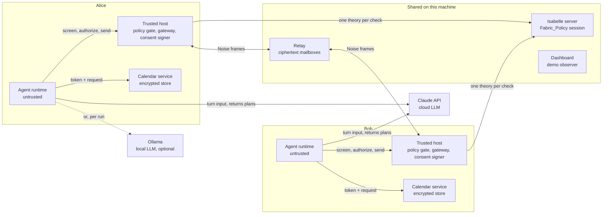
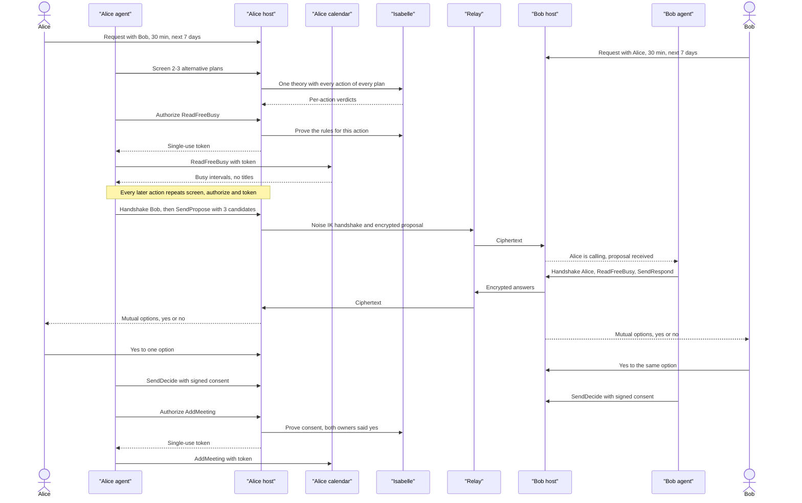

# Fabric Policy Demo — Isabelle-Gated Calendar Agents

**Status:** approved on 2026-10-18; version 1.1 records gate G1. Phases 0 and 1 are done; Phase 2 is in progress.

**Prepared:** 2026-10-18

**Scope:** a working, single-machine demo in which LLM agents negotiate and book a meeting while Isabelle/HOL proves every action against explicit rules and per-action tokens gate every effect
**Related:** [Product requirements](PRD.md) · [Technical architecture](architecture.md) · [Calendar vertical](calendar.md)

---

## 1. What the demo must show

Two people, Alice and Bob, each have a private calendar and an agent that plans with an LLM. Both agents use Claude by default; either can run on a local model through Ollama instead, chosen per run (Q27). The agents agree on a 30-minute meeting and add it to both calendars. Along the way the demo shows that:

1. Calendar data sits in a separate, encrypted service per person. Agents reach it only through a loopback API that demands a valid token on every call, and they only ever receive free/busy intervals, never event details.
2. On each turn an agent's LLM writes 2–3 alternative plans. Each plan is an ordered list of typed actions.
3. Isabelle/HOL checks every action in every plan against a rule theory. The dashboard shows each verdict, the rule that decided it, and the proof.
4. An action runs only with a token minted from an Isabelle theorem about that exact action. Tokens are single-use, short-lived, and bound to the action's arguments and to the agent that asked.
5. The agents handshake and negotiate over an encrypted relay with typed, signed messages and an optional short note.
6. Each agent adds the meeting only after both owners clicked yes for that exact meeting.
7. Dashboard switches trigger four denials on demand: an over-broad calendar read, too many candidates, a write without consent, and token misuse.

The demo shows the semantics and how they are enforced. It is not production security; section 15 lists what it does not protect.

## 2. Decisions recorded from the Q&A

| # | Topic | Your decision |
|---|---|---|
| Q1 | How Isabelle checks actions | A live proof per action through a running `isabelle server`. A token is issued only after the proof succeeds. |
| Q2 | Language and location | Rust, as new crates in this workspace. |
| Q3 | LLM backends | Claude API (cloud) and Ollama (local). |
| Q4 | Calendar | A synthetic local store seeded with fixture events. |
| Q5 | Participants | Two people. Alice's agent on Ollama and Bob's on Claude by default; either can be switched per run in config. Backends superseded by Q27. |
| Q6 | Agent connection | Signed and encrypted messages through a relay process. |
| Q7 | Message content | Typed protocol messages plus a short free-text note. |
| Q8 | Cloud model's view | Free/busy within the negotiation window. No titles or other event details. |
| Q9 | Calendar isolation | A separate calendar service process per person. Its loopback API answers only requests that carry a valid per-action token. The store is encrypted at rest with a per-user key. |
| Q10 | Owner consent | Each owner says yes or no to each mutual option. Add-to-calendar only for a meeting both owners accepted. |
| Q11 | Encryption | The Noise protocol framework. |
| Q12 | Local model's view | Same as the cloud model: free/busy only. |
| Q13 | Token format | COSE_Sign1 over CBOR, Ed25519. |
| Q14 | UI | A local web dashboard, plain HTML and JS served by Rust. |
| Q15 | Platform | Windows, native. |
| Q16 | Note limits | A length cap and no digits. |
| Q17 | Rule groups | The disclosure budget, plus the calendar-view and note rules. |
| Q18 | Denials to show | All four: over-broad read, too many candidates, write without consent, token misuse. |
| Q19 | On denial | The agent receives the rule name and the failed condition, and may re-plan a bounded number of times. |
| Q20 | Where this spec lives | `docs/` on a new branch. |
| Q21 | Who may be handshaked | Only the participant named in the owner's request, identified by a pre-configured public key. No contact list and no TOFU. |
| Q22 | Consent rule | A minimal rule: add-to-calendar only for the exact meeting both owners said yes to. No once-only or own-calendar checks. |
| Q23 | Alternatives | Alternative plans: 2–3 action lists per turn; the first plan whose actions are all permitted runs. |
| Q24 | Triggering denials | Fault-injection switches in the dashboard. |
| Q25 | Anthropic API key | Read from a git-ignored `.env` file at the repository root, which you create. An `ANTHROPIC_API_KEY` already set in the environment takes precedence. |
| Q26 | API workspace | Your key is not scoped to a workspace, so the Claude backend sends the `anthropic-workspace-id` header with the ID from `ANTHROPIC_WORKSPACE_ID` in the same `.env` file. |
| Q27 | Agent backends (gate G1) | Both agents use Claude by default; Ollama stays available as a per-run option. Phase 1 measured 3–4B local models picking the correct plan in only 2–4 of 10 turns. |

## 3. Decisions that need your confirmation

Your answers left the gaps below. You approved every proposed default on 2026-10-18; the alternatives stay here for the record.

### 3.1 Flow and planning

| # | Proposed default | Alternative |
|---|---|---|
| D1 | **Plans cover one turn.** A turn ends at the next outside event: an inbound message, a result the agent asked for, or an owner's click. An agent cannot know Bob's answer or the owners' clicks in advance, so plans for the whole negotiation would be mostly guesses. | Whole-negotiation plans with placeholders that are filled in later. |
| D2 | **Every action is checked twice.** Once when plans are screened (no token), and again right before it runs. Only the second check mints a token, against the state at that moment, because consent can arrive and rounds can advance in between. | Mint tokens at screening time. |
| D3 | **Actions that return information end the plan.** `ReadFreeBusy` is always the last action of a plan; the next turn sees its result. | Let plans continue after a read, with later actions fixed before the result is known. |
| D4 | **The LLM is a planner, not a tool caller.** Each turn is one LLM request that returns plans as JSON matching a schema. The agent runtime, not the model, submits actions to Isabelle and presents tokens. The prompt states the rules in plain words, and Isabelle still checks everything. | Model-driven tool calls. Harder to show alternatives, and harder for a small local model. |
| D5 | **Re-planning limit:** 3 attempts per turn after denials; then the agent stops and the dashboard says so. | Another limit. |

### 3.2 Semantic layer (Isabelle)

| # | Proposed default | Alternative |
|---|---|---|
| D6 | **Isabelle proves denials too.** For each rule, Isabelle must prove either the rule or its negation for the concrete action. Permit means every rule is proven. Deny means at least one negation is proven, and that rule is reported. If neither is proven within the timeout, the action is denied as `undecided`. A failed proof attempt alone never counts as a violation. | Treat any failed proof as a denial. Simpler, but it cannot tell "violates the rule" from "could not decide". |
| D7 | **Kernel-checked proofs.** Verdicts are proven with Isabelle's simplifier over the policy definitions, so each verdict is a theorem checked by the kernel. `value` is used only to compute the numbers shown in denial messages. | `by eval`, which is faster but trusts the code generator instead of the kernel. |
| D8 | **Batched screening.** One generated theory per screening pass holds every action of every alternative, each proven separately inside it. Each execution-time check is its own theory. | One theory per action at screening time too, at the cost of more round trips. |
| D9 | **One shared Isabelle server** on the machine, used by both policy gates as a stateless prover. Each check is its own theory and is purged afterwards. | One server per person: more memory, cleaner separation. |
| D10 | **Policy sanity lemmas**, proven when the policy session builds. For example: event details are never readable; `AddMeeting` is never permitted without both owners' yes for that exact meeting; a permitted proposal never has more than 3 candidates. | Per-action checks only. |
| D11 | **Protocol well-formedness rules.** A message must refer to the active negotiation and round, a response must cover exactly the received candidates in order, and a decision must refer to a mutual option. These go beyond the rule groups you picked. | Leave them out. The disclosure budget still bounds what each side reveals. |
| D12 | **Gaps in the minimal consent rule.** Your minimal rule permits (a) a second `AddMeeting` for the same meeting with a fresh token, and (b) adding several meetings if both owners said yes to several options. Replaying the same token is still rejected. Keep the minimal rule as is? | Add "once per negotiation" and "only the first option both accepted, in proposal order", which is the rule `fabric-core` already implements. |
| D13 | **Notes are printable ASCII** (character codes 32–126), at most 200 characters, with no `0`–`9`. Restricting to ASCII closes the loophole of non-ASCII digits. | Allow any Unicode text and ban only ASCII digits. |

### 3.3 Components and security

| # | Proposed default | Alternative |
|---|---|---|
| D14 | **One trusted host process per person**, beside the calendar service. It holds that person's keys and runs the policy gate (talks to Isabelle, mints tokens), the messaging gateway (the Noise endpoint) and the consent signer. The agent process holds no keys except its own token-binding key and its LLM credential. **The agent supplies only the proposed action; the host supplies every fact Isabelle reasons about.** | Separate processes for the gate, gateway and signer: more processes, same boundaries. |
| D15 | **Where tokens are verified.** Calendar actions at the calendar service; handshake and send actions at the messaging gateway. The relay needs no tokens and sees only ciphertext. This refines your "calendar service or relay" answer so the relay learns nothing about actions. | The relay also checks a minimal mailbox token. |
| D16 | **Signed inside encrypted.** Every protocol message is a COSE_Sign1 signed by the sender's Ed25519 identity key, then encrypted in the Noise session. Consent records are signed the same way, so Alice's gate can verify Bob's yes without trusting either agent. Isabelle receives the results of these signature checks as facts. | Rely on Noise's authentication alone. It is not transferable, so Alice's gate could not verify Bob's consent on its own. |
| D17 | **Noise pattern IK** (`Noise_IK_25519_ChaChaPoly_BLAKE2s`). The caller is authenticated in the first message, so the responder can check it is the configured participant before answering. Each side needs its own `Handshake` token. The XX pattern mentioned in the earlier question would reveal the responder's key before it knows who is calling. | XX with a key check after the handshake, or KK. |
| D18 | **Both owners file a request** naming the other person: duration, window, and a free-text preference. Bob's request is his pre-authorization to negotiate with Alice. Alice coordinates. | Only Alice files a request; Bob's side uses a standing configuration. |
| D19 | **Inbound messages need no token.** The gateway delivers decrypted inbound messages to its own agent; only actions the agent starts need tokens. | Make "receive" a tokenized action too. |
| D20 | **Calendar store:** one CBOR file per person, encrypted with XChaCha20-Poly1305, with the key in Windows Credential Manager. This avoids building SQLCipher and OpenSSL on Windows. | SQLite with SQLCipher. |
| D21 | **Same-user limit.** Every process runs under your Windows user. The demo's isolation is the API and token boundary, not an operating-system sandbox. | Run agents under a separate Windows account or in an AppContainer. Out of scope unless you want it. |

### 3.4 Runtime and engineering

| # | Proposed default | Alternative |
|---|---|---|
| D22 | **Fixed demo clock per run**, configurable, with all times in UTC, so fixtures and denials are reproducible. | The real clock. |
| D23 | **Owner request form** in the dashboard, pre-filled with the scenario: the other person, duration, window, and a free-text preference that only the owner's own LLM reads. | The LLM drafts the typed request from a sentence and the owner confirms it. |
| D24 | **The dashboard is a demo observer** that shows both owners' views and both agents' traces. In a real deployment each owner would see only their own console. | Two separate owner consoles. |
| D25 | **Models.** Both agents: `claude-opus-5-5` with adaptive thinking, `effort: "medium"` set explicitly, and server-side refusal fallbacks enabled (`fallbacks: "default"`), which re-run a declined request on another Claude model; confirmed at G1. A local run names its Ollama model in the run config; Phase 1 measured `granite4.1:3b`, `qwen3:4b` and `qwen3.5:4b`. | Name other models, or turn fallbacks off. |
| D26 | **Parameters** as listed in section 8.3. | Change any value. |
| D27 | **New dependencies.** The workspace has no third-party crates today. The demo adds them only to new crates; `fabric-core` stays dependency-free. Every version is pinned in `Cargo.lock`. | — |
| D28 | **Tests and CI.** Tests that need Isabelle or an LLM run locally and are skipped in CI. Everything else, including the existing six-host CI, stays green. The demo itself is supported on Windows only. No stand-in prover is used anywhere. | Add Isabelle to CI, which means a large download on six runners. |
| D29 | **Isabelle install** into `.tooling/isabelle/` by a new setup script, like the Rust toolchain. If the Isabelle site publishes no checksum, the script pins the SHA-256 of the first download you approve. | You install Isabelle anywhere and the demo reads its path from config. |

## 4. System overview



Every component also sends audit events to the dashboard; those arrows are left out for clarity.

Trust levels:

- **Untrusted:** both agent runtimes (their plans come from LLMs, and peer notes can carry prompt injection), the LLM providers, and the relay.
- **Trusted, one per person:** the trusted host and the calendar service.
- **Trusted, shared:** the Isabelle server (the prover and its kernel) and the dashboard, which observes everything for the demo.

## 5. Components

### 5.1 Calendar service (one per person)

- Owns the encrypted store (D20) and loads the fixtures.
- Agent API, loopback only, token required on every call:
  - `POST /v1/freebusy` runs `ReadFreeBusy(window)`. It returns this person's busy intervals clipped to the window and merged, with no titles, IDs or other fields.
  - `POST /v1/meetings` runs `AddMeeting(meeting)` and writes one event to this person's store only.
  - No endpoint returns event details to an agent. `ReadEventDetails` exists only in the action vocabulary, so an agent can ask and Isabelle can deny it.
- Owner API, used only by the dashboard and authenticated by a per-run owner secret: list events with titles, reset fixtures.
- Before acting, it checks the token: signed by this person's policy gate key, addressed to this service, argument digest matches the request, not expired, nonce unused, and a valid proof-of-possession signature by the agent key named in the token. The nonce is consumed only when the action executes.

### 5.2 Trusted host (one per person)

- **Policy gate.** Accepts `screen(plans)` and `authorize(action)` from its own agent. Builds the context from its own records: the owner's request, the negotiation state reported by the gateway, verified consent records, round counts, the demo clock and the parameters. Renders the context and the actions as HOL terms, runs the check on Isabelle (section 8.4), and returns verdicts; for `authorize` it also mints a token. It records the check theory, Isabelle's messages, timings and the verdict in the audit log.
- **Messaging gateway.** Holds the person's X25519 Noise static key and Ed25519 identity key. It opens a Noise session through the relay only with a valid `Handshake` token, and sends a message only with a valid `Send…` token whose argument digest matches that exact message. It signs outgoing messages, decrypts and verifies incoming ones, tracks the negotiation state, and delivers inbound messages to its agent.
- **Consent signer.** When the owner clicks yes or no in the dashboard, it signs a consent record with the identity key and stores it. When the agent sends its decision, the gateway attaches the signed records.
- Keys live in Windows Credential Manager. The launcher distributes both people's public keys in the per-run configuration.

### 5.3 Agent runtime (one per person, untrusted)

- Holds its LLM backend configuration and credential (an Anthropic API key, or none when it runs on Ollama), and an Ed25519 token-binding key generated at start. The launcher registers the public half with the trusted host.
- Runs the turn loop in section 10.1.
- Sees: its owner's request, the free/busy results it fetched with tokens, inbound messages (the peer's candidates, answers, notes and decisions), its own past actions, and denial reasons.
- Never sees: the calendar store, event titles, any key other than its own token-binding key, or the other person's data beyond the messages it receives.

### 5.4 Relay (shared)

- FIFO mailboxes keyed by random 128-bit IDs, one inbox per person, set in the per-run configuration. `POST /v1/mailboxes/{id}` appends a frame; `GET /v1/mailboxes/{id}?after=n` long-polls.
- Keeps frames in memory for 10 minutes and logs only mailbox ID, size and time.

### 5.5 Isabelle server (shared)

- Isabelle2025-2 for Windows, the current release (January 2026). On Windows, Isabelle's command-line tools run through its bundled Cygwin.
- `scripts/setup-demo.ps1` installs it into `.tooling/isabelle/` (D29), and `scripts/isabelle.ps1` runs its tools. Both set `USER_HOME`, so Isabelle's per-user directory, including session heaps, stays in `.tooling/isabelle/home` instead of your Windows profile.
- Sessions start with `headless_consolidate_delay=0.1`; the 2.0 s default adds about a second to every check (G1). On Windows, `session_stop` always reports return code 130, so the launcher treats that as normal and always sends `shutdown` afterwards; otherwise the server keeps running.
- The launcher starts `isabelle server -n fabric-demo`, reads the address and password from the server's first output line, and passes them privately to the two policy gates.
- One session, `Fabric_Policy`, built from `isabelle/Fabric_Policy` with HOL as its parent. The gates use the server's `session_start`, `use_theories` and `purge_theories` commands over its TCP protocol.

### 5.6 Dashboard (shared demo observer)

See section 13. Components post audit events to it with a per-run secret, and it pushes them to the page.

### 5.7 Launcher

- `fabric-demo up` starts or reuses the Isabelle server, builds the policy session if needed, creates keys on first run, writes the per-run configuration to `.local/demo/` (already git-ignored), and starts the relay, both trusted hosts, both calendar services, both agents and the dashboard. It then prints the dashboard URL.
- `fabric-demo down` stops everything. Every service listens on loopback only.

## 6. Data model

Times are UTC milliseconds since the Unix epoch and durations are seconds, as in `fabric-core`. Intervals are half-open, `[start, end)`. The JSON the LLM reads and writes uses ISO 8601 UTC strings; the runtime converts them.

| Record | Fields | Notes |
|---|---|---|
| Calendar event | ID, start, duration, title, busy flag | Stored only in the calendar service. Events that are not busy do not block time. |
| Free/busy result | busy intervals | Clipped to the requested window and merged. |
| Owner request | peer (configured key IDs), duration, window `[opened_at, opened_at + length)`, negotiation expiry, preference text | The typed fields go into the policy context. The preference text goes only to the owner's own LLM. |
| Candidate | random ID, start, duration | |
| `Propose` message | negotiation ID, round, candidates, note | Sent by the coordinator. |
| `Respond` message | negotiation ID, round, (candidate ID, available) pairs, note | |
| `Decide` message | negotiation ID, round, signed consent records, note | One record per mutual option. |
| `Close` message | negotiation ID, reason (`agreed`, `no_match` or `withdrawn`), note | |
| Consent record | signer, negotiation ID, meeting (start, duration, both participants), yes or no, issued at, expires at | COSE_Sign1 by the owner's identity key, made only by the consent signer. |
| Meeting | start, duration, participants | Written with the title "Meeting with *peer* (Fabric)". |

Two people need no extra message to find mutual options: Alice knows which of her candidates Bob marked available, and Bob knows which he marked.

## 7. Action vocabulary

| Action | Arguments | Executed by | Rules (section 8.2) |
|---|---|---|---|
| `ReadFreeBusy` | window | own calendar service | `read_window` |
| `ReadEventDetails` | window | nobody | `view_details_never` (always denied) |
| `Handshake` | peer key ID | own gateway | `handshake_target` |
| `SendPropose` | negotiation, round, candidates, note | own gateway | disclosure budget, `note`, `well_formed` |
| `SendRespond` | negotiation, round, answers, note | own gateway | disclosure budget, `note`, `well_formed` |
| `SendDecide` | negotiation, round, decisions, note | own gateway | `consent_lifetime`, `note`, `well_formed` |
| `SendClose` | negotiation, reason, note | own gateway | `consent_lifetime`, `note`, `well_formed` |
| `AddMeeting` | meeting | own calendar service | `consent` |

## 8. Semantic layer: Isabelle/HOL

### 8.1 Theory layout

- `isabelle/Fabric_Policy/ROOT` declares `session Fabric_Policy = HOL` with the theory `Fabric_Policy`.
- `Fabric_Policy.thy` defines datatypes for intervals, candidates, actions, requests, negotiation state, consent facts, parameters and the context; one predicate per rule; `applies r a`, true when rule `r` governs action `a`; `holds r ctx a`, true when `r` does not apply or is satisfied; and `permitted ctx a`, true when every rule holds. It also contains the sanity lemmas (D10).
- This theory is the contract. You review it at gate G2 before anything else is built on it.

### 8.2 Rules

`P` is the parameter set, `req` the owner's request, `now` the demo clock.

| Rule | Applies to | Holds when | Group |
|---|---|---|---|
| `view_details_never` | `ReadEventDetails` | never | calendar view |
| `read_window` | `ReadFreeBusy w` | `w` lies inside `req`'s window | calendar view |
| `cand_count` | `SendPropose` | at least 1 and at most `P.max_candidates` candidates | disclosure budget |
| `answer_count` | `SendRespond` | at most `P.max_candidates` answers | disclosure budget |
| `round_limit` | `SendPropose`, `SendRespond` | round is at most `P.max_rounds` | disclosure budget |
| `horizon` | `SendPropose`, `SendRespond` | `req`'s window is at most `P.horizon` long, and every candidate lies inside it and starts after `now` | disclosure budget |
| `grid` | `SendPropose` | every candidate starts on the `P.grid` and lasts exactly `req`'s duration | disclosure budget |
| `consent_lifetime` | every `Send…` | the negotiation expires at most `P.consent_ttl` after it opened, and `now` is before expiry | disclosure budget |
| `note` | every `Send…` with a note | printable ASCII (D13), at most `P.note_max` characters, no `0`–`9` | note |
| `handshake_target` | `Handshake k` | `k` is the configured key of `req`'s peer | handshake (Q21) |
| `consent` | `AddMeeting m` | the context holds a valid, unexpired yes for exactly `m` signed by the owner, and one signed by the peer | consent (Q22) |
| `well_formed` | every `Send…` | refers to the active negotiation and round; answers cover exactly the received candidates, in order; decisions refer to mutual options | well-formedness (D11) |

### 8.3 Parameters (D26)

| Parameter | Value | Source |
|---|---|---|
| `max_candidates` | 3 | calendar.md §23.7 default |
| `max_rounds` | 3 | calendar.md §23.7 default |
| `horizon` | 14 days | calendar.md §23.7 default |
| `grid` | 15 minutes | calendar.md §23.7 default |
| `consent_ttl` | 24 hours | calendar.md §23.7 default |
| `note_max` | 200 characters | your example value |
| Token lifetime | 60 seconds | proposed |
| Isabelle check timeout | 30 seconds | proposed |
| Re-plan attempts per turn | 3 | proposed (D5) |
| Plans per turn | 2 to 3 | your answer (Q23) |

### 8.4 One check, step by step

1. The gate renders the context and each action as HOL definitions in a generated theory, `Check_<n>`, that imports `Fabric_Policy`.
2. For each rule and each action the theory states two lemmas, `holds r ctx a` and `¬ holds r ctx a`, each proven with the simplifier over the policy definitions. For concrete terms only one of the two can succeed.
3. It adds `value` commands for the quantities that denial messages quote, such as the number of candidates.
4. The gate submits the theory with `use_theories`, reads which lemmas failed from the reported errors and their line positions, computes the verdict (D6), and calls `purge_theories`.
5. The proof ID is the SHA-256 of the check theory text, the hash of `Fabric_Policy.thy`, and the Isabelle version. It goes into the token and the audit log.

Spike T1.1 confirmed that a failed proof does not stop Isabelle from checking the later lemmas of the same theory, so each check is a single pass. Measured on this machine: about 1.0 s for one action and 1.5 s for a 9-action screening batch (`spikes/phase1/RESULTS.md`).

An abbreviated check theory, for illustration only (the exact syntax is settled in T2.1 and T2.2):

```isabelle
theory Check_0042
  imports Fabric_Policy
begin

definition ctx :: context where "ctx = ..."   (* rendered from the gate's records *)
definition act :: action where "act = SendPropose ..."   (* five candidates *)

lemma cand_count_holds: "holds Cand_count ctx act"
  by (simp add: policy_defs ctx_def act_def)
lemma cand_count_fails: "\<not> holds Cand_count ctx act"
  by (simp add: policy_defs ctx_def act_def)
value "length (candidates_of act)"

end
```

Here the first lemma fails, the second is proven, and `value` returns 5, so the gate reports `cand_count: 5 > 3`.

### 8.5 What Isabelle does not check

- Signatures, digests and token cryptography are checked in Rust. Isabelle reasons over their results, which the gate supplies as facts.
- The Rust code that renders facts into HOL is not verified. A rendering bug could make Isabelle prove the wrong statement, so T2.4 tests the renderer against hand-written theories.

## 9. Access tokens

A token is a CBOR Web Token (CWT, RFC 8392) in a COSE_Sign1 envelope (RFC 9052), signed with the person's policy-gate Ed25519 key. The payload uses deterministic CBOR (RFC 8949 §4.2).

| Claim | Meaning |
|---|---|
| `iss` | the policy gate that minted it |
| `aud` | the one service that may accept it: `calendar:<person>` or `gateway:<person>` |
| `cnf` | the agent's token-binding public key (proof of possession, RFC 8747) |
| `iat`, `exp` | issue time, and expiry 60 seconds later |
| `cti` | a random 128-bit nonce; the token works once |
| private: action | the action kind |
| private: args | SHA-256 of the deterministic CBOR of the action's exact arguments |
| private: negotiation | the negotiation ID, when there is one |
| private: proof | the Isabelle proof ID (section 8.4) |

To use a token, the agent sends it with a proof-of-possession signature made with its token-binding key over the nonce, the hash of the request body, and a timestamp. The service rejects the call if any check fails and names the reason: `bad_signature`, `wrong_audience`, `expired`, `token_replayed`, `token_argument_mismatch` or `pop_invalid`.

## 10. Agents and LLM backends

### 10.1 Turn loop

1. A turn starts on an outside event: the owner's request, a result the agent asked for, an inbound message, an owner's click, or a denial.
2. The runtime builds the turn input: the agent's role and the rules in plain words, the owner's request, the negotiation so far, the results it fetched, recent denials with their reasons, the action vocabulary, and an instruction to return 2–3 alternative plans.
3. One LLM request returns the plans as JSON matching the plan schema. Invalid JSON counts as a failed attempt.
4. The runtime sends all plans to its gate for screening. The first plan, in the LLM's order, whose actions are all permitted runs. If none is permitted, the runtime re-plans with every denial reason, at most 3 times (D5).
5. For each action of the chosen plan, the runtime asks for authorization (the execution-time check and token), calls the service, and records the result. A denial at this point stops the plan and starts a re-plan with the reason.

The plan schema shapes the output but enforces no limits; limits are Isabelle's job. Claude's structured outputs do not support numeric or string-length constraints in any case.

The schema lists properties in a fixed order: `kind` first in every action, and `label` and `rationale` before `actions` in every plan. Constrained decoding writes properties in schema order, and in Phase 1 an alphabetically sorted schema made Claude emit placeholder plans (G1). A test checks the order. Example of a valid plan list:

```json
{
  "plans": [
    {
      "label": "Afternoons early in the week",
      "rationale": "Tuesday and Wednesday afternoons are free.",
      "actions": [
        {"kind": "handshake", "peer": "bob"},
        {"kind": "send_propose", "round": 1,
         "candidates": [{"start": "2027-01-12T14:00:00Z", "minutes": 30}],
         "note": "afternoons suit me"}
      ]
    }
  ]
}
```

### 10.2 Claude backend (both agents by default)

- Raw HTTPS to `POST https://api.anthropic.com/v1/messages`, since there is no official Anthropic SDK for Rust. Headers: `x-api-key`, `anthropic-version: 2023-06-01`, `content-type: application/json`, `anthropic-workspace-id` (Q26), and `anthropic-beta: server-side-fallback-2026-07-01` for fallbacks.
- Body: `"model": "claude-opus-5-5"`, `"max_tokens": 16000`, `"thinking": {"type": "adaptive"}`, `"output_config": {"effort": "medium", "format": {"type": "json_schema", "schema": <plan schema>}}`, `"fallbacks": "default"`, the system prompt, and the turn messages.
- The runtime checks `stop_reason` before reading the content (`refusal` and `max_tokens` fail the attempt), and records which model served the turn and the token usage in the audit log.
- Credential: `ANTHROPIC_API_KEY` and `ANTHROPIC_WORKSPACE_ID`, read from the git-ignored `.env` file at the repository root (Q25, Q26). The key is never written to the repository, logs or audit trail.
- Cost: Phase 1 measured 3,000–3,900 input and 400–1,000 output tokens per turn, about 3 cents. With both agents on Claude, a happy-path run is roughly 8–10 turns, about 30 cents.

### 10.3 Ollama backend (optional, per run)

- `POST http://localhost:11434/api/chat` with `"stream": false`, `"format": <plan schema>` and temperature 0. The schema is also included in the prompt, as Ollama's documentation recommends.
- Ollama 0.40.5 is installed. Phase 1 measured `granite4.1:3b`, `qwen3:4b` and `qwen3.5:4b`: valid JSON every time, but the correct plan in only 2–4 of 10 turns, at 20–136 s per turn. A run names its model in the run config.

### 10.4 Scripted planner (tests only)

Deterministic plans read from fixture scripts, for automated tests. It is never used in the live demo.

### 10.5 What leaves the machine

- Each agent on Claude sends Anthropic its system prompt, its owner's request and preference text, the free/busy windows it read, the other person's candidates, notes and decisions, and its denial reasons.
- An agent on Ollama sends nothing off the machine. The relay, Isabelle and both calendar services are always local.

## 11. Negotiation protocol



Bob's side mirrors Alice's: it reads free/busy and adds the meeting through Bob's own calendar service with Bob's own tokens.

Handshake details: Alice's agent obtains a `Handshake(Bob)` token, and her gateway sends the first IK message to Bob's inbox. Bob's gateway authenticates the caller's static key, tells its agent that Alice is calling, and continues only after Bob's agent obtains its own `Handshake(Alice)` token. If the caller's key is not the configured peer's, the handshake ends with `peer_key_mismatch`.

Messages travel as COSE_Sign1-signed CBOR inside Noise transport frames, in order, through FIFO mailboxes.

## 12. Consent

- When mutual options exist, the dashboard shows each owner the options with Yes and No buttons and says what yes allows, for example: "Yes lets your agent add this exact meeting: Tue 12 Jan 2027, 14:00–14:30 UTC with Bob. This consent expires at 08:00 UTC tomorrow."
- A click makes the consent signer sign a record (section 6). The agent learns the decision but never holds the signature key. `SendDecide` carries the signed records, which the gateway attaches.
- The peer's gateway verifies each signature against the configured identity key. The peer's gate then holds both owners' records as facts, and the `consent` rule can be proven for `AddMeeting`.

## 13. Dashboard

- **Run bar:** start the scenario, reset fixtures, the demo clock, and the backends in use.
- **One column per person (Alice and Bob):**
  - Owner: the request form; the calendar with titles (the owner's view); yes/no cards for mutual options.
  - Agent: the current turn; the alternatives with a verdict per action (permitted, denied with rule and condition, or undecided); "View proof", which opens the check theory with Isabelle's messages and timing; executed actions with their decoded tokens; and the free/busy data the agent received.
  - Fault switches (Q24): over-broad read; too many candidates; write without consent; replay a used token; use a token for a different slot.
- **Relay:** frames with mailbox, size and time. Ciphertext only.
- **Isabelle:** checks run, verdicts and times.
- **Audit log:** every event, filterable by person and kind.

The page is plain HTML, CSS and JS with no build step, updated over Server-Sent Events, and makes no external network requests.

## 14. Scenario and expected runs

- Demo clock: Monday 11 January 2027, 08:00 UTC (configurable, D22).
- Requests: Alice and Bob each ask for 30 minutes with the other within 7 days; the negotiation expires after 24 hours.
- Fixtures: chosen so that Alice's free/busy suggests three afternoon candidates, Bob is busy for one of them, and round 1 yields two mutual options. Exact times live in `demo/fixtures/` and are reviewed at gate G3.

Expected happy path:

1. Both owners submit the pre-filled requests.
2. Alice's agent reads her free/busy, then plans `Handshake(Bob)` and `SendPropose` with three candidates and a note.
3. Bob's agent gets the handshake, obtains `Handshake(Alice)`, reads his free/busy around the candidates, and sends `SendRespond`.
4. Both owners see two mutual options. In the rehearsal script Bob says no to the first, and both say yes to the second.
5. Both agents send `SendDecide`, add the meeting with `AddMeeting`, and send `SendClose(agreed)`.
6. Both calendars show the meeting. The audit log shows a proof and a token for every action, and the relay log shows only ciphertext.

Denial runs:

| Switch | What it does | Expected result |
|---|---|---|
| Over-broad read | The next turn's plans get a `ReadFreeBusy` window that runs past the request's window, and a `ReadEventDetails` | Screening denies them (`read_window`, `view_details_never`); another alternative runs, or the agent re-plans |
| Too many candidates | Every `SendPropose` in the next turn gets 5 candidates | Screening denies every plan (`cand_count: 5 > 3`); the agent re-plans with 3 |
| Write without consent | Inserts `AddMeeting` before any consent exists | The execution-time check denies it (`consent`); the agent re-plans |
| Replay a token | Re-sends a request with a token that was already used | The service rejects it (`token_replayed`); Isabelle is not involved |
| Token for a different slot | Changes the meeting time after the token was issued | The calendar service rejects it (`token_argument_mismatch`); the agent gets a fresh token and continues |

## 15. Security model and limits

What the demo enforces:

- Agents receive free/busy only for windows a token allows, and never event details.
- Every agent action is proven permissible by Isabelle before it can run, and runs only with a single-use token bound to its exact arguments and to the agent's key.
- Agents cannot forge consent: consent records are signed with keys agents never hold.
- The relay sees only ciphertext and traffic metadata.

What it does not protect (the dashboard says so too):

- All processes run under one Windows user, so there is no OS sandbox (D21).
- Isabelle checks the policy over facts the trusted host supplies. The host, its signature checks and its HOL rendering are trusted, not verified.
- Nothing checks that an agent's availability answers match its owner's calendar.
- With the default backends, both owners' free/busy windows, and everything the agents receive, go to Anthropic.
- Peer notes can carry prompt injection. They can steer a plan but cannot get an action past Isabelle.
- The cryptography has not been independently reviewed and is not production code.

## 16. Platform, setup and dependencies

- Windows 11 on this machine. Rust 1.97.1 through `scripts/setup.ps1`, which downloads rustup and the toolchain into `.tooling/`.
- Isabelle2025-2 for Windows (`Isabelle2025-2.exe`, a self-extracting archive) into `.tooling/isabelle/` (D29). The Isabelle site notes that the app has no developer signature, so Windows may warn on first run, and that Windows Defender can block external provers; this demo uses none. The site publishes no checksum, so `scripts/setup-demo.ps1` pins the size and SHA-256 of the archive approved on 2026-10-18. It downloads over HTTPS from the TUM mirror, because the site's own link redirects to plain HTTP.
- Ollama for Windows and the three Phase 1 models (about 8 GB), for optional local runs.
- Your Anthropic API key and workspace ID in a git-ignored `.env` file at the repository root (Q25, Q26).
- New crates, with versions pinned when added: an async runtime (tokio), an HTTP server and client (axum, and reqwest with rustls), serde, CBOR (ciborium or minicbor, with deterministic-encoding test vectors), COSE (coset), Ed25519 (ed25519-dalek), Noise (snow), XChaCha20-Poly1305 (chacha20poly1305), SHA-256 (sha2), Windows Credential Manager (keyring), and tracing.

Proposed layout:

```text
crates/fabric-core/        unchanged, still dependency-free
crates/fabric-policy/      actions, context, HOL rendering, Isabelle client, verdicts
crates/fabric-token/       CWT/COSE tokens, proof of possession, replay cache
crates/fabric-wire/        protocol messages, signatures, Noise sessions
apps/fabric-demo/          one binary: up, down, relay, host, calendar, agent, dashboard
isabelle/Fabric_Policy/    ROOT, Fabric_Policy.thy
demo/                      config, fixtures, prompts, dashboard assets
scripts/                   setup-demo.ps1 (Isabelle), demo.ps1 (start)
```

Per-run state, public keys, logs and audit files go to `.local/demo/`, which is already git-ignored.

## 17. Acceptance criteria

| # | Criterion |
|---|---|
| A1 | `fabric-demo up` starts every component on this machine and prints the dashboard URL; `fabric-demo down` stops them. |
| A2 | The happy path completes with Claude for both agents. The meeting appears in both calendars, and every executed action in the audit log has a permit theorem and a token. A run with Ollama for one agent starts and is checked the same way; its plan quality is not a criterion (Q27). |
| A3 | Each denial switch produces the expected rejection: rule name and condition for Isabelle denials, the token error for misuse. The run then recovers or stops cleanly. |
| A4 | No agent-facing response contains an event title or event ID. An automated test uses fixtures with marker titles. |
| A5 | The relay capture contains no plaintext candidate times, notes or names. An automated test searches the frames for fixture markers. |
| A6 | Every token is single-use and bound to its arguments and agent key (automated tests). |
| A7 | The policy test corpus has at least one permit and one deny case per rule, and live Isabelle decides each as expected (local test). |
| A8 | The sanity lemmas (if D10 is approved) are proven when the session builds. |
| A9 | `scripts/verify.ps1` passes: formatting, check, Clippy with warnings denied, tests, and docs. |
| A10 | Isabelle check times are recorded per check. Target: a screening pass within 5 seconds on this machine, to be confirmed by spike T1.1. |

## 18. Risks

| # | Risk | Mitigation |
|---|---|---|
| R1 | Driving Isabelle on Windows through its bundled Cygwin from Rust: process control, and Windows versus Cygwin paths for `master_dir`. | Resolved in Phase 1: it works, with `/cygdrive/c/...` paths and a `shutdown` after every session. |
| R2 | Checks are too slow for a smooth demo. | Resolved in Phase 1: about 1 s per action and 1.5 s per screening batch. |
| R3 | A small local model on a 4 GB GPU cannot produce valid plans reliably. | Confirmed in Phase 1 (2–4 of 10 turns correct). Both agents use Claude by default (Q27); local runs stay optional. |
| R4 | Schema support differs between Ollama and Claude, for example `anyOf` for the action union, or structured outputs together with fallbacks. | Resolved in Phase 1: both accept the schema; property order matters (section 10.1). |
| R5 | A CBOR library does not encode deterministically as required. | Test vectors in T3.1. |
| R6 | Scope: this is a large build. | Phase gates G1–G3 let you stop or re-scope early. |

## 19. Task list

You approved this task list on 2026-10-18, including the Phase 0 downloads and installs. "Needs" marks steps that download software, spend money, or need something from you. Sizes are relative to each other: S small, M medium, L large.

### Phase 0 — Setup (done 2026-10-18)

| Task | Work | Size | Needs |
|---|---|---|---|
| T0.1 | Commit this spec on branch `claude/isabelle-calendar-demo`. | S | your approval |
| T0.2 | Install the pinned Rust 1.97.1 with `scripts/setup.ps1` (rustup 1.29.0 and the toolchain, into `.tooling/`). | S | download |
| T0.3 | Download Isabelle2025-2 for Windows into `.tooling/isabelle/` and record its SHA-256. | S | large download |
| T0.4 | Install Ollama for Windows and pull 2–3 candidate models for the spike. | S | install, several GB |
| T0.5 | The git-ignored `.env` file holds `ANTHROPIC_API_KEY` (you paste it) and `ANTHROPIC_WORKSPACE_ID`. | — | you |

### Phase 1 — Spikes, then gate G1 (done 2026-10-18; results in `spikes/phase1/RESULTS.md`)

| Task | Work | Size | Needs |
|---|---|---|---|
| T1.1 | Isabelle spike: from Rust, start `isabelle server` through Cygwin, `session_start` HOL, run a generated theory with `use_theories`, read per-lemma results including failed proofs, `purge_theories`, and measure latency. | M | |
| T1.2 | Ollama spike: run the candidate models on 5 scripted turn inputs with the real plan schema; measure valid-output rate and latency. You pick the model. | M | |
| T1.3 | Claude spike: the same 5 inputs with `claude-opus-5-5` over raw HTTP, with structured output, adaptive thinking, `effort: "medium"` and fallbacks; measure validity, latency, tokens and cost. | S | small API spend |
| G1 | You review the spike results and confirm or adjust D6, D7, D8 and D25. | | your review |

### Phase 2 — Semantic layer, then gate G2

| Task | Work | Size | Needs |
|---|---|---|---|
| T2.1 | `Fabric_Policy.thy`: datatypes, the rules in section 8.2, `permitted`, and the sanity lemmas; build the session. | M | |
| T2.2 | Rust action and context types, the HOL renderer, and the check-theory generator (screening batches and single actions). | M | |
| T2.3 | Policy gate: the verdict procedure (prove the rule or its negation), denial values, timeouts and `undecided`, proof IDs, and audit records. | M | |
| T2.4 | Policy test corpus with permit and deny cases for every rule, run against live Isabelle, plus renderer tests against hand-written theories. | M | |
| G2 | You review the Isabelle rules and the test corpus. | | your review |

### Phase 3 — Tokens and keys

| Task | Work | Size | Needs |
|---|---|---|---|
| T3.1 | Deterministic CBOR encoding with test vectors. | S | |
| T3.2 | CWT/COSE_Sign1 tokens: mint and verify, proof of possession, expiry, single-use nonces, argument digests. | M | |
| T3.3 | Keys: generate, store in Windows Credential Manager, and distribute public keys through the launcher's configuration. | S | |

### Phase 4 — Calendar service

| Task | Work | Size | Needs |
|---|---|---|---|
| T4.1 | Encrypted store, fixture loader and owner API. | S | |
| T4.2 | Token-gated `ReadFreeBusy` and `AddMeeting`, with tests for misuse and for "no titles reach agents". | M | |

### Phase 5 — Messaging

| Task | Work | Size | Needs |
|---|---|---|---|
| T5.1 | Relay: FIFO mailboxes, ciphertext-only logging, retention. | S | |
| T5.2 | Messaging gateway: Noise IK through the relay, peer key check, token-gated handshake and send, signed messages, inbound delivery, negotiation state. | L | |

### Phase 6 — Agents

| Task | Work | Size | Needs |
|---|---|---|---|
| T6.1 | Agent runtime: turn loop, prompt builder, plan schema validation, screening, execution, re-planning, fault-injection hooks. | L | |
| T6.2 | Claude backend over raw HTTP. | S | |
| T6.3 | Ollama backend. | S | |
| T6.4 | Scripted planner for tests. | S | |

### Phase 7 — Consent and the end-to-end flow

| Task | Work | Size | Needs |
|---|---|---|---|
| T7.1 | Consent records: owner click to signed record, attached to `SendDecide`, verified on receipt, and turned into facts for `AddMeeting`. | M | |
| T7.2 | End-to-end negotiation with scripted planners on both sides through live Isabelle. | M | |

### Phase 8 — Dashboard and launcher

| Task | Work | Size | Needs |
|---|---|---|---|
| T8.1 | Audit event intake, Server-Sent Events, and the dashboard page (section 13). | L | |
| T8.2 | Fault-injection switches wired to the agents. | S | |
| T8.3 | Launcher (`up`, `down`), configuration, and `scripts/demo.ps1`. | M | |

### Phase 9 — Verification and docs, then gate G3

| Task | Work | Size | Needs |
|---|---|---|---|
| T9.1 | Automated acceptance tests A3–A7 with scripted planners. | M | |
| T9.2 | Live rehearsal with Claude for both agents, plus one run with Ollama for one agent; record the transcripts and timings, and fix what they find. | M | small API spend |
| T9.3 | README section and docs updates; `scripts/verify.ps1` clean; existing CI still green. | S | |
| G3 | You run the demo. | | your run |

## 20. Out of scope

- Real calendar providers (Google Calendar, CalDAV, EventKit) and recurrence, time zones or DST beyond UTC.
- Contact lists, TOFU, MLS, and owner time-policy rules (working hours, buffers, notice, daily limits).
- The full consent rule group (once-only, own-calendar), unless you choose it in D12.
- Three or more participants.
- macOS and Linux support for the demo itself.
- Operating-system sandboxing of agents (D21).
- Production key management and an independent security review.
