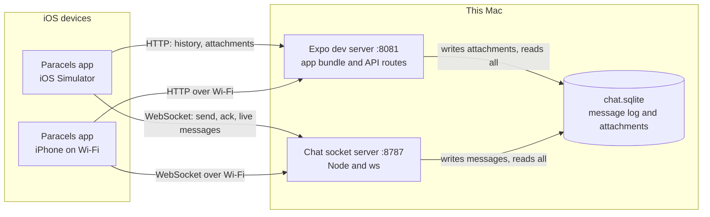
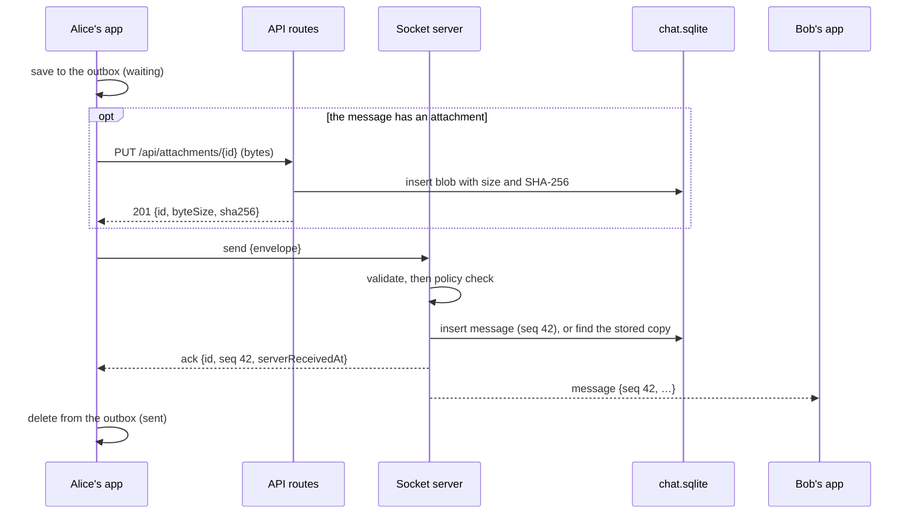
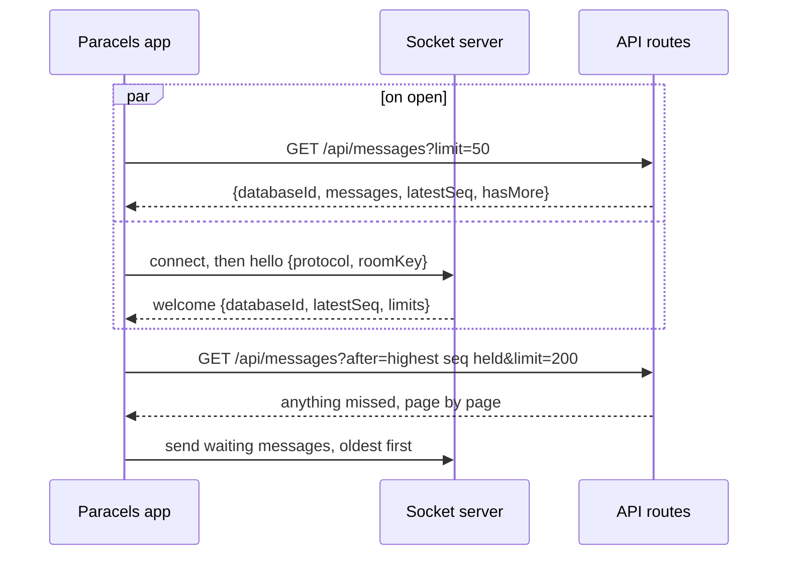
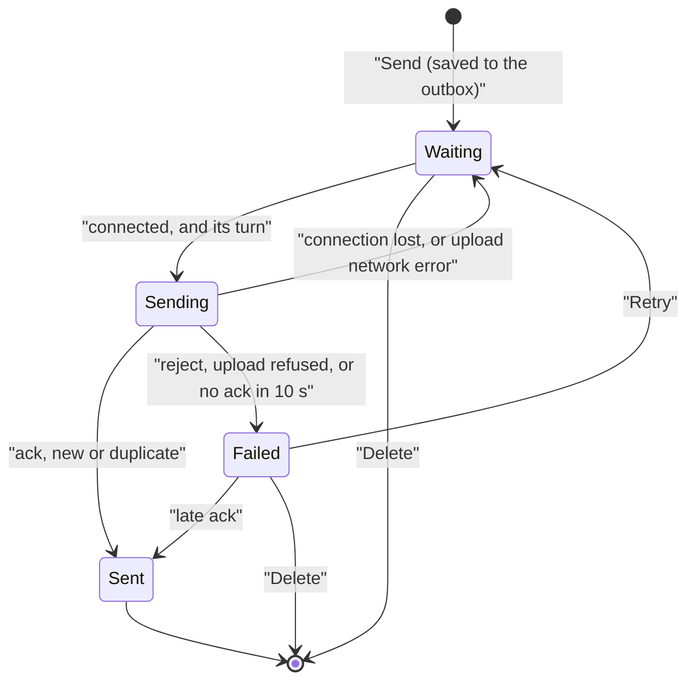

# Paracels Chat — A Dummy Chat Prototype

**Status:** version 0.6, approved at gates G0 and G1 on 2026-10-22 and at gate G2 on 2026-10-26. You approved every proposed default except D28, where you chose the alternative (Q20). Phases 1 through 4 are done (results in section 17). Gate G4 is next: airplane mode, force-quit, and a socket server restart. Gate G3, a chat between the simulator and the iPhone, is still yours to run.

**Prepared:** 2026-10-21

**Scope:** a dummy group chat in the paracels iOS app that talks to servers on this Mac and logs every sent message to SQLite, with seams for Fabric's encryption, policy and local-first storage
**Related:** [Product requirements](PRD.md) · [Technical architecture](architecture.md) · [Paracels app](../apps/paracels/README.md)

---

## 1. What the prototype must show

Two demo users, Alice and Bob, chat in one shared room from the paracels iOS app: one on the iOS Simulator, the other on your iPhone over Wi-Fi. Along the way the prototype shows that:

1. Every sent message reaches a server on this Mac, is logged exactly once in a SQLite database, and is delivered live to everyone else connected.
2. Opening the app loads earlier messages, each with its sender's name and time.
3. Each of your messages shows whether it is waiting, sending, sent or failed. A failed message can be retried without creating a duplicate.
4. Messages written offline wait on the phone, survive closing the app, and go out when the server is reachable again.
5. Photos from the library or the camera, and any file, can be sent and opened.
6. Only devices that hold the room key can read or post.
7. The code keeps seams where Fabric's encryption, policy and local-first storage will plug in (section 11).

It is a dummy: no accounts, no encryption, development builds only. Section 13 lists what it does not protect.

## 2. Decisions recorded from the Q&A

| # | Topic | Your decision |
|---|---|---|
| Q1 | Host app | `apps/paracels`, the Expo app. |
| Q2 | Purpose | A first step toward Fabric's messaging: build the dummy now, but keep seams for encryption, policy and local-first storage. |
| Q3 | Server technology | Expo Router API routes inside paracels (`+api.ts` files; `app.json` already sets web output to `server`). Refined by Q14. |
| Q4 | Server behavior | Store each message and deliver it to everyone else connected, in one shared room. |
| Q5 | Users | Fixed demo users, switchable in the app. |
| Q6 | Storage | On the server, in a SQLite database. |
| Q7 | Transport | WebSocket for live updates. |
| Q8 | Platforms | The iOS Simulator on this Mac, and a physical iPhone on the same Wi-Fi, reaching the server over the local network. |
| Q9 | Placement | Replace the starter screens; chat becomes the main screen. |
| Q10 | Scope | Load earlier messages when the app opens; per-message status (sending, sent, failed) with retry; queue messages written offline and send them later; timestamps and sender names; image and file attachments. |
| Q11 | Documentation | A spec in `docs/` in the format of [the calendar demo spec](isabelle-calendar-demo.md); updates to the root README, the app README, `docs/architecture.md` and the app's `AGENTS.md`. |
| Q12 | Gates | Spec and plan first, then stop. Your approval before any code, and again after each phase. |
| Q13 | Git | A new branch. The starter, as it stood before this work, is committed as a baseline, then the docs, then each phase. |
| Q14 | Server shape | Two processes on this Mac. The Expo dev server runs the API routes (history and attachments, with hot reload), and a separate small WebSocket server delivers live messages. Both use one SQLite file. Expo Router API routes cannot accept WebSockets in SDK 58: the dev server drops upgrade requests for paths it doesn't own, and none of `expo-server`'s adapters handle upgrades. |
| Q15 | Offline storage on the phone | Unsent messages only, in an on-device SQLite outbox that survives closing the app. |
| Q16 | Attachment kinds | Photos from the photo library, photos taken with the camera, and any file from the Files app. |
| Q17 | Installing on the iPhone | Built and installed from this Mac with Xcode signing (`npx expo run:ios --device`). |
| Q18 | Network protection | A shared room key. The app sends it with every request and connection, and the server rejects anything without it. |
| Q19 | Commits | Authored as Areg Melik-Adamyan <areg@hey.com>, set in this repository's git config, with the `Co-Authored-By: Claude Opus 5.5` trailer the history already uses. |
| Q20 | Spec approval (gate G0) | Every proposed default approved as written, except D28: the app keeps the generated project's bundle ID, `com.paracels.conclave`, and `app.json` changes to match. Phase 1 starts right away and pauses when the iPhone is needed. |
| Q21 | Spike review (gate G1) | D7 and D8 confirmed. Code that Node loads also imports types with `import type`. `tsconfig.json` gains `erasableSyntaxOnly`, and ESLint's `consistent-type-imports` rule covers `src/chat/shared/`, `src/chat/server/`, `server/` and `scripts/`, so the starter files stay as they are. The `chat:socket` script passes `--disable-warning=MODULE_TYPELESS_PACKAGE_JSON`. Phase 1's choices are approved as made. Phase 2 starts right away. |
| Q22 | Server review (gate G2) | The API answers with the room key. Phase 3 starts right away. |

## 3. Decisions that need your confirmation

Your answers left the gaps below. You approved every proposed default on 2026-10-22, except D28, where you chose the alternative (Q20). After the spikes, you confirmed D7 and D8 at gate G1 (Q21). The alternatives stay here for the record.

### 3.1 Servers and storage

| # | Proposed default | Alternative |
|---|---|---|
| D1 | **Socket server on port 8787**, listening on all network interfaces so the iPhone can reach it; `CHAT_SOCKET_PORT` changes it. Expo's dev server stays on 8081. It offers 8082 when 8081 is busy, which is why the socket server avoids 8082. | Another port. |
| D2 | **Database file `apps/paracels/.local/chat.sqlite`**, with `.local/` added to `apps/paracels/.gitignore`. Both processes start in `apps/paracels`, so they resolve the same path; `CHAT_DB_PATH` overrides it. | The repository's `.local/paracels-chat/`, which the root `.gitignore` already covers. |
| D3 | **One writing process per table.** Only the socket server writes `messages`; only the API routes write `attachments`; both read everything. The database runs in WAL mode with a 5-second busy timeout, so readers never block the writer. | Let both processes write any table: fewer rules, but two writers per table. |
| D4 | **Attachment bytes as BLOBs in the same database**, so the log and its files live in one file and are deleted together. | Files under `.local/attachments/`, with only their metadata in SQLite. |
| D5 | **Limits:** text up to 4,000 characters; one attachment per message, up to 10 MB; the text may be empty when there is an attachment. | 25 MB, or several attachments per message. |
| D6 | **Append-only log.** Sent messages cannot be edited or deleted, and nothing expires. `npm run chat:reset` deletes the whole database. | A retention window, for example 30 days. |
| D7 | **SQLite through Node's built-in `node:sqlite`** in both processes. Native add-ons such as better-sqlite3 cannot be bundled into API routes, and Metro already treats `sqlite` as a Node built-in. This Mac has Node 26.12.0 with SQLite 3.54.1. | — |
| D8 | **Node runs the socket server's TypeScript directly**, with no build step. Code that both Node and Metro load (`src/chat/shared/`, `src/chat/server/`) therefore uses only erasable TypeScript syntax and relative imports ending in `.ts`, and `tsconfig.json` gains `allowImportingTsExtensions`. Confirmed at G1 (Q21), with one more rule from the spikes: this code imports types with `import type`. `erasableSyntaxOnly` and ESLint's `consistent-type-imports` check it. | Run the socket server with `tsx`: one more dev dependency, but `@/` imports work everywhere. |

### 3.2 Protocol

| # | Proposed default | Alternative |
|---|---|---|
| D9 | **Payloads are opaque to the server, except in the policy module.** The server stores each message's payload verbatim as JSON tagged `plain/1`. The attachment's name, type, size and hash travel inside the payload; the blob table holds only bytes, size, SHA-256 and uploader. This is the encryption seam (section 11). | The server owns attachment metadata: simpler queries, but it must be redesigned when payloads are encrypted. |
| D10 | **Every message and history query carries a room ID**, always `main` for now. It is where a Fabric space ID will go. | Leave it out until there is a second room. |
| D11 | **The room key travels in an `Authorization: Bearer` header on HTTP and in the first WebSocket frame (`hello`)**, never in a URL, where it would end up in logs. | A header on the WebSocket upgrade request, which React Native supports. |
| D12 | **Delivery:** the sender's connection gets an `ack`; every other connection gets the message, including another device signed in as the same demo user. | Also echo the message to the sender. |
| D13 | **Ack timeout of 10 seconds.** A message without an ack in time turns failed, with its outcome unknown; Retry is safe because the server deduplicates by message ID. A connection lost before the ack puts the message back to waiting, with no action needed. | Another timeout, or automatic retries before failing. |
| D14 | **History in pages of 50** when the app opens and when you scroll up; catch-up after a reconnect in pages of 200. | Other sizes, or the whole history at once. |
| D15 | **Displayed time:** the server's receive time once a message is sent, the device's time while it waits, shown in the device's time zone and locale format. | Always the device's time. |

### 3.3 App

| # | Proposed default | Alternative |
|---|---|---|
| D16 | **Demo users Alice and Bob**, chosen from a menu in the header and remembered on each device. | Add a third user, Carol, to see delivery to more than one other person. |
| D17 | **Waiting and failed messages keep the sender they were written as** when you switch user. | Block switching while messages wait. |
| D18 | **Four visible states:** waiting (offline, your queue), sending, sent and failed. | Show waiting as "sending". |
| D19 | **Failed messages offer Retry and Delete; waiting messages offer Delete.** | Retry only. |
| D20 | **Replacing the starter** removes the tabs, the Explore screen, the starter components (animated icon, hint row, web badge, collapsible, external link), their images and `scripts/reset-project.js`. It keeps the theme constants, the themed text and view, the color-scheme hooks and the splash screen configuration. | Keep a tab bar with Chat as its first tab. |
| D21 | **Photos are images only** (no video, so no microphone permission), compressed by the picker at quality 0.8 before sending. Originals, often HEIC, can be several megabytes. | Send originals as picked. |
| D22 | **Images show inline. Tapping any attachment downloads it and opens Quick Look**, which has its own share button, so `expo-sharing` is not needed. | Also offer a share sheet through `expo-sharing`. |
| D23 | **App state in React** (a reducer and a context); no state library. | TanStack Query for the history requests. |
| D24 | **Reconnect with backoff:** after 1 second, doubling up to 30 seconds, with jitter; immediately when the app returns to the foreground. An app-level ping every 20 seconds detects dead connections. No NetInfo. | Add NetInfo to reconnect the moment the network returns. |
| D25 | **English strings in one module**, ready for translation; no i18n library yet. | Add an i18n library now. |
| D26 | **Server addresses come from the dev server.** In development, Expo resolves relative `fetch` URLs against the dev server the app loaded from, so the API routes need no setting. The WebSocket uses the same host on port 8787, and `EXPO_PUBLIC_CHAT_SOCKET_URL` overrides it. Development builds only. | Fixed addresses in `.env`. |
| D27 | **The room key is built into the app** from `EXPO_PUBLIC_CHAT_ROOM_KEY` in a git-ignored `apps/paracels/.env`, which `npm run chat:setup` creates. Anyone who can download the app's development bundle from the dev server on your network can read it. | Type the key once on each device and keep it in the iOS Keychain (`expo-secure-store`), so the bundle never contains it. |

### 3.4 Build, tooling and process

| # | Proposed default | Alternative |
|---|---|---|
| D28 | **Chosen at G0 (Q20): bundle ID `com.paracels.conclave`.** `app.json` changes from `com.aregm.paracels` to match the generated `ios/` project, and that project's signing team, `BZ5NJV27J6`, goes into `app.json` as `ios.appleTeamId`, so regenerating `ios/` keeps both. | The earlier proposal: keep `com.aregm.paracels` from `app.json` and regenerate `ios/` with it. |
| D29 | **Tests use Node's built-in test runner** (`node --test`) for the shared, server and client logic. Screens are checked by hand on both devices. No Jest. | Add `jest-expo` for component tests. |
| D30 | **ESLint** set up by `npx expo lint` (it adds `eslint` and `eslint-config-expo`), plus a rule that stops app code from importing `src/chat/server/` or `node:` modules. | — |
| D31 | **CI unchanged.** The GitHub workflow keeps testing only the Rust workspace. | Add a job that runs the app's typecheck, lint and tests. |
| D32 | **Names:** branch `cursor/paracels-chat` (already created), this spec `docs/paracels-chat.md`, protocol `paracels-chat/1`. | Other names. |
| D33 | **New dependencies**, at the versions SDK 58 lists: `expo-sqlite`, `expo-image-picker`, `expo-document-picker`, `expo-file-system` and `expo-crypto`, all installed with `npx expo install`; and `ws` 8 with `@types/ws` for the socket server. Everything except `ws` is part of the Expo SDK, and Expo CLI already depends on `ws`. | — |

## 4. System overview



Each device also has its own outbox, an on-device SQLite database that holds unsent messages.

Everything runs on your own devices, so no component is untrusted in the sense of the calendar demo. The network is the exposure: traffic is plain HTTP and WebSocket on your Wi-Fi, the room key is the only gate, and the dev server serves the app's JavaScript to anyone on the network who asks, as development builds always do.

## 5. Components

### 5.1 Paracels app

The chat screen is `src/app/index.tsx`, inside a Stack in `src/app/_layout.tsx` that replaces the starter's tabs (D20). Its logic lives outside `src/app/`:

- `src/chat/client/config.ts`: server addresses (D26), the room key (D27) and default limits.
- `src/chat/client/api.ts`: history pages, uploads and downloads over HTTP, with the key header and absolute URLs.
- `src/chat/client/socket.ts`: the one WebSocket connection, with `hello`, ping, backoff and reconnect on return to the foreground (D24). It exposes the connection state and incoming frames.
- `src/chat/client/outbox.ts`: the outbox interface and the worker that sends waiting messages in order (section 9). `outbox-sql.ts` is the schema and the recovery rule. `sqlite-outbox.ts` opens `paracels-chat.db` with expo-sqlite. The memory store remains for the worker tests.
- `src/chat/client/attachments.ts`: the pickers, copying files into the app's documents directory, size checks, downloads and Quick Look (section 10).
- `src/chat/client/state.ts`: a reducer that merges history pages, live messages, acks and outbox items by message ID. Sent messages are ordered by sequence number; unsent ones follow them, ordered by device time.
- `src/chat/client/use-chat.ts`: the hook that wires these together for the screen.
- `src/chat/client/chat-context.tsx`: the React context the screen and the header share (D23).
- `src/chat/client/user-store.ts`: the selected demo user, remembered in `expo-sqlite/kv-store` (D16).
- `src/chat/client/strings.ts`: the UI strings (D25).
- `src/components/chat/`: message list, message bubble, composer, attachment views, user menu and connection banner.

### 5.2 Expo dev server and API routes

`npx expo start` serves the app's JavaScript and the API routes on port 8081. The routes are `src/app/api/health+api.ts`, `src/app/api/messages+api.ts` and `src/app/api/attachments/[id]+api.ts`. Each is a few lines that call handlers in `src/chat/server/http.ts`. The handlers take a Web `Request` and return a `Response`, so tests call them directly, without a running server.

- One SQLite connection per process, reused across requests and code reloads.
- Writes only the `attachments` table (D3).
- Runs only while `npx expo start` runs. Release builds and `npx expo export` are out of scope.

### 5.3 Chat socket server

`server/chat-socket.ts`, started by `npm run chat:socket`, which runs `node --env-file=.env server/chat-socket.ts`.

- Listens on all interfaces, port 8787, path `/chat`. It uses `ws` with a 64 KiB frame limit.
- Keeps the set of connections that completed `hello` in memory. For each valid `send`, it asks the policy module, stores the message or finds the existing copy, and acknowledges the sender. It then relays a newly stored message to every other connection; a duplicate is acknowledged but not relayed again.
- Pings every connection every 30 seconds and drops those that don't answer. On Ctrl+C it closes connections with code 1001 and closes the database.
- Logs one JSON line per event: connection opened or closed (with the remote address), `hello` refused, message stored (ID, sequence number, sender, text length, whether it has an attachment), message rejected (reason code). Message text, file contents and the key never appear.
- Writes only the `messages` table (D3).

### 5.4 Server database

`chat.sqlite` (D2), opened by both processes through `node:sqlite` (D7):

- `journal_mode=WAL`, `synchronous=FULL` (the log is this prototype's canonical record), `busy_timeout=5000`, `foreign_keys=ON`.
- Migrations are keyed by `PRAGMA user_version` and applied inside `BEGIN IMMEDIATE` by whichever process opens the database first.
- `meta.database_id` is a random UUID created with the database. Clients compare it to notice that the database was reset.

### 5.5 Device storage

- An expo-sqlite database, `paracels-chat.db`, holds the outbox (section 6.3).
- `expo-sqlite/kv-store` remembers the selected demo user (D16).
- Attachment copies stay in the app's documents directory, under `outbox/`, until their message is sent.

### 5.6 Shared protocol module

`src/chat/shared/` holds the frame and envelope types (`protocol.ts`), validators that return typed results instead of throwing (`validate.ts`), the limits (`limits.ts`) and the demo users (`users.ts`). It is pure TypeScript with no imports from React Native, Expo or Node, so the app, the API routes and the socket server all use the same definitions.

### 5.7 Scripts

| Command | What it does |
|---|---|
| `npm run chat:setup` | Creates `apps/paracels/.env` with a fresh random room key if it doesn't exist. It never prints the key. |
| `npm run chat:socket` | Starts the socket server. |
| `npm run chat:log` | Prints the stored messages: sequence number, time, sender, text and attachment name. |
| `npm run chat:reset` | Deletes the database files. Stop both servers first. |
| `npm test` | Runs the tests (D29). |

### 5.8 Forbidden dependencies

These edges would collapse a seam, so they are not allowed:

- App code (screens, `src/chat/client/`, `src/components/`) never imports `src/chat/server/` or a `node:` module. A lint rule enforces this (D30). The `server-only` package cannot do it here, because it throws when plain Node loads it.
- `src/chat/shared/` imports nothing outside itself.
- The API routes never write `messages`, and the socket server never writes `attachments`.
- On the server, only `src/chat/server/policy.ts` decides whether content is acceptable, and only it reads payload fields.
- The room key goes only into the `Authorization` header and the `hello` frame.

## 6. Data model

### 6.1 Message envelope and payload

A message is created on the device. The envelope carries what the server needs for routing and storage; the payload carries the content.

```json
{
  "id": "0b6f6a7e-3c1e-4c38-9a0e-2a4e7f1d9b21",
  "roomId": "main",
  "senderId": "alice",
  "clientCreatedAt": "2026-10-21T10:42:05.123Z",
  "attachmentId": "5d0e2c41-8a7b-4f0e-b3d2-91c4a6e7f830",
  "payload": {
    "format": "plain/1",
    "text": "The plan is attached.",
    "attachment": {
      "fileName": "plan.pdf",
      "mimeType": "application/pdf",
      "byteSize": 482113,
      "sha256": "9f2c…"
    }
  }
}
```

- IDs are lowercase UUID v4 strings from `expo-crypto`'s `randomUUID()`. A message keeps its ID through every retry and restart.
- Times are ISO 8601 in UTC with milliseconds.
- `attachmentId` and `payload.attachment` are both `null` when there is no attachment. The ID sits in the envelope so that a server that can no longer read the payload (once it is encrypted) still knows which blob a message refers to.
- A stored message is the envelope plus `seq`, a positive integer that orders the room, and `serverReceivedAt`. The socket server assigns both.

### 6.2 Server database

```sql
CREATE TABLE meta (
  key   TEXT PRIMARY KEY,
  value TEXT NOT NULL                       -- 'database_id' -> random UUID
);

CREATE TABLE attachments (
  id          TEXT PRIMARY KEY,             -- client-generated UUID
  uploader_id TEXT NOT NULL,                -- demo user ID, for attribution
  byte_size   INTEGER NOT NULL,
  sha256      TEXT NOT NULL,                -- hex, computed by the server
  bytes       BLOB NOT NULL,
  created_at  TEXT NOT NULL                 -- server time
);

CREATE TABLE messages (
  seq                INTEGER PRIMARY KEY AUTOINCREMENT,  -- room order
  id                 TEXT NOT NULL UNIQUE,               -- idempotency key
  room_id            TEXT NOT NULL,                      -- 'main'
  sender_id          TEXT NOT NULL,                      -- self-asserted demo user
  client_created_at  TEXT NOT NULL,
  server_received_at TEXT NOT NULL,
  attachment_id      TEXT REFERENCES attachments(id),
  payload_format     TEXT NOT NULL,                      -- 'plain/1'
  payload_json       TEXT NOT NULL                       -- stored verbatim
);

CREATE INDEX messages_by_room ON messages (room_id, seq);
```

`AUTOINCREMENT` keeps sequence numbers increasing and never reused, which the catch-up cursor relies on. A refused insert can still leave a gap. Only one process writes `messages`, so sequence numbers are assigned in exactly one place.

### 6.3 Device database

```sql
CREATE TABLE outbox (
  id                TEXT PRIMARY KEY,       -- message UUID
  sender_id         TEXT NOT NULL,
  client_created_at TEXT NOT NULL,
  text              TEXT NOT NULL,
  attachment_id     TEXT,
  attachment_uri    TEXT,                   -- copy in the documents directory
  attachment_name   TEXT,
  attachment_mime   TEXT,
  attachment_size   INTEGER,
  attachment_sha256 TEXT,                   -- set when the upload succeeds
  state             TEXT NOT NULL,          -- waiting, sending or failed
  failure_code      TEXT,
  attempts          INTEGER NOT NULL DEFAULT 0
);
```

A row is deleted when its message is acknowledged. Sent messages live only on the server (Q15).

### 6.4 Limits

| Limit | Value | Enforced by |
|---|---|---|
| Text | 4,000 characters (D5) | The composer, and the socket server's policy module |
| Attachment | 10 MB, one per message (D5) | The app before queuing, and the upload route |
| WebSocket frame | 64 KiB | The socket server; attachments never travel in frames |
| History page | 50 by default, at most 200 (D14) | The history route |
| `hello` deadline | 5 seconds after connecting | The socket server |
| Ack timeout | 10 seconds (D13) | The app |
| App ping | every 20 seconds; reconnect if no `pong` within 10 seconds (D24) | The app |
| Server ping | every 30 seconds; a connection that has not answered by the next ping is dropped | The socket server |
| Reconnect backoff | 1 second, doubling to 30 seconds, with ±20% jitter (D24) | The app |

## 7. Protocol

### 7.1 HTTP API (API routes)

The routes are served by the dev server at `http://<Mac address>:8081/api/…`. Every request needs `Authorization: Bearer <room key>`. Until a key is configured, every route answers 503 `not_configured` and does not check the header. Errors use one shape, `{ "error": { "code": "…", "message": "…" } }`, and unsupported methods get 405 from Expo Router.

| Method and path | Purpose | Request | Success | Errors |
|---|---|---|---|---|
| `GET /api/health` | Check that the server is reachable and the key is right | — | 200 `{ ok, protocol }` | 401, 503 |
| `GET /api/messages` | One page of history | `roomId` (required, `main`), `limit` (1–200, default 50), and optionally `before` or `after`, a sequence number | 200 `{ databaseId, messages, latestSeq, hasMore }`, messages in ascending `seq` | 400, 401, 503 |
| `PUT /api/attachments/{id}` | Upload one attachment's bytes | The raw bytes as the body; `X-Chat-Uploader` names the demo user | 201 if new, 200 if the same bytes are already stored: `{ id, byteSize, sha256 }` | 400; 401; 409 for different bytes under this ID; 413 over the limit; 503 |
| `GET /api/attachments/{id}` | Download the bytes | — | 200 with `Content-Type: application/octet-stream`, `Content-Disposition: attachment`, `X-Content-Type-Options: nosniff`, `Cache-Control: private, max-age=31536000, immutable` | 401, 404, 503 |

The key is compared in constant time. The upload route checks `Content-Length` before reading and counts bytes while reading, so a missing or wrong length cannot slip past the limit. A 400 uses `invalid_query`, `invalid_attachment_id`, `unknown_uploader`, `invalid_content_length` or `incomplete_upload`. The other codes are `unauthorized` (401), `attachment_conflict` (409), `attachment_too_large` (413), `not_found` (404), `not_configured` (503) and `internal_error` (500, with no details from the failure).

### 7.2 WebSocket frames

The socket server listens at `ws://<Mac address>:8787/chat`. Frames are JSON text, and each has a `type`.

From the app to the server:

| Frame | Fields | Server's answer |
|---|---|---|
| `hello` | `protocol` (`paracels-chat/1`), `roomKey` | `welcome`; or `error` and a close (section 7.3) |
| `send` | `message`: an envelope (section 6.1) | `ack` to the sender and `message` to everyone else; or `reject` |
| `ping` | — | `pong` |

From the server to the app:

| Frame | Fields |
|---|---|
| `welcome` | `protocol`, `databaseId`, `latestSeq`, `serverTime`, `limits` |
| `ack` | `id`, `seq`, `serverReceivedAt`, `duplicate` (true when the ID was already stored) |
| `reject` | `id`, `code` (`invalid_message`, `unknown_sender`, `attachment_missing`, `attachment_mismatch` or `id_conflict`), `detail` |
| `message` | `message`: a stored message |
| `pong` | — |
| `error` | `code` (`bad_frame`, `unsupported_protocol`, `unauthorized`, `hello_timeout`, `not_ready` or `internal_error`), `detail`; always followed by a close |

### 7.3 Connection rules and close codes

- The first frame must be `hello`, within 5 seconds. Anything else first gets `error` (`not_ready`) and a close.
- The server is strict: an unknown frame type or protocol version gets `error` and a close. The app is lenient: it ignores server frames it doesn't know, so the server can add frame types later.
- `send` is idempotent by message ID. The same ID with the same content gets `ack` with `duplicate: true` and the original `seq`; the same ID with different content gets `reject` (`id_conflict`).

| Close code | Meaning |
|---|---|
| 1000 | Normal close |
| 1001 | The server is shutting down |
| 1009 | A frame was larger than 64 KiB |
| 1011 | The server hit an unexpected error on this connection |
| 4400 | Bad frame, wrong first frame or unsupported protocol |
| 4401 | Missing or wrong room key |
| 4408 | No `hello` within 5 seconds |

### 7.4 Sending a message



The server acknowledges only after the insert commits, and relays only after acknowledging.

### 7.5 Opening the app and reconnecting



The same catch-up runs after every `welcome`, so a reconnect fills the gap. Merging by message ID makes the order of these steps irrelevant: a message that arrives both live and in a history page shows once. If `databaseId` has changed because the database was reset, the app drops the messages it holds and loads them again.

## 8. Message status and delivery guarantees



Every attempt ends in one of four outcomes:

| Outcome | Examples | Status | What happens next |
|---|---|---|---|
| Success | `ack`, new or duplicate | Sent | Removed from the outbox; shown in sequence order |
| Retryable failure | The connection drops before the ack; the upload hits a network error or a 5xx | Waiting | Tried again automatically with the same ID: after reconnecting, or after a backoff delay if the connection is still up |
| Terminal failure | `reject`; the upload gets 401, 409 or 413 | Failed | You retry or delete it (D19) |
| Unknown outcome | No ack within 10 seconds | Failed | Retry resends the same ID; if the server already stored it, it answers `duplicate`. A late ack also marks the message sent. |

- **Exactly-once effect.** The message ID is created once on the device and kept through retries and restarts. The server stores at most one row per ID and acknowledges only stored rows, and the outbox keeps trying until a message is sent or deleted.
- **Order.** The log's order is the server's receive order. Each device sends one message at a time, oldest first, so a device's messages are logged in the order written. The exception is a failed message that is retried later: it lands after the messages sent in the meantime, unless the server had already stored it.
- **Live delivery is best effort.** A device that is not connected misses the live frame and catches up from the log when it reconnects (section 7.5).

## 9. Offline queue

- When you tap Send, the message, and a copy of its attachment, is saved to the outbox in one step before anything is sent, and its bubble appears at once.
- While the socket is connected, the outbox worker takes the oldest waiting message, uploads its attachment if that hasn't happened yet, sends it, and waits for the outcome before taking the next one.
- Failed messages don't block the queue; the worker skips them until you retry.
- On launch, a message left in the sending state because the app was closed mid-send goes back to waiting. Resending it is safe, because it keeps its ID.
- Switching user doesn't change waiting messages (D17). Delete removes a waiting or failed message and its file copy (D19).
- Only unsent messages are kept on the phone (Q15). History comes from the server each time the app opens; offline, the screen shows your waiting messages and a banner.

## 10. Attachments

1. **Pick.** Photo Library and Take Photo use `expo-image-picker`, for images only, compressed at quality 0.8 (D21). Choose File uses `expo-document-picker` for any type; it copies the file into the app's cache. The simulator has no camera, so Take Photo works only on the iPhone.
2. **Check.** The size must be at most 10 MB (D5). Otherwise the app says so and nothing is queued.
3. **Keep.** On Send, the file is copied into the documents directory under `outbox/`, because iOS may purge the cache (R11), and the outbox row gets an attachment ID from `randomUUID()`.
4. **Upload.** The app sends the raw bytes with `PUT /api/attachments/{id}`, using `expo-file-system`'s binary upload. The route enforces the limit, computes the SHA-256 and stores the blob. Repeating the upload with the same bytes returns 200; different bytes under the same ID return 409.
5. **Send.** The envelope names the attachment ID, and the payload carries the file name, MIME type, and the size and SHA-256 the upload returned. The policy module checks them against the stored blob (`attachment_missing`, `attachment_mismatch`). After `attachment_missing`, for example when the database was reset, the app uploads once more before reporting a failure.
6. **Show.** Images load inline through `expo-image` from `GET /api/attachments/{id}`, with the key header. Files show an icon, name and size. Tapping either downloads it into the cache under its sanitized original name and opens Quick Look (D22).
7. **Clean up.** The copy in the documents directory is deleted once its message is sent.

## 11. Seams for Fabric

The prototype is server-first and unencrypted, so it doesn't meet Fabric's architecture invariants (architecture section 9.2). It does keep the seams where they will attach:

| Fabric concern | Seam in the prototype | What changes later |
|---|---|---|
| End-to-end encryption (PRD 2.1) | The payload is tagged JSON (`plain/1`) that the server stores verbatim and reads only in the policy module. Attachments are opaque blobs with a size and SHA-256. | Clients encrypt payloads and blobs under a new format, such as `e2ee/1`. The server keeps routing and storing them; the policy module can then check only sizes. |
| Policy outside the model (invariant 7) | One server module decides every accept or reject, with a reason code. Nothing else refuses content. | Fabric's policy engine replaces it, for example rules checked as in `isabelle/Fabric_Policy`, without touching transport or storage. |
| Local-first storage (invariant 2) | Message IDs and times are created on the device; the outbox is a device store behind an interface; catch-up uses the server's sequence cursor. | A device replica of the history behind the same interface. The server becomes a relay for encrypted operation feeds (architecture section 9.3, Sync). |
| Spaces (invariant 8) | Every message and history query carries a room ID, fixed to `main` (D10). | The room ID becomes a Fabric space, with its own membership and keys. |
| Identity | The sender is a self-asserted demo user; the shared room key stands in for membership. | Device keys sign messages, as `fabric-wire` signs protocol messages, and membership replaces the shared key. |
| Attribution (invariant 5) | Each stored message records its sender, device time, server time and payload format; each blob records its uploader. | Signatures and key IDs join them. |

None of these later changes alters the transport, the outbox or the message lifecycle, which is the point of the seams. The prototype doesn't touch the Rust workspace.

## 12. The chat screen

- **Header:** the title "Chat" and, on the right, a menu that shows the current demo user and switches between Alice and Bob (D16). SDK 58 has no `Stack.Toolbar`, so the control is an `@expo/ui/swift-ui` `Menu` of `Toggle`s in `headerRight`.
- **Connection banner:** below the header it shows "Connecting…", or "Can't reach the chat server. Messages will wait on this phone." along with the address it is trying (R3). It is hidden while connected.
- **Messages:** an inverted list, newest at the bottom, that loads older pages when you scroll to the top. Each bubble shows the sender's name, the time and the text. Your messages sit on the right with their status: a clock for waiting, a spinner for sending, a check for sent, and a red "Not sent" with Retry and Delete for failed (D19).
- **Empty, loading and error states:** "No messages yet. Say hello." when the room is empty; a spinner while the first page loads; a retry button if history fails to load, while your waiting messages stay visible.
- **Composer:** a multiline text field with a counter that appears near the 4,000-character limit; an attach button offering Photo Library, Take Photo and Choose File; a preview of the chosen attachment with a remove button; and Send, disabled when there is nothing to send. The composer stays above the keyboard.
- **Attachments in bubbles:** images as thumbnails at their aspect ratio; files as a row with an icon, name and size. Tapping downloads with progress and opens Quick Look.
- **Accessibility:** VoiceOver reads each bubble as, for example, "Alice, 10:42, sent: The plan is attached. Attachment: plan.pdf, 471 kilobytes." Every control has a label and a hint where needed. Text follows Dynamic Type, touch targets are at least 44 points, and colors come from the existing light and dark theme.

## 13. Security model and limits

What the prototype enforces:

- The room key on every HTTP request and every WebSocket connection, compared in constant time. A missing or wrong key gets 401 or close code 4401, and the attempt is logged without the key.
- Validation and limits on every frame and upload, in the shared validators and the policy module (section 6.4).
- At most one stored copy per message ID, and acks only for committed writes.
- Message text is rendered only as plain text, so it cannot inject markup or links.
- Downloads are sent as `application/octet-stream` with `Content-Disposition: attachment` and `nosniff`, so a browser never renders them.
- File names from other devices are sanitized before they become local file names.
- No secrets in git: `.env` and `.local/` are ignored, and logs never contain message text, file contents or the key.

What it does not protect:

- There is no TLS. Anyone who can capture traffic on your Wi-Fi can read messages, files and the room key.
- With D27's default, anyone who can download the development bundle from the dev server can read the key. The dev server serves the app's code to your network anyway; that is how development builds work.
- Identities are self-asserted: anyone with the key can post as Alice or Bob.
- There is no end-to-end encryption. The server stores and serves plaintext.
- `chat.sqlite` is not encrypted at rest, unlike Fabric's planned `vault.db`.
- There are no rate limits. A client with the key can fill the disk, one 10 MB attachment at a time.
- Development builds only. The servers are not meant to run beyond this Mac and your network.

## 14. Platform, setup and dependencies

- **This Mac:** macOS with Xcode 27.1 and its iOS Simulator; Node.js 26.12.0 and npm 11.20.0. Node runs TypeScript directly and includes SQLite, both checked on this Mac. Node is a host prerequisite: the repository's setup scripts install only Rust into `.tooling/`.
- **iPhone:** Developer Mode on, the same Wi-Fi network as the Mac (not a guest network that isolates clients), and a USB connection for the first install. The app asks for local network access the first time; it must be allowed.
- **Signing:** the generated Xcode project signs with team `BZ5NJV27J6` (D28).
- **From the starter:** Expo SDK 58.0.17, Expo Router 58.0.25, React Native 0.88.0, React 19.3.0, TypeScript 6.0.
- **Added in Phase 1 (D33):** `expo-sqlite` ~58.0.13, `expo-image-picker` ~58.0.10, `expo-document-picker` ~58.0.4, `expo-file-system` ~58.0.10 and `expo-crypto` ~58.0.7; `ws` ^8.22.0 with `@types/ws` ^8.18.2, and `@types/node` ^26.6.5 (section 17); `eslint` ^9.0.0 and `eslint-config-expo` ~58.0.4 through `npx expo lint` (D30). Native modules need a rebuilt app (`npx expo run:ios`), not just a reload.
- **App configuration (`app.json`):** `ios.infoPlist.NSLocalNetworkUsageDescription`; the image picker plugin's photo and camera permission texts, with the microphone permission off; and the bundle ID and `ios.appleTeamId` (D28). Plain HTTP and WebSocket to the Mac are allowed because the generated `Info.plist` sets `NSAllowsLocalNetworking`.
- **Ports:** 8081 for the dev server and 8787 for the socket server (D1). macOS may ask whether Node may accept incoming connections; allow it, or the iPhone cannot connect.
- **Files:** `apps/paracels/.env`, which the root `.gitignore` already ignores, and `apps/paracels/.local/chat.sqlite` (D2).

Proposed layout:

```text
apps/paracels/
  .env.example             EXPO_PUBLIC_CHAT_ROOM_KEY= (the real .env is git-ignored)
  .local/chat.sqlite       the server database (git-ignored, D2)
  server/chat-socket.ts    the WebSocket server
  scripts/                 chat-setup.ts, chat-log.ts, chat-reset.ts
  src/app/_layout.tsx      the root Stack
  src/app/index.tsx        the chat screen
  src/app/api/             health+api.ts, messages+api.ts, attachments/[id]+api.ts
  src/chat/shared/         protocol, validators, limits, demo users
  src/chat/server/         database, stores, room key, policy, HTTP handlers
  src/chat/client/         addresses, HTTP and WebSocket clients, outbox, attachments, state
  src/components/chat/     list, bubble, composer, attachments, user menu, banner
```

## 15. Acceptance criteria

| # | Criterion |
|---|---|
| A1 | Following `apps/paracels/README.md` from a fresh clone builds and starts everything: the app on the simulator and on the iPhone, the dev server and the socket server. |
| A2 | Alice on the simulator and Bob on the iPhone exchange messages. Each message appears on the other device within 1 second on the same Wi-Fi, and its sender sees it go from sending to sent. |
| A3 | Every accepted message is in `chat.sqlite` exactly once, with its sequence number, sender and both times, and `npm run chat:log` shows it. An automated test sends the same message ID twice and finds one row. |
| A4 | Reopening the app shows earlier messages in order, with sender names and times; scrolling up loads older ones. |
| A5 | With the socket server paused (`kill -STOP`), a message turns failed after 10 seconds. After the server resumes, the message ends up sent, through a late ack or through Retry, and the database holds it once. |
| A6 | With the iPhone in airplane mode, new messages show waiting. They survive force-quitting and reopening the app. When the network returns, they are delivered once each, in the order written. Restarting the socket server has the same effect. |
| A7 | A photo from the library, a photo from the camera (iPhone only) and a file from Files each reach the other device. Images show inline, and any attachment opens in Quick Look. A file over the limit is refused before upload, with a message that says why. An attachment queued offline survives a restart and is sent later. |
| A8 | Automated tests show that requests without the room key, or with a wrong one, get 401, and that such WebSocket connections are closed with 4401. The key appears nowhere in git, server logs or test output. |
| A9 | Switching between Alice and Bob changes the sender of new messages and survives reopening the app; waiting messages keep their original sender. |
| A10 | VoiceOver on the iPhone reads each message's sender, time, status and text, and every control has a label. |
| A11 | `npm test`, `npx tsc --noEmit` and `npx expo lint` pass in `apps/paracels`. The Rust workspace and its CI are unchanged. |

## 16. Risks

| # | Risk | Mitigation |
|---|---|---|
| R1 | `node:sqlite` may fail to load inside API routes run by the dev server. Metro lists `sqlite` among the Node built-ins it leaves external, which suggests it works, but nobody has run it. | Spike T1.4. If it fails, I stop and offer options, such as serving the HTTP endpoints from the socket server process instead. |
| R2 | The dev server may limit or slow uploads near 10 MB, because the route reads the whole body into memory. | Spike T1.4 with a 10 MB file; lower the limit (D5) if needed. |
| R3 | The iPhone cannot reach the Mac: local network access was declined, the Wi-Fi isolates clients (common on guest networks), or the macOS firewall blocks Node. | Spike T1.4. The app README explains each fix, and the banner shows the address the app is trying. |
| R4 | Device installs break: installs signed by a free team expire after 7 days, and iOS requires Developer Mode. Keeping the generated project's bundle ID (D28) avoids a new provisioning profile. | T1.3 covers the first install; the app README covers renewal. |
| R5 | Two processes on one SQLite file can hit "database is locked". | WAL, a 5-second busy timeout, one writing process per table (D3) and short transactions. |
| R6 | Code shared by Metro and plain Node must suit both: erasable syntax and `.ts` import extensions. | Spike T1.4; fall back to `tsx` (D8). |
| R7 | Hermes, the app's JavaScript engine, may lack `crypto.randomUUID`. | Use `expo-crypto`'s `randomUUID()`. |
| R8 | The iOS Simulator has no camera. | Camera capture is tested on the iPhone only (A7). |
| R9 | The room key can be read from the development bundle (D27). | Documented in section 13; the Keychain alternative keeps it out of the bundle. |
| R10 | Expo APIs differ from what an agent remembers. | Every phase reads the SDK 58 docs before coding, as `apps/paracels/AGENTS.md` requires. |
| R11 | iOS may purge the picker's cached copy before an offline message is sent. | Attachments are copied into the documents directory when queued (section 10). |
| R12 | Scope: five features across two servers and an app. | A gate after every phase lets you stop or re-scope. |

## 17. Task list

Each phase ends with one commit on the branch and a stop for your approval (Q12, Q13). "Needs" marks steps that download software or need something from you. Sizes are relative to each other: S small, M medium, L large.

### Phase 0 — Spec and documentation (done 2026-10-21)

| Task | Work | Size | Needs |
|---|---|---|---|
| T0.1 | Create branch `cursor/paracels-chat` and commit the paracels starter as the baseline (`147f95a`). | S | |
| T0.2 | Write this spec; update the root README, the app README, `docs/architecture.md` and the app's `AGENTS.md`; commit. | M | |
| G0 | You review this spec and approve or change D1–D33. Done 2026-10-22: all approved except D28 (Q20). | | your review |

### Phase 1 — Tooling, devices and spikes, then gate G1 (done 2026-10-22; approved at G1, Q21)

| Task | Work | Size | Needs |
|---|---|---|---|
| T1.1 | Install the new packages (D33); set up ESLint with `npx expo lint` (D30); add `allowImportingTsExtensions` and the `test` script. | S | npm downloads |
| T1.2 | Configure `app.json` (section 14, D28), regenerate `ios/` and run the app on the simulator. | S | |
| T1.3 | Install on your iPhone with `npx expo run:ios --device` and allow local network access. | S | your iPhone, USB once |
| T1.4 | Spikes: an API route that opens `node:sqlite` under `npx expo start` (R1); a socket server stub under Node that imports shared `.ts` modules (R6); the iPhone reaching both ports over Wi-Fi (R3); a 10 MB upload through an API route (R2). The results go into this spec. | M | your iPhone |
| G1 | You review the spike results and confirm D7 and D8, or pick a fallback. Done 2026-10-22: both confirmed (Q21). | | your review |

Results (2026-10-22), on this Mac, the iPhone 18 Pro simulator (iOS 27.0) and your iPhone 16 Pro:

- **T1.1, packages:** `npx expo install` added `expo-sqlite` 58.0.13, `expo-image-picker` 58.0.10, `expo-document-picker` 58.0.4, `expo-file-system` 58.0.10 and `expo-crypto` 58.0.7, and listed the `expo-sqlite` config plugin in `app.json` by itself. npm added `ws` 8.22.0 and `@types/ws` 8.18.2. It also added `@types/node` 26.6.5, which D33 did not list: the server code's `node:sqlite` types come from it, and until now it was in the tree only as a dependency of Expo CLI.
- **T1.1, lint:** `npx expo lint` installed ESLint 9.39.5 and `eslint-config-expo` 58.0.4 and wrote `eslint.config.js`. That file now also has D30's rule, for everything in `src/` except `src/app/api/` and `src/chat/server/`. A throwaway file confirmed that the rule rejects `node:fs`, `../chat/server/…` and `@/chat/server/…`, type-only imports included. Without arguments, `npx expo lint` checks only `src/`, so Phase 2 adds `server/` and `scripts/` to the `lint` script. The starter's web color-scheme hook broke the React Compiler rule `react-hooks/set-state-in-effect`. D20 keeps that hook, so it now uses `useSyncExternalStore`, which gives the same result without an extra render. Lint is clean.
- **T1.1, typecheck and tests:** `tsconfig.json` has `allowImportingTsExtensions`. `npx tsc --noEmit` reports one error, in the starter's `app-tabs.web.tsx`. It was there before Phase 1, and Phase 3 deletes that file (D20). `npm test` runs `node --test` over `src/**/*.test.ts` and `server/**/*.test.ts`; there are no tests yet.
- **T1.1, advisories:** npm reports 19 high-severity advisories. All come from two transitive packages, `braces` and `node-forge`, reached through `expo`, `react-native`, `react-native-reanimated` and `react-native-worklets`; none comes from the new packages. `npm audit fix --force` would move SDK packages off their SDK 58 versions, so they stay as they are.
- **T1.2:** `app.json` now has the bundle ID `com.paracels.conclave` and `ios.appleTeamId` (D28), `NSLocalNetworkUsageDescription`, and the image picker's photo and camera texts with the microphone permission removed. `npx expo prebuild --clean --platform ios` rebuilt `ios/` in 77 seconds, CocoaPods included. The old project differed from a generated one only in its bundle ID and team, which had been set by hand in Xcode; both now come from `app.json`. `npx expo run:ios` built the app in 2 minutes 15 seconds, with no errors, and launched it on the simulator.
- **T1.3:** `npx expo run:ios --device` built the app for the iPhone and signed it with team `BZ5NJV27J6`. It then stopped with "the device is locked", because the phone had locked during the build. After you unlocked it, `xcrun devicectl` installed and launched that build. The app has local network access.
- **R1, passed:** an API route served by the dev server opened `node:sqlite` and got SQLite 3.54.1 in WAL mode. Its working directory was `apps/paracels`, so D2's relative path works. D7 holds.
- **R2, passed:** 10 MiB request bodies reached the route intact (same SHA-256) and were stored as BLOBs in 50–90 ms over localhost; 25 MiB took 140–175 ms. The app sent a 10 MiB body in about 0.1 seconds from the simulator and in 0.6 seconds from the iPhone over Wi-Fi, roughly 140 Mbit/s. The dev server set no limit at these sizes, so D5 holds.
- **R6, passed:** one module in `src/chat/shared/` loaded in the app through `@/`, in the API route through `../../chat/shared/spike.ts`, and in the socket stub under plain Node 26. Node refused four things: an enum ("not supported in strip-only mode"), the `@/` alias, an import without `.ts`, and a type imported without the `type` keyword ("does not provide an export named"). D8 holds, and the last point becomes a rule: code that Node loads imports types with `import type`. TypeScript can check two of these. `erasableSyntaxOnly` already passes on the whole project; `verbatimModuleSyntax` would first need `import type` in five starter files, two of which D20 keeps. Node also warns at each start that `package.json` declares no module type (`MODULE_TYPELESS_PACKAGE_JSON`); passing `--disable-warning=MODULE_TYPELESS_PACKAGE_JSON` in the `chat:socket` script silences it without changing how Metro and Expo read the project.
- **R3, passed:** a temporary panel on the home screen ran the checks on each device and posted its results to the spike route. On the simulator, it found the dev server at `http://localhost:8081`, reached the API route with a relative `fetch` (200 in 65–84 ms), and reached the socket stub at `ws://localhost:8787/chat` (95–221 ms). On the iPhone, it found the dev server at `http://192.168.1.185:8081`, the Mac's Wi-Fi address, and the API route answered in 34 ms. The socket stub at `ws://192.168.1.185:8787/chat` answered in 52 ms and saw the phone as 192.168.1.171. D26 works as described on both devices. Both servers listen on every interface, IPv4 and IPv6, and this Mac's firewall is off.
- **Found for Phase 2:** a 70 KB frame made `ws` close that connection with 1009, as the 64 KiB limit in section 6.4 intends, and then emit an `error` event. With no handler, that event stopped the whole socket server. T2.4 handles errors on every connection and tests that the server keeps serving after an oversized frame.
- **Dev server:** the first spikes used a dev server started on 2026-10-21 with `npx expo run --device`. It served the new files without a restart, but the app's live-reload connection to it failed ("Cannot connect to Expo CLI"). With your approval it was replaced by a fresh `npx expo start`. R1 and the simulator checks passed again, the warning was gone, and the iPhone's JavaScript logs appeared in the server's output.
- **Found for Phase 3:** the iPhone has Reduce Motion on, and Reanimated reports that it disables some animations there. The chat screen must work fully without animation.
- **Spike code** was removed before the Phase 1 commit: `src/chat/shared/spike.ts`, `src/app/api/spike+api.ts`, `server/spike-socket.ts`, `src/components/spike-panel.tsx` and two lines in `src/app/index.tsx`.

### Phase 2 — Servers, then gate G2 (done 2026-10-25; gate G2 approved 2026-10-26)

| Task | Work | Size | Needs |
|---|---|---|---|
| T2.1 | Shared protocol: types, validators, limits and demo users, with tests. | M | |
| T2.2 | Server storage: schema and migrations, message and attachment stores, room-key check and policy module, with tests. | M | |
| T2.3 | API routes: health, history pages, attachment upload and download, with handler tests. | M | |
| T2.4 | Socket server: `hello` and the room key, `send`, `ack` and `reject`, relay, ping, shutdown and logs, with integration tests using two clients. | M | |
| T2.5 | Scripts: `chat:setup`, `chat:socket`, `chat:log`, `chat:reset`. | S | |
| G2 | You run both servers and the tests. Done 2026-10-26: you ran the API with the room key and started Phase 3. | | your review |

Results (2026-10-25):

- **T2.1:** `src/chat/shared/` holds the frame and envelope types, the validators, the limits and Alice and Bob. Validators return results instead of throwing. Frames from the app are checked strictly; frames from the server are parsed leniently, and an unknown server frame is reported for the app to ignore.
- **T2.2:** `node:sqlite` opens `chat.sqlite` in WAL mode with a 5-second busy timeout. Migrations run inside `BEGIN IMMEDIATE`, and whichever process opens a new file first creates `database_id`. Switching a brand-new file to WAL can still return "database is locked" before that timeout applies, so opening retries for up to 5 seconds. A test opens the same new file from six processes at once and sees one database ID. The message log is idempotent by message ID. The attachment store computes the SHA-256 itself. Only `policy.ts` reads payload fields.
- **T2.3:** `GET /api/health`, `GET /api/messages` and `PUT`/`GET /api/attachments/{id}` are thin routes over handlers that tests call without a server. The dev server already running on port 8081 served `/api/health` and answered 503 `not_configured`, because no room key is set yet. That also confirms `node:sqlite` still loads inside an API route.
- **T2.4:** the socket server listens on port 8787, path `/chat`, with the 64 KiB frame limit. Every connection has an `error` handler. A frame over the limit closes that connection with 1009, and the next client still gets `welcome`. Two clients exchange a message; a repeat is acknowledged with `duplicate: true` and is not relayed again. A wrong room key closes with 4401. Shutdown on SIGTERM closes connections with 1001. Logs are JSON lines and, in the tests, contain neither the room key nor the message text.
- **T2.5:** `npm run chat:setup` creates `.env` with mode 0600 and does not print the key; a second run leaves the file alone. `chat:log` prints the stored messages and shows `(unsupported payload)` for anything other than `plain/1`, without dumping it. `chat:reset` deletes the database and its WAL files, and says to stop both servers first.
- **Checks:** `npm test` runs 87 tests, all passing. `npm run lint` checks `src/`, `server/` and `scripts/` and is clean. `npx tsc --noEmit` reports only the existing error in `src/components/app-tabs.web.tsx`, which Phase 3 deletes. `tsconfig.json` has `erasableSyntaxOnly` and `types: ["node"]` (Q21). ESLint's `consistent-type-imports` covers the folders Node loads.
- **Recorded in the spec from the build:** history requires `roomId=main` (D10). A missing room key is 503 `not_configured`. An unexpected failure on one socket sends `internal_error` and closes with 1011; the process stays up. Sequence numbers can skip after a refused insert.

### Phase 3 — Chat screen, then gate G3 (done 2026-10-26; gate G3 next)

| Task | Work | Size | Needs |
|---|---|---|---|
| T3.1 | Replace the starter (D20) with the root Stack and the chat screen. | S | |
| T3.2 | Client core: server addresses (D26), the HTTP client, the socket connection with backoff (D24), chat state, and the in-memory outbox behind the outbox interface. | M | |
| T3.3 | Interface: message list with names and times, status on your messages, Retry and Delete (D19), composer, user menu (D16), connection banner and accessibility labels. | M | |
| T3.4 | History when the app opens, older pages on scroll, and catch-up after reconnecting. | S | |
| G3 | You chat between the simulator and the iPhone. | | your run |

Results (2026-10-26):

- **T3.1:** the starter tabs, explore screen, reset-project script and unused starter images are gone. `src/app/_layout.tsx` is a root Stack around `ChatProvider`. `src/app/index.tsx` is the chat screen. `npx tsc --noEmit` is clean: deleting `app-tabs.web.tsx` removed the only remaining error.
- **T3.2:** `src/chat/client/` holds addresses (D26), the history client, the socket with D24 backoff and ping, the reducer, the in-memory outbox and the hook that wires them. Client modules that `node --test` loads stay on relative `.ts` imports. The persisted outbox is still Phase 4; uploads stay Phase 5.
- **T3.3:** the list, bubbles, composer, connection banner and user menu are in `src/components/chat/`. The header control is `@expo/ui/swift-ui` `Menu` + `Toggle` (SDK 58 has no `Stack.Toolbar`). There is no animation, so Reduce Motion on the iPhone does not hide a path. Colors for own/other bubbles, tint and danger sit on the existing theme.
- **T3.4:** opening the app loads the first history page; scrolling up asks for older pages; a `welcome` after reconnect runs catch-up. Tests cover the reducer, outbox worker, HTTP client, socket (against a real `startChatSocketServer`) and address helpers.
- **Simulator:** the iPhone 18 Pro simulator (iOS 27.0) opened Chat with Alice in the header and the composer at the bottom. The socket accepted the app from `::1` with no `hello_refused`. `GET /api/messages` bundled on that launch. A second client sent Bob's "Hello from Bob on the Mac."; `chat:log` shows it as seq 1. A system sheet, "Open in paracels?", sat on top of the screen for the whole check, so Send was not tapped from the simulator in this run. The sheet is iOS asking to open the `paracels` URL scheme; tap Open or Cancel and the chat is underneath.
- **Checks:** `npm test` runs 101 tests, all passing. `npm run lint` and `npx tsc --noEmit` are clean.

### Phase 4 — Offline queue, then gate G4 (done 2026-10-26; gate G4 next)

| Task | Work | Size | Needs |
|---|---|---|---|
| T4.1 | The device outbox in expo-sqlite, behind the same interface, with migrations and recovery of interrupted sends. | M | |
| T4.2 | The waiting state, the ordered flush after reconnecting, the ack timeout and safe retry. | S | |
| G4 | You test airplane mode, force-quitting and reopening the app, and a socket server restart. | | your run |

Results (2026-10-26):

- **T4.1:** the app opens `paracels-chat.db` through `expo-sqlite`'s `openDatabaseSync` (SDK 58). The table is section 6.3, including the attachment columns, which stay empty until Phase 5. `PRAGMA user_version` is 1. A schema newer than this app is refused. On open, a row left in `sending` goes back to `waiting` and keeps its ID and attempt count. Sent rows are still deleted on `ack`. The screen's first state is that list, so unsent messages are visible before history returns.
- **T4.2:** the Phase 3 worker is unchanged and now writes the sqlite store. It still sends the oldest `waiting` row, skips `failed` rows, returns the in-flight row to `waiting` when the socket drops, and marks `ack_timeout` when 10 seconds pass with no ack. Retry puts a failed row back to `waiting` with the same ID. A duplicate `ack` from the server removes it.
- **Checks:** `npm test` runs 104 tests, all passing, including a reopen of the same file and a flush through the worker. `npm run lint` and `npx tsc --noEmit` are clean. Airplane mode, force-quit and a socket restart are gate G4.

### Phase 5 — Attachments, then gate G5

| Task | Work | Size | Needs |
|---|---|---|---|
| T5.1 | Pickers for the photo library, the camera and files (D21); copies into the documents directory; size checks. | M | |
| T5.2 | The upload step in the outbox, the attachment payload, and the policy check of size and hash. | M | |
| T5.3 | Inline images and file rows; download and Quick Look (D22). | M | |
| G5 | You send each kind of attachment in both directions. | | your run |

### Phase 6 — Verification and documentation, then gate G6

| Task | Work | Size | Needs |
|---|---|---|---|
| T6.1 | Check every acceptance criterion on the simulator and the iPhone, and record the results here. | M | your iPhone |
| T6.2 | Final updates to the READMEs, `AGENTS.md` and the architecture document; tests, typecheck and lint clean. | S | |
| G6 | You run the prototype. | | your run |

## 18. Out of scope

- TLS, end-to-end encryption, accounts and authentication beyond the shared room key.
- More than one room, direct messages and Fabric spaces.
- Editing, deleting, reactions, replies, typing indicators, read receipts and presence.
- Push notifications and delivery while the app is in the background.
- A copy of the history on the phone (only unsent messages are kept) and search.
- Android, web and iPad-specific layouts.
- Release builds, TestFlight, EAS Hosting and any deployment beyond this Mac.
- Video, voice messages and more than one attachment per message.
- Any change to the Rust workspace, and integration with Fabric's policy engine or Isabelle.
- CI for the app, unless you choose it in D31.
