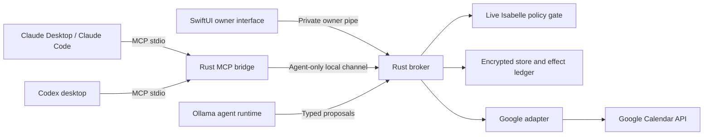

# Fabric Calendar Desktop — Standalone Implementation Plan

Prepared: 2026-11-15. Status: planning deliverable; application implementation has not been authorized in this task. Owner/product decider: Areg Melik-Adamyan. Intended readers: independent software agents, implementers, reviewers, and release engineers.

Repository: https://github.com/aregm/fabric. Audited upstream baseline: `4fb3330` (main). Integration baseline including preserved local architecture: `54dd653`. Clone the repository and check out the delivered plan branch, `codex/calendar-desktop-plan`, then record its exact commit in the implementation evidence. A local checkout currently exists at `/Users/intel/Documents/ChatGPT/fabric`; implementations on other machines must derive their own checkout path.

This document contains the requirements, source interpretation, proposed architecture, interfaces, work sequence, verification gates, and agent handoff instructions. Implementation must not depend on access to the originating conversation or private Google Doc. The portable export is `fabric-calendar-desktop-plan-2026-11-15.zip`, containing `IMPLEMENTATION_PLAN.md`, `BUILD_AUDIT.md`, `README.md`, `manifest.json`, `SHA256SUMS`, and `reference-mockups/`. The manifest identifies the exact plan commit, source revision and image-to-screen mapping; SHA256SUMS covers every other packet file. Visual references stay in that local packet; the normative behaviors are restated here so the repository plan is usable on its own.

## 1. Outcome and confirmed scope

Build a minimal macOS desktop application that lets a person control what AI agents may read and change in Google Calendar. It is a permission broker, with an approval interface and an action history. Calendar intelligence may propose actions; an independent trusted Rust broker proves and enforces authority.

Confirmed product decisions:

| ID | Decision |
|---|---|
| C01 | Deliver a plan now. Do not implement the application as part of this planning task. |
| C02 | Calendar is the first vertical. Email is planned for later. |
| C03 | Use real personal Google/Gmail accounts and real agents. Synthetic fixtures remain necessary for tests and early development. |
| C04 | The first release must pass integration with Claude Desktop over MCP, Claude Code over MCP, Codex desktop, and Ollama running through an agent runtime inside Fabric. All four client paths are release gates. |
| C05 | Every agent/provider action requires a live Isabelle proof. An offline-validated Rust evaluator is not an acceptable substitution. |
| C06 | Include time-protection and scheduling-buffer warnings in the first release. Warnings inform; they do not block actions. |
| C07 | Support editing existing selected calendars and sending invitations. A dedicated draft calendar alone is insufficient. |
| C08 | Include Google Cloud project, Calendar API, and Desktop OAuth client setup; none has been created for this app. |
| C09 | Plan distribution to other Macs, including signing, notarization, installation, and recipient-machine validation. |
| C10 | Minimize TypeScript. Compare approaches and recommend a desktop architecture. macOS is the target; preserve existing Rust work. |
| C11 | Distribute to Apple Silicon Macs only. The OS baseline may be selected in this plan. |
| C12 | Support multiple personal Google accounts connected simultaneously. |
| C13 | Support owned calendars and writable calendars shared by another person. |

Selected OS target: macOS 15.0 and newer on arm64. This is a target chosen under C11, not a claim of tested compatibility. Use APIs available at that baseline, and require minimum-version plus current-version native/prover release tests. Current build evidence covers only macOS 27.0.1. Reopen the target if a required third-party component cannot support macOS 15; do not silently raise it.

An action is an agent-requested read, disclosure, or provider mutation. Broker-initiated provider refresh, reconciliation, and setup mutations also need explicitly modeled, proven system authority. UI rendering, broker health reads, and editing an unsaved local form do not grant provider authority.

The first release excludes Gmail operations, peer-to-peer Rendezvous, mobile changes, multi-device sync, a general knowledge vault, autonomous rule learning, person/fact-level disclosure classification, undoing sent invitations, recurring-event mutations, travel-route lookup, and a Mac App Store submission. Unsupported provider event types must be rejected explicitly. These are scope proposals to freeze at G0, not assertions that the source document forbids them.

## 2. Source analysis and precedence

### 2.1 Sources inspected

The primary source is [Design Document: Sandbox for AI Agents](https://docs.google.com/document/d/1DLTm50iUQu31IqUnLb8uFolhnve4c04fGEiqbeuZzjU/edit). Its linked tab is `t.ct0v2cvfgagq`, **Rudimentary Mockups**, and the link points to `h.s3b5gr9a1vqe`, **Nice to have: smart warnings**. The source was read on 2026-11-15, revision `AHj4eMQqrKvw70IlS3r0ikNVF-7-Iz2CMXF_IVJZlSwMw0BbYe-tJFj0tAeitPhYVFlqnPPg32fHMU7fS6wTTFnXGbnEW1tqMxvx4csbm0g`.

All nine tabs' text was inspected: Design Document, AI Agent Use Cases, Data Standards, People, Disclosure Tracking, Context Modeling, Resources, Rudimentary Mockups, and Scratchpad. All 13 embedded images in Rudimentary Mockups were visually inspected. Other tabs contain background research, unresolved questions, and future ideas; they are not all first-release requirements. Scratchpad explicitly describes generated mockups as reference starting points.

Repository sources: `docs/PRD.md`, `docs/architecture.md`, `docs/calendar.md`, `docs/system-design.md`, `docs/agent-sandbox.md`, `docs/isabelle-calendar-demo.md`, `docs/requirements-trace.md`, and the implemented Rust modules listed in section 3.

### 2.2 What the source means for the product

The three goals are prevention of damaging actions, revocation of authority, and visibility of consequences. The source distinguishes agent policy (should it act), authority (may it act), and data validity (are the inputs trustworthy). The broker must not become a second autonomous scheduling agent.

The UI patterns are profiles plus fine-grained modes, incremental broker grants, visible duration, approval cards that narrow scope, contact groups, and action history. The source's party legend is blue for the agent, amber for the broker/Sandbox, and green for external services. Color supplements text and icons; it never carries authority by itself.

The calendar images are more specific than the early prose. Careful confines automatic event changes to an Agent Drafts calendar and asks before actions involving other people. Flexible offers more event permissions and selected-contact invitation rules. Both ask for invitation responses and block calendar deletion and sharing/ACL changes. The advanced-preferences image says the preferences apply across all agents and profiles, and explicitly says warnings never block calendar actions.

### 2.3 Conflicts that must remain visible

| Conflict | Resolution for this plan |
|---|---|
| `agent-sandbox.md` D11 proposes a web dashboard and excludes a native app | The new request calls for a desktop app; this plan recommends a native shell. The older proposal remains historical and must be updated when G0 accepts this plan. |
| Sandbox D2 proposes Rust runtime evaluation; demo requires Isabelle | C05 controls: retain live proofs, including proof failure and timeout states. |
| Earlier system design assumes opaque Busy events in a pilot calendar | C07 requires a separate explicit provider-invitation mode and existing-calendar edits. Do not claim the private Rendezvous disclosure contract for Google invitations. |
| Broad Flexible mockup can look like automatic deletion of any event; baseline limits destructive automatic actions | Proposed matrix below keeps destructive actions at Ask/Block and defaults existing-event changes to Ask. Freeze the exact defaults at G0. |
| Older mockups may imply indefinitely approved contacts | A contact group is a selector, not a grant. Every authorization has an explicit duration and is separately revocable. |
| Prose calls smart warnings a nice-to-have | C06 makes time and fixed-buffer warnings required. Map-derived travel estimates remain deferred. |
| Source uses Flexible/Careful, Relaxed/Vigilant, Muse/Instinct/Sandbox | Use Careful/Flexible in the proposed UI. Use registered agent names rather than fictional agent brands. Final product naming is an open release input. |

Precedence: confirmed decisions C01–C13; explicit safety invariants and accepted requirements; this plan's accepted G0 decisions; source illustrations; historical proposals. Recommendations remain recommendations until accepted. Never resolve a conflict by silently broadening a permission.

## 3. Actual starting point and reuse

The current workspace builds; it already includes a Rust calendar simulator, a separate Isabelle-gated multi-process demo, policy/token/wire crates, and an Expo iOS chat prototype. It has no macOS desktop application, Google Calendar adapter, OAuth broker, or MCP server. The iOS prototype is outside the Cargo workspace and is not the desktop foundation.

| Existing artifact | Reuse | Missing work or limit |
|---|---|---|
| `crates/fabric-core/src/calendar.rs` | Checked half-open UTC intervals | No complete recurrence/time-zone normalization |
| `crates/fabric-policy` and `isabelle/Fabric_Policy` | Trusted-context separation, proof transport, HOL rendering, explanations, corpus | Actions/context are negotiation-specific; profiles, grants and Google CRUD need new formal definitions |
| `crates/fabric-token` | CBOR, COSE signatures, exact argument binding, proof of possession, macOS Keychain pattern | No grant revocation lookup; replay cache is in memory; current proof field means an actual Isabelle proof ID |
| `apps/fabric-demo/src/host` | Separation of untrusted proposals and trusted owner authority | Demo state and launcher assumptions do not implement a general broker |
| `apps/fabric-demo/src/agent/planner.rs` | Typed planner boundary and Ollama example | Not a complete desktop assistant or MCP integration |
| `apps/fabric-demo/src/calendar/store.rs` | Encryption/key-management example | Whole-file CBOR fixture store, not durable grants/sync/effect storage |
| `apps/fabric-demo/src/dashboard.rs` and `demo/dashboard` | Behavior examples and request flow | Replace rendering with the desktop UI contract |
| `apps/fabric-demo/src/audit.rs` | Record vocabulary only | Logging can be disabled and I/O errors are swallowed. The new broker must fail closed when pre-call audit persistence fails. |
| `apps/paracels` | Prior examples of idempotent outbox behavior | Separate mobile prototype; no new desktop TypeScript dependency |

Do not claim expiry equals revocation, signature verification equals policy approval, an in-memory nonce cache equals crash-safe idempotency, or an encrypted fixture file equals a canonical database.

Observed local environment: `sphynx`, arm64, macOS 27.0.1, Xcode 27.1, Swift 6.4, project Rust/Cargo 1.97.1. Claude Code 2.1.318, Codex CLI 0.169.0-alpha.11.1, and Ollama client 0.40.8 are present. Ollama did not report a running server; no model availability was established. Isabelle is not installed locally. Client versions are observations, not required release versions.

The integrated Rust check passed: formatting, check, Clippy, tests, docs; 93 passed, 0 failed, 11 ignored. Ignored live tests were not validated. See the companion build audit for commands and limits. A successful Cargo build does not establish working Google, desktop, or live-proof integration.

## 4. Architecture recommendation and alternatives

### 4.1 Derivation

Purpose: let the owner control real calendar access by multiple agents. Operand: typed action proposals and owner grants. Required attributes: comprehensible consent, enforceable revocation, reproducible proof, durable history, recoverable provider effects. Functions: propose, inspect, prove, approve, dispatch, reconcile, explain. Governing concept: an owner-controlled permission broker with a thin presentation layer.

### 4.2 Compare concrete forms

| Option | TypeScript added | Benefits | Cost and reason for choice |
|---|---:|---|---|
| SwiftUI application + Rust broker via IPC | Zero | Native macOS forms, accessibility and menus; keeps Rust policy/provider authority | Two language toolchains and a versioned IPC contract. Recommended for this macOS-only release, subject to spike G1. |
| Tauri + static HTML/CSS + small vanilla TypeScript | Small | Familiar mockup layout; Rust backend; existing dashboard behavior examples | Webview and JS bridge, frontend build and capability configuration. Fallback if native integration fails or exact web-layout reuse becomes a stronger requirement. |
| Rust egui application | Zero | One implementation language and direct Rust reuse | Must separately demonstrate accessibility and form fidelity. Suitable for diagnostics; not selected for this permission-oriented desktop UI. |
| Existing browser dashboard | Existing JavaScript | Least initial implementation | Does not satisfy the requested desktop application. |

Recommendation: SwiftUI controls, Swift view state and Codable transport types, Rust application services, and no new JavaScript/TypeScript. Preserve the existing TypeScript mobile prototype. Use IPC rather than Rust FFI; the workspace currently forbids unsafe Rust, and IPC avoids introducing an ABI or unsafe-code exception.

### 4.3 Process and authority boundaries



The SwiftUI app launches one bundled broker using inherited stdin/stdout pipes. No GUI command goes through the agent tool surface. The broker owns one encrypted database and single-writer application service. Owner pipe lifetime defines the UI connection, not the entire scope of every grant. Launch children with an explicit environment allowlist; never inherit Google credentials, owner-channel handles or unrelated host secrets into an agent/bridge.

External clients launch a small Rust MCP bridge through stdio. The bridge joins an already running broker over a local Unix-domain socket in a private per-user runtime directory. Enrollment starts with the bridge generating a private key in its dedicated Keychain namespace and a public enrollment ID/key. The owner approves that public identity on the private owner channel; the broker binds the agent record and allowed tool scope to that key. Configuration contains only the public enrollment ID and executable location. The bridge proves key possession on connection; no bearer secret is printed, embedded in MCP configuration, or supplied in arguments. Define code-signing/Keychain access behavior for the distributed bridge in G1. It never receives an owner capability. The socket is mode 0600 in a mode 0700 directory, with peer and capability checks. Same-user hostile software is a stated residual threat; a socket mode is not an OS sandbox.

An embedded agent runtime in Rust calls local Ollama and sends typed proposals through the same agent application interface. It may be a bundled child mode of the broker executable to avoid a second binary/toolchain. It never receives Google credentials or permission to call owner methods.

Quit the app: stop accepting new proposals, end session grants, shut down workers with bounded drain, and preserve ambiguous effects for reconciliation. A crashed broker requires an owner-controlled restart; MCP bridges cannot restart it into an implicit owner session. Concurrent app launches attach to the single existing instance or show an explicit conflict.

### 4.4 Module ownership

| Module | Authoritative responsibility | Forbidden dependencies |
|---|---|---|
| Desktop UI | presentation, navigation, local form editing, accessible approval display | Direct Google/Keychain/DB access; policy decisions |
| Application service | request transitions, grants, profiles, identity, revocation, pause, ordering | Model-selected authority |
| Formal policy | actual permission decision over trusted immutable context; signed/tokened evidence from real proof | Network API calls, model outputs treated as facts |
| Google adapter | OAuth, endpoint validation, scopes, provider translation, revision conditions | Grant minting or UI consent |
| Effect coordinator | durable dispatch, retry/reconciliation, replay prevention | Reinterpreting approved arguments |
| Encrypted repository | migrations, durable state, pre-call audit and atomic local transitions | Scheduling intelligence |
| Warning engine | deterministic time-protection and buffer notices | Granting/blocking actions; external maps |
| Agent adapters | MCP/tools or Ollama proposals, stable request correlation | Owner approval methods, provider secrets |

## 5. Requirements and acceptance obligations

| ID | Requirement | Evidence required |
|---|---|---|
| R01 | Native desktop app installs and launches on another supported arm64 Mac | Clean-machine signed/notarized bundle launch and recorded OS version |
| R02 | One Calendar permission surface works identically for all four client paths | Live integration matrix for Claude Desktop, Claude Code, Codex desktop, embedded Ollama |
| R03 | Connect personal Google accounts through app-owned OAuth | Consent denial, partial grant, refresh, revocation, reconnect, selected account/calendar tests |
| R03a | Connect multiple accounts simultaneously, including writable shared calendars | Account/calendar identity isolation, account-specific scopes, ACL downgrade, and explicit destination tests |
| R04 | Read bounded events/availability from selected calendars | Disallowed calendar/range/field requests never reach provider or leave broker |
| R05 | Create and edit events in selected existing calendars; send invitations | Exact owner preview, successful test-account mutation and recipient notification |
| R06 | Live Isabelle proof gates each agent/provider action | Real proof ID/theory hash/context digest logged; unavailable/timeout/undecided fails closed |
| R07 | Profiles, per-action modes, scope narrowing and durations are effective | Conformance tests from displayed settings to policy context to provider request |
| R08 | Pause and revoke take effect before any subsequently dispatched call | Revoke during proof, queued dispatch, pagination, retry, and restart tests |
| R09 | Review shows requests, denials, proof, approval, provider outcome, and recovery | One correlated durable lifecycle per logical request, with attempts underneath |
| R10 | Time-protection and buffer warnings are global and advisory | Same inputs produce identical warnings across profiles/agents; warnings alone never deny |
| R11 | UI is understandable and accessible | Keyboard-only paths, VoiceOver labels, contrast, resize/dark-mode checks |
| R12 | Restarts and uncertain Google responses do not create blind duplicates | Fault injection before/after each durable transition and provider acceptance |
| R13 | Secrets and sensitive calendar content are protected locally | Encrypted DB/WAL/temp-file test, Keychain access, redacted logs and exports |
| R14 | Users know when approved data goes to a cloud agent | Per-agent destination notice; Ollama local endpoint shown and remote endpoints explicit |

Proposed quality targets to freeze at G0: UI acknowledgement within 100 ms excluding proof/network; policy progress visible within 500 ms; proof timeout 30 seconds per action; bounded queue of 100 pending agent requests with explicit busy responses; provider timeout 30 seconds; at most three transient retries with jitter within a two-minute retry budget. These are proposed limits, not measured performance promises. Revoke acknowledgement must commit locally before success is displayed; it must not wait behind a long-running proof.

## 6. GUI specification derived from the mockups

### S01 — Setup and account connection

Show the three parties and explain the broker's role in plain language. Offer Careful and Flexible, with an explicit description and detailed-settings link. Proposed default is Careful; G0 freezes it. Selecting a profile does not connect Google or create a grant. Explain that Google may grant broader API access than Fabric allows each agent.

Connect Google opens the system browser. Show verified account identity, provider permission result, selected calendars, and read/write scope. Provide Add account and separate connection/revocation controls for each connected personal account. Distinguish owner calendars from writable shared calendars. Every request and approval names its account and calendar explicitly; an ambiguous task asks the owner to choose, never silently uses `primary`. Connecting an account and authorizing an agent are separate steps. Do not promise that every Google calendar is writable.

### S02 — Agent permissions

Use the source's three destinations: Agent permissions, Contacts, Review agent actions. A left-hand profile list contains built-ins and named custom profiles; the main area displays Calendar action rows. Keep Email as a clearly labeled future area without interactive fake controls.

Calendar rows: view availability; view event details; create events; edit/reschedule events; delete events; send/change invitations; respond to invitations; delete calendars; change sharing. Use consequence text below each row. A mode pill is an accessible control with Allow/Ask/Block plus its resource scope. Locked prohibitions explain why they cannot be changed.

Cancel discards the form; Save as custom persists a new version after a preview of authority expansion. Built-in profiles remain immutable templates. Profile switching does not silently erase custom overrides or retroactively expand grants. The broker computes the effective policy.

### S03 — Incremental request and exact approval

Display registered agent identity, original task as untrusted text, requested operation, Google account, calendar, affected event, original and proposed values, local time and time zone, attendees, notification side effects, warning notices, proposed duration, and why the current grant is insufficient. Use separate read and mutation approvals.

The owner can narrow calendars, date window, fields, recipients, and duration. Deny and Allow selected are distinct. New scope causes a new canonical request digest and proof; the UI cannot widen the request invisibly. A create or edit preview shows the exact provider payload in plain language, including who will be notified. Invitation approval always identifies the recipient list. A summary says precisely what was approved and for how long.

On stale/changed request, disable approval and require refreshed review. Double-click/retry reuses the command ID. The agent sees pending status and a request ID; it cannot approve its own request. Escape/cancel leaves the request pending or explicitly denied according to the selected control; never interpret dismissal as consent.

### S04 — Contacts and recipient sets

The source shows groups, members, optional domains, and per-group invitation behavior. For the Calendar-first proposal, implement manually curated local groups and exact addresses, plus an explicit domain selector. Google People import is a later optional adapter. Group deletion affects the permission selector, not the Google contact itself.

For mixed groups, evaluate every recipient; one recipient needing approval makes the whole invitation request Ask. A group membership change does not retroactively broaden an existing exact-recipient approval. Show the expansion before approving a domain-wide rule. Domain matching uses normalized exact domain equality; no substring matches. Full address normalization must preserve local-part distinctions and not invent Gmail alias equivalence.

### S05 — Review, active grants, pause, and recovery

Show pending, allowed, denied, executing, applied, failed, and outcome-unknown requests. Drill down to explanation, policy version, proof reference, exact approval snapshot, provider event/revision, and attempts. Default history omits private event details; details are available only to the owner from encrypted local state.

Show active grants separately with purpose, scope, duration, expiry, and Revoke. Provide Pause for each agent plus Pause all. These controls are additions needed to meet the source's revocation goal. Clearly distinguish stopping future calls from undoing an already accepted Google operation. Resume does not revive revoked grants or session grants from an old process.

For outcome unknown, offer reconciliation status and an explicit manual resolution path. Never show Scheduled or Invitation sent solely because a local approval exists.

### S06 — Advanced calendar preferences: required smart warnings

Reproduce the source's functional groups: protect certain times, preserve uninterrupted time, and leave breathing room between events. Preferences apply across profiles and agents. Provide add/remove controls, weekday/time ranges, named time zone, minimum uninterrupted duration, applicable workdays, preferred part of day, buffer duration, enable/disable, Cancel, and Save preferences.

Deterministic warning definitions:

1. **Protected time:** warn if the proposed event interval overlaps an enabled protected local-time rule after zone/DST resolution.
2. **Uninterrupted time:** compare free intervals before/after the proposal within configured workday bounds; warn when the change removes the requested contiguous free duration. Explain the specific affected day. Preferences must supply the workday boundaries; do not invent them from event history.
3. **Buffer:** for adjacent relevant non-free events, warn if the gap before/after the proposal is smaller than the configured buffer. Exclude the event's previous version when evaluating a reschedule.

Evaluate against the latest available observations and show freshness. Let the owner explicitly select the calendars, potentially across connected accounts, that contribute to global warnings. Those background reads have proven owner/system authority separate from an agent read grant. If data or time-zone interpretation is incomplete, say Warning unavailable or Incomplete calendar data; do not report No conflicts. Deleting an event is evaluated against the resulting calendar state. No model performs time arithmetic. A warning is never an additional permission or a policy denial; show the warning even when a separately proven permission allows the operation.

Full warning explanations are owner-only by default. A warning can reveal a private adjacent event's existence or timing, especially across accounts. Returning any warning detail to an agent requires its own proven, field-limited disclosure authority; neither global preferences nor a mutation grant imply access to the underlying calendar context. Add negative tests for warning-based cross-calendar/cross-account leakage.

The source's travel-mode/extra-travel-time fields depend on a map provider and location disclosure. They remain visibly deferred in this plan because C06 requests time and buffer warnings, not travel routing.

### S07 — Agent connections and local task entry

For each external agent, show enrollment, installation instructions, connection status, last tool call, and pause/revoke. Show the Google credentials remain with Fabric. Provide copyable MCP configuration generated for the installed application location, never a developer checkout path.

For embedded Ollama, provide a small task composer, chosen local model, progress, bounded tool steps, result, and links to pending approvals. Do not build a general chat platform. Missing Ollama/model produces an actionable state. Do not download a model silently or substitute a cloud model. Render model and provider text as plain text.

### Shared UI states

Each screen must handle loading, empty, offline, locked database, Keychain refusal, prover unavailable, provider authentication required, conflicting settings revision, and broker disconnected. Forms preserve unsaved local state across a recoverable broker disconnect; approvals must be revalidated. Native notifications may open the app but cannot approve an action.

## 7. Proposed policy matrix and duration semantics

The following defaults are a recommendation to accept at G0. They preserve safe defaults while allowing C07 through explicit approval. Google ACLs and API scopes are necessary but never sufficient authority.

| Operation | Careful | Flexible | Hard constraints |
|---|---|---|---|
| List selected calendars / availability | Allow within an explicit broker read grant | Same | Calendar allowlist, date bounds, field minimization |
| Read event details | Ask for required fields/window | Allow only in an explicitly accepted read grant | No hidden description/attendee disclosure |
| Create owner-only event in Agent Drafts | Allow in grant | Allow in grant | Calendar ID plus local creation record |
| Create in selected existing calendar | Ask | Allow only with an explicit user-created scoped grant | Must be writable; attendee side effects checked separately |
| Edit Fabric-created event | Ask outside drafts | Allow in accepted scoped grant if no new recipients | Ownership tracked locally; revision precondition |
| Edit pre-existing event | Ask | Ask | C07 is satisfied through a real approval, not unrestricted edits |
| Send/change invitations | Ask | Ask by default; may Allow an explicitly approved recipient set/grant | New recipients, changed message/time/notification scope require valid authority |
| Respond to an invitation | Ask | Ask | Bind event revision and exact response |
| Delete event | Ask, feature disabled until G0 accepts scope | Same | No assumption of Google trash/undo guarantees |
| Delete calendar or modify ACL/sharing | Block | Block | No agent tool or general API proxy exposes it |

Priority: paused/revoked/expired/unsupported → Block; explicit prohibition → Block; insufficient capability or required human approval → Ask; otherwise prove permission and Allow. A read profile alone never implies sending rights. A warning cannot convert Block to Allow or Allow to Block.

Durations:

- **This request only:** bind one immutable action digest and one logical effect/read result, consumed durably. A retry of the same request returns its existing lifecycle, not another grant.
- **This session:** bind to the registered agent session and current broker run; end on explicit disconnect/end-session, app quit, broker restart, or configured idle expiration. UI connection hiccups do not create a new unlimited session.
- **Until revoked:** explicit persistent choice, `expires_at = null` with a visible duration label; revoked by owner, account disconnect, relevant authority reduction, or agent removal. Do not describe it as a finite expiry.

For a broader grant, record purpose, resources, actions, data fields, temporal range, recipient rule, notification rules, issuer, session/account binding, creation approval, policy version, revision, and revocation epoch. Any expansion requires owner acceptance. A safer profile change or revocation can narrow existing authority immediately.

## 8. Live-proof and authorization contract

Extend the theory with separate namespaced broker actions; preserve the demo's negotiation protocol. New action families cover calendar enumeration, availability read, event read/create/update, invitation mutation/response, cached-result disclosure, warning disclosure, system refresh/reconciliation reads, and any accepted deletion scope. Formal context includes broker-derived identity, grants, selected account/calendar, current profile, pause/revocation epochs, ownership evidence, exact recipients/fields, original event revision, time, purpose, and approval digest. Re-evaluate actual time and grant/approval expiry at the dispatch boundary; a proof produced before expiry is not authority to dispatch after expiry.

For every action, prove permission or a failing condition using the real Isabelle server. Model three distinct outcomes in the broker theory: Permit, NeedApproval, and Block, plus operational Undecided. A proved missing-consent condition may produce NeedApproval and an approval card; it is not permission to execute. Only a fresh live Permit after the immutable consent exists may queue or dispatch a provider call or disclose data. An incomplete proof is Undecided and fails closed. Record actual proof ID, Isabelle version, theory hash, exact context/action digest, rule verdicts, and timings. Model statements are proposals, never facts supplied to Isabelle.

Before dispatch, with per-account serialized authority transitions:

1. Persist the canonical request and audit intent.
2. Resolve latest identity, grant, policy, provider observation, and owner approval.
3. Check typed inputs and compute warnings independently.
4. Run live proof over that immutable context and exact action outside the authority/dispatch lock. NeedApproval goes to the owner and cannot execute; after consent, obtain a new context and proof.
5. Recheck pause/revocation/policy/approval/provider revisions after the proof. If relevant facts changed, discard proof and re-prove or return stale.
6. Commit a short-lived, exact-action authorization and durable effect reservation.
7. Immediately before provider dispatch, verify authorization, current epochs, and provider preconditions; record dispatch intent durably.
8. Call Google, persist outcome, and reconcile observed state.

Revocation is serialized with the dispatch boundary, not blocked by the proof mutex. The dispatch linearization point is the broker's authorized handoff to its transport worker: compare epochs, expiry, policy and proof binding and enqueue the exact call atomically with respect to revocation. A revoke success acknowledgement guarantees that no subsequent handoff can use the old authority. A previously handed-off call may still reach or finish at Google; display that limit accurately. Do not hold the authority lock through a proof or network request. Every later handoff, including retries and paginated reads, rechecks authority. A consumed effect identity cannot become a second effect just because a token expired.

Preserve existing token wire semantics. If adding general broker actions, introduce a versioned token/profile or an internal authorization type with real proof provenance. Existing `Claims.proof` is not a place for a simulated or runtime-evaluation hash. Signing and proof-of-possession are reusable primitives; minting APIs and verifier rules require deliberate extension.

## 9. IPC and tool contracts

### 9.1 Owner channel

Proposed protocol `fabric-desktop/1`: UTF-8 JSON messages delimited by newline. Each message carries `protocol`, `id`, `method`, and typed `params`; replies carry the same ID plus `result` or structured `error`. No raw logs on stdout. Bounded frames (proposed 1 MiB) and strict schema validation. Unknown major versions fail with an actionable compatibility error.

Owner methods:

| Method | Essential fields / behavior |
|---|---|
| `hello` | build/protocol negotiation, broker identity, schema version, capabilities |
| `get_snapshot` | accounts, agents, profiles, pending requests, grants, health and event cursor |
| `connect_google` | begin OAuth; progress/consent result, never tokens |
| `save_profile` / `save_preferences` / `save_group` | command ID, expected revision, typed changes; conflict instead of overwrite |
| `decide_request` | command ID, request ID/digest, expected revision, selected subset, duration, approve/deny |
| `pause_agent` / `revoke_grant` | command ID, expected revision; commit sequence on success |
| `get_request_details` / `get_proof` | owner-only detail retrieval with redaction controls |
| `subscribe` | ordered broker changes after cursor; gap returns snapshot-required |
| `disconnect_google` | stop future dispatch, revoke broker grants, offer explicit provider token revocation |

All mutations are idempotent by command ID plus body digest. Reusing an ID with different content is an error. Subscriptions carry a monotonic sequence; UI recovers with a fresh snapshot if history was compacted. Proposed bounded subscriber queue: 256 notices, then disconnect/resnapshot rather than memory growth. Broker errors include code, user explanation, retryability, request/correlation ID, and recovery action.

Illustrative approval message (values are synthetic, not credentials):

```json
{
  "protocol": "fabric-desktop/1",
  "id": "command-42",
  "method": "decide_request",
  "params": {
    "request_id": "request-17",
    "request_digest": "sha256-of-canonical-action-and-scope",
    "expected_revision": 3,
    "decision": "approve",
    "duration": { "kind": "one_request" }
  }
}
```

Finalize real JSON Schemas, canonical hashing rules, timestamps, identifiers, and golden fixtures in W01 before parallel implementation. Swift Codable and Rust serde types must pass the same fixtures; no policy is duplicated in Swift.

### 9.2 Agent channel

MCP tools expose only bounded actions: `fabric_calendar_list`, `fabric_calendar_availability`, `fabric_calendar_read`, `fabric_calendar_propose_create`, `fabric_calendar_propose_update`, `fabric_calendar_propose_invitation`, `fabric_calendar_propose_response`, `fabric_request_status`, `fabric_request_result`, and accepted optional delete. Agent identifiers come from enrollment, not a supplied display name. No tool exposes Google HTTP passthrough, arbitrary URLs, approval, grant creation, or profile editing.

An initial Ask returns `pending_approval` plus stable `request_id`; status polling observes the same action. Do not keep an MCP request open indefinitely while a person decides. Allow returns the proven filtered read result or the effect lifecycle. Block returns a bounded explanation. Cancellation before dispatch stops the operation; after dispatch it triggers reconciliation, not a false rollback.

Status polling returns only safe lifecycle metadata, never cached titles, descriptions, attendees, availability, or model summaries. Reading a completed result is a disclosure action: verify current session, grant, pause/revocation state and expiry and obtain a fresh live proof before releasing data. A one-request read grant permits one disclosure; the broker records consumption. Lost-response retries may inspect lifecycle metadata but require new consent or an existing still-valid broader grant and fresh proof to re-disclose content. Do not make command idempotency an authorization bypass. This rule also applies to the embedded Ollama adapter.

Use MCP initialization/version negotiation supported by the selected SDK/client versions and test the exact installed clients. Pin the SDK and negotiated version in the G2 report; do not assume a version from this plan is the latest.

### 9.3 Agent integration matrix

| Client | Integration / release evidence |
|---|---|
| Claude Desktop | Local bundled MCP bridge, configuration or desktop-extension installation supported by that client; read → Ask → owner approval → actual Google effect → pause test |
| Claude Code | Same tool schema through local stdio; verify supported command/configuration on tested version; same acceptance scenario |
| Codex desktop | Local MCP configuration supported by the tested desktop version; inspect local CLI/config support and official docs; verify in the desktop app itself, not only a CLI smoke test |
| Ollama inside Fabric | Rust agent runtime, owner-selected tool-capable installed local model, bounded turns/time, same canonical proposals; repeat scenario across an actual model output |

No client can reuse the host's Google credentials. The app must explain that approved calendar data returned to Claude/Codex can be processed by their configured cloud services. Ollama must remain on the explicitly selected local endpoint for the local mode. The desktop does not claim to contain an agent that independently controls a browser or already has its own Google OAuth grant.

## 10. Google integration and provisioning

### 10.1 Human-owned setup

The implementation runbook must guide the owner to create a Google Cloud project, enable Calendar API, configure the OAuth audience/branding/consent and test users, create a Desktop application client, and store the client configuration outside Git. A desktop client is a public client; a packaged client secret is not a security boundary. The developer owns the distribution client/project; each recipient authorizes their own account. Never export refresh tokens to another Mac.

Use a system-browser authorization-code flow with PKCE S256, state validation, loopback redirect, bounded callback lifetime, and single-use code handling. The Rust broker handles the token exchange and Keychain storage. Establish Google account identity using verified OpenID Connect identity (`openid email` scopes), including issuer, audience, signature, nonce and expiry validation against Google's documented metadata. Use stable provider subject as identity and verified email as display metadata; a typed email or Calendar scope is not identity proof. W05 must validate the exact flow and any added consent fields on personal accounts. Scope denial, partial grants, cancellation, account mismatch, token refresh failure, and reconnect must be explicit states. Tokens, cursors, caches, grants and effects are namespaced per account, even when the same calendar is shared into two accounts.

Google's installed-app documentation says incremental OAuth authorization is unsupported. Fabric's incremental **broker** grants still work; provider scope expansion requires a separate explicit supported consent/reconnection flow. Validate actual granted scopes instead of assuming that the requested set was granted. Never embed Google sign-in in the app's own webview.

For external distribution, complete the Google consent/verification requirements for the final scope set and audience. Testing mode is a development gate, not the release mode; include refresh-token expiry behavior in tests. Workspace administrator approval is outside this personal-account release, but accessRole changes on calendars shared with the personal account remain a required failure case.

### 10.2 Scope and endpoint matrix

Freeze scopes after a spike on personal accounts. Candidate minimums:

| Need | Candidate Google scope / boundary |
|---|---|
| Calendar enumeration | `calendar.calendarlist.readonly` |
| Availability only | `calendar.freebusy` or `calendar.events.freebusy`, depending on selected collection access |
| Event details | `calendar.events.readonly` if writes are not yet granted |
| Existing owner-calendar event writes | `calendar.events.owned` if sufficient for accepted calendars |
| Writable shared-calendar events (required by C13) | `calendar.events`, after confirming behavior in the scope spike |

All scopes above use the prefix `https://www.googleapis.com/auth/`. Do not request the blanket `calendar` or ACL scope. Scope selection is coarser than per-calendar/per-agent rules; the broker enforces those restrictions on every call. Request only the scopes necessary for the chosen release behavior. Do not add People/Gmail permissions to implement the manual contact-group UI.

Operations map to bounded calendar list/freeBusy/events get/list/insert/update or patch and response updates. Keep caller-selected account/calendar IDs resolved against local authorized records and current provider access roles. Shared-calendar write access never implies ownership or permission to modify sharing. ACL downgrade must stop writes and stale approvals. Never accept an arbitrary Google API URL from an agent.

### 10.3 Temporal and mutation rules

Preserve provider IDs, etags, raw encrypted evidence, original time zones, all-day local dates, cancellations, and recurrence metadata. For availability and warnings, use provider-expanded occurrences over a bounded window or a tested domain recurrence engine; do not treat recurrence masters as individual events. First-release recurring mutations are rejected with a clear explanation. Single-event all-day edits require date semantics, not an arbitrary midnight UTC conversion.

Existing-event updates must bind a before-image and etag, preserve untouched fields, and use conditional modification. A stale etag produces a new preview/approval, not an overwrite. Distinguish owner-organized events, received invitations, and read-only subscribed events.

An invitation is an explicit compatibility mode: Google and recipients receive the approved event details and attendee information. Bind `sendUpdates`, attendee changes, description/location/conference fields and notification behavior to the approval. Do not market this as private peer scheduling. Setting `sendUpdates=none` alone is not a universal guarantee against external email; avoid claiming otherwise. A response operation may itself notify an organizer; show that consequence.

## 11. Durable state, effects, and recovery

Use an encrypted local database under macOS Application Support and Keychain-wrapped keys. SQLCipher is the proposed concrete store; validate its build/signing/license and encrypted WAL/temp behavior at G1. Never fall back to plaintext SQLite silently. Each macOS user has separate state; each Google account and agent is namespaced within it.

Minimum tables/record families: accounts/token references, selected calendars, agents/enrollments, sessions, immutable profile versions, recipient groups/versions, global preferences, grants/revocation epochs, requests/approvals, proof reports, provider observations, effects/attempts, consumed authorizations, command deduplication, audit lifecycle, and schema migrations.

Append canonical state transitions with the selected single-device operation-envelope pattern, but do not make the entire future multi-device vault a prerequisite. Follow the distinction in proposed ADR-007: canonical mutations and higher-volume access audit are different records. A logical request has one correlated lifecycle with multiple append-only observations/attempts; do not confuse this with exactly one immutable audit row for its entire life.

State grammar:

```text
received -> validating -> proving_classification -> allowed | pending_approval | blocked | undecided
pending_approval -> approved | denied | expired | cancelled | stale
approved/allowed -> proving_fresh_permit -> queued -> dispatching
dispatching -> applied -> reconciled
dispatching -> retry_wait | outcome_unknown | terminal_failure
outcome_unknown -> reconciling -> applied | absence_confirmed | needs_owner_resolution
```

Auditing is mandatory before any provider call or agent disclosure. Commit the intent/proof/grant/effect reservation locally; if that fails, stop. Google is outside the database transaction: after a crash, the durable dispatch intent is a known ambiguity to reconcile. Do not reuse the demo's best-effort `AuditLog` as the authority ledger.

For creates, generate a provider-compliant stable event ID tied to the effect and persist it before the first call. A retry uses the same ID. On timeout/conflict, query that exact event and compare approved content before deciding whether to retry. For updates, compare etag and post-image; for notifications, avoid blind mutation replays that may send repeated emails. If notification delivery cannot be established, display that uncertainty rather than send again automatically.

For retries, refresh, pagination, and reconciliation, require current proven authority at dispatch. Revoked mutations may still need a separately authorized broker-system read to learn whether Google already applied them. Never create a second user effect to make the recovery state look successful.

Startup verifies schema and durable history integrity, expires old sessions, recovers outstanding effects, and shows locked/recovery states before accepting new writes. Migrations are versioned and rehearsed on encrypted fixtures. Unknown newer schema refuses writes. Backup/restore excludes live token export, binds a schema/watermark, and verifies replay. Downgrade uses a tested pre-migration backup or read-only export; do not promise an automatic reverse migration.

## 12. Distribution and operations

Package a signed arm64 `.app` targeting macOS 15.0+, Rust broker/bridge executables, schema/assets, theory version, and a validated Isabelle runtime strategy. Developer ID signing, hardened runtime, notarization, and stapling are release gates. Build and sign nested components in the appropriate order; verify on a clean second Mac and the minimum supported macOS. DMG or ZIP distribution is recommended; Mac App Store work is deferred.

Isabelle is a release-critical dependency. The existing macOS setup downloads roughly 1.7 GB and assumes repository-local paths. G1 must compare bundling a validated redistributable runtime against an explicit verified first-run installation; examine licenses, signing, JVM/PolyML executables, size, session build/cache paths, offline start, and upgrade behavior. Upstream's Isabelle2025-2 macOS distribution is not developer-signed/notarized; do not assume that nesting or downloading it makes the final product distributable. A manual external-runtime installation may be an explicitly accepted onboarding alternative, with its own Gatekeeper verification. Do not ship an app that points to the developer's `.tooling` directory. Prover absence blocks agent actions with actionable setup, never a permissive fallback. Select and document the runtime strategy before the GUI release is accepted.

Place writable state/caches outside the signed app bundle. Use a distinct Keychain service for the new product, not `fabric-demo`, with stable signing identity behavior. Handle screen lock, wake, Keychain denial, changed signing identity, and broker death. Secrets never appear in MCP configuration, arguments, stdout, telemetry, source control, or support bundles.

No background login agent is required by this plan. Users run Fabric for broker availability. Clients receive a clear Fabric-not-running response. Manual signed upgrades are sufficient initially; any automatic updater is a separate approved mechanism. Support export is local, explicit and redacted; no external telemetry service is required.

## 13. Work packages, dependencies, and agent assignments

Each package produces a focused commit/PR, artifact list, commands and results, and unresolved issues. Owner acceptance is required for product choices; independent QA accepts evidence. One implementer must not weaken acceptance tests to admit its own code.

| Package | Owner role | Depends on | Work / deliverable | Gate |
|---|---|---|---|---|
| W00 | Architect + product owner | None | Freeze proposed matrix/defaults, release operations, supported OS/account count, distribution identity, open decisions | G0: decisions recorded in this plan/ADRs |
| W01 | Contract engineer | W00 | JSON Schemas, Rust/Swift fixture agreement, canonical digests, error/status grammar, request state transitions, tool catalog | G1a: cross-language contract suite |
| W02 | Desktop engineer | W01 | SwiftUI app and Rust child echo/progress/approval round trip, crash/relaunch, packaging spike | G1b: native + keyboard/VoiceOver evidence |
| W03 | Formal-methods engineer | W00/W01 | Broker action theory, trusted context, real proof reports, negative cases, timeout/revocation races | G1c: real Isabelle permission and denial; no fake prover |
| W04 | Storage/authority engineer | W01 | Encrypted store, grants, pause/revoke, owner-only channel, durable audit/effect state and migration | G2a: audit failure/replay/restart tests |
| W05 | Provider engineer | W01/W03/W04 | Google project runbook, OAuth/Keychain, scopes, selected reads and conditional writes, recovery | G2b: real test-account Google spike |
| W06 | Agent integration engineer | W01/W04 | Rust MCP bridge and enrollment; Claude Desktop/Code and Codex desktop connection tests | G2c: three external clients, pending/allow/block/pause paths |
| W07 | Local-agent engineer | W01/W04 | Embedded Ollama runtime, tool schema, bounded loop, task UI state, real model evaluation | G2d: actual local model scenario |
| W08 | Desktop engineer | W02/W04 | Setup, profiles, Calendar permissions, exact approval, contacts/groups, review/revoke/recovery UI | G3a: all functional screen scenarios |
| W09 | Calendar engineer | W01/W05 | Global preferences + protected-time/uninterrupted/buffer engine, DST/freshness fixtures | G3b: advisory warnings across agents/profiles |
| W10 | Integrator + independent QA | W03–W09 | Real end-to-end create/edit/invite/respond, negative cases, chaos, privacy and accessibility | G4: acceptance matrix below |
| W11 | Release engineer | G4 | Signing/notarization, Isabelle runtime installation, Google production-readiness, installation docs and support export | G5: clean second-Mac release rehearsal |

Sequence: W00/W01 first. W02/W03/W04 may then run in parallel against frozen contracts. Provider, agent and warning work follows their declared dependencies. Do not allow parallel agents to modify shared token formats or the policy theory without one designated contract owner.

Proposed layout (create only when behavior is implemented):

```text
apps/fabric-desktop/              SwiftUI app, tests and release project
apps/fabric-broker/               Rust executable composition/lifecycle
crates/fabric-desktop-contracts/  schemas or Rust transport types
crates/fabric-broker/             application services, grants and request reducer
crates/fabric-google-calendar/    OAuth/provider adapter
crates/fabric-calendar/           normalized domain and warning engine
crates/fabric-storage/            encrypted repository and effects
isabelle/Fabric_Broker/           broker theory and corpus
contracts/desktop/v1/             JSON Schemas and golden fixtures
scripts/build-desktop.sh          proposed build/bundle entrypoint
scripts/verify-desktop.sh         proposed native/integration check entrypoint
```

Avoid creating empty crates solely to match the tree. Existing `fabric-policy`, `fabric-token` and demo callers must retain their documented behavior; new namespaces isolate new semantics.

## 14. Verification and falsification gates

Existing commands, runnable now:

```sh
sh scripts/verify.sh
sh scripts/run.sh cargo run --locked -p fabric-cli -- demo-meeting
sh scripts/isabelle.sh version
```

The last command currently reports Isabelle missing. `sh scripts/setup-demo.sh` is the existing macOS bootstrap but downloads a large runtime; the future broker packaging must be independently tested. Live tests are opt-in and may change Keychain entries or call paid model APIs; run only the relevant named tests with test identities, never blindly run every ignored test on a personal account.

Proposed new commands (must be implemented by W02/W11; they do not exist today):

```sh
sh scripts/build-desktop.sh --configuration debug
sh scripts/verify-desktop.sh --offline-fixtures
sh scripts/verify-desktop.sh --live-proofs
sh scripts/verify-desktop.sh --google-test-account
sh scripts/build-desktop.sh --configuration release --sign --notarize
```

Freeze actual flags with the scripts; never claim the above commands ran before they exist. The native project must support `xcodebuild` build/test without hidden GUI project edits. CI checks the Rust workspace and macOS native build/fixtures. A dedicated live-proof job or release run installs the pinned Isabelle runtime and actually proves the corpus; standard Rust tests alone cannot close G1c or G4.

Required scenarios:

| Test | Expected result |
|---|---|
| Unregistered agent or owner-method attempt through MCP | Denied; no provider dispatch |
| Missing Google scope or denied OAuth consent | No false connected/authorized state |
| Read a disallowed calendar or hidden field | Refused or filtered according to a proven narrowed grant |
| Account A request targets Account B or shared ACL is downgraded | No cross-account token/cache/grant use; old write authority is refused |
| Approve an event, then alter time/attendees/body/account | Stale or argument mismatch; new approval required |
| Revoke/pause while proof runs, while queued, or before retry | No subsequently dispatched effect under old authority |
| Expire one-request/session grant; restart broker | No authority resurrection; duplicate command remains one lifecycle |
| Poll a completed read after grant expiry/revocation | Safe status only; no cached content disclosure without new current proof/authority |
| Kill Isabelle or exceed proof budget | Undecided/blocked with visible recovery; no runtime-evaluator fallback |
| Fail audit persistence or lock the database | No external call or agent disclosure |
| Google accepted insert; response lost; broker killed | Reconcile stable provider ID, no duplicate create |
| Provider event changed after preview | Etag conflict; refresh exact diff and reapprove |
| Invitation recipients include an unapproved address | Ask/Block as policy requires; no partial silent invitation send |
| Approved cloud-agent read | Destination warning shown; only proven fields leave broker |
| Protected Friday / uninterrupted block / short buffer | Explain advisory warning; same result for all four clients |
| Warning uses a private calendar not granted to an agent | Full details remain owner-only; no hidden-event timing/details leak to agent |
| DST gap/fold, all-day occurrence, recurring master/exception | Correct bounded read/warning; unsupported mutation explicitly rejected |
| UI double-click, dropped notification, subscription cursor gap | Idempotent command and authoritative resnapshot |
| Clean recipient Mac and a path containing spaces | Installed app/bridge/prover work without checkout or developer toolchain |
| Upgrade encrypted fixture database | Verified migration and supported recovery path |

Each client gate must show a real availability read, a denied request, a pending approval, an approved create, an edit to an existing test event, a controlled invitation to an owned test recipient, and pause/revocation. Show actual provider outcome and proof evidence, not screenshots alone. Use disposable accounts/calendars/recipients for live acceptance. Do not send invitations to unrelated people to demonstrate the app.

Falsification conditions: reopen native-shell selection if packaged IPC/lifecycle/accessibility fails; reopen Google scope design if accepted restrictions cannot be enforced; block release if local audit can fail open; block release if a client cannot use the tool surface; block release if Isabelle runtime cannot legally and reliably run on a recipient Mac; block release if ambiguous notification outcomes lead to blind resend.

## 15. Open decisions and release inputs

These are deliberately unresolved, not assumptions implementers may fill silently. Record answers and affected contracts before the indicated gate.

| ID | Question / input | Needed by |
|---|---|---|
| Q01 | Accept SwiftUI + Rust IPC recommendation and proposed policy/default matrix? | G0, before implementation baseline |
| Q02 | Validate selected macOS 15.0+ arm64 baseline against native/prover dependencies; actual minimum-version tests still needed | G1 native and prover packaging |
| Q05 | Include event deletion and recurring/all-day mutations in v1? Proposed scope includes single non-recurring event edits and invitations; destructive/recurring scope needs explicit acceptance. | W00/W03 |
| Q06 | Accept manually curated contacts/groups and exact/domain recipient sets, or require Google People import? | W01/W08 |
| Q07 | Product/app name, reverse-DNS bundle ID, Apple Developer team/Developer ID certificates, and distribution owner | W02 identity, W11 signing |
| Q08 | Google project owner, consent branding/domain/privacy policy/support contact, verification audience | W05 setup; external distribution before G5 |
| Q09 | Bundled versus explicitly installed pinned Isabelle runtime; redistributed component licenses/signing and cache location | G1 packaging |
| Q10 | Ollama model/hardware budget and client versions to support; installed models have not been inspected | W07/G2d |
| Q11 | Exact duration/timeout/rate-limit defaults, audit retention/export policy and warning workday defaults | W00/W01; do not invent user work hours |

Unresolved release identity/certificates may be supplied during development; they do not prevent pure contracts or fixture work after G0 authorizes implementation. Google setup and live tests need owner interaction. The plan does not authorize an implementation agent to publish credentials, send real invitations, register paid services, or release binaries without the applicable project authority and explicit in-product consent.

## 16. Copyable handoff instruction for an implementation agent

> Implement Fabric Calendar Desktop from this plan in https://github.com/aregm/fabric on the delivered `codex/calendar-desktop-plan` branch or its accepted successor. First record the exact commit and read this complete plan, the companion build audit, applicable AGENTS.md files, and the architecture skill if available. Preserve user changes. Confirm G0 decisions and your assigned work package before modifying implementation. Use SwiftUI plus the Rust broker if the recommendation is accepted; add zero TypeScript to the desktop. Support real personal Google Calendar reads, existing-calendar edits and invitations, with live Isabelle proofs for every action, explicit scoped consent, durable audit/recovery, and advisory global time/buffer warnings. All of Claude Desktop MCP, Claude Code MCP, Codex desktop, and embedded Ollama must pass release acceptance. Keep provider credentials and owner commands out of agent adapters. Work only in the declared package scope, implement the shared contract fixtures, and preserve demo semantics. Report changed files, actual build/test commands and results, proof/provider evidence where applicable, unresolved choices, and limitations. Never substitute mocks for a live release gate, broaden authority to make a test pass, or assume an unrecorded product decision. The current task delivered a plan only; begin implementation only when assigned and authorized.

## 17. Technical references

These links support API/framework mechanics. The behavior above is self-contained; implementations should recheck the specific pinned SDK/client versions.

- [Apple SwiftUI](https://developer.apple.com/documentation/swiftui): native declarative views and controls.
- [Tauri frontend configuration](https://v2.tauri.app/start/frontend/): alternative web-frontend form.
- [egui upstream](https://github.com/emilk/egui): alternative Rust GUI form.
- [Google desktop OAuth](https://developers.google.com/identity/protocols/oauth2/native-app): public clients, PKCE, browser/redirect and installed-app authorization limits.
- [Google token lifecycle](https://developers.google.com/identity/protocols/oauth2#expiration): token expiration/revocation and testing-mode considerations.
- [Google OpenID Connect](https://developers.google.com/identity/openid-connect/openid-connect): verified provider account identity.
- [Calendar scopes](https://developers.google.com/workspace/calendar/api/auth): scope selection and verification requirements.
- [Calendar insert](https://developers.google.com/workspace/calendar/api/v3/reference/events/insert), [conditional modifications](https://developers.google.com/workspace/calendar/api/guides/version-resources), [update](https://developers.google.com/workspace/calendar/api/v3/reference/events/update): event IDs, notification controls, etags and exact updates.
- [Calendar incremental synchronization](https://developers.google.com/workspace/calendar/api/guides/sync): optional future persisted replica mechanics; checkpoint resync must preserve audit evidence.
- [MCP transports](https://modelcontextprotocol.io/specification/2025-11-25/basic/transports): stdio and transport semantics.
- [Claude Desktop local MCP](https://support.claude.com/en/articles/10949351-getting-started-with-local-mcp-servers-on-claude-desktop), [Claude Code MCP](https://code.claude.com/docs/en/mcp), [Codex MCP](https://developers.openai.com/codex/mcp): client configuration entrypoints to validate against release versions.
- [Ollama tool calling](https://docs.ollama.com/capabilities/tool-calling): local agent tool loop mechanics.
- [Apple notarization](https://developer.apple.com/documentation/security/notarizing-macos-software-before-distribution): external macOS distribution mechanics.
- [Pinned Isabelle installation guidance](https://isabelle.in.tum.de/website-Isabelle2025-2/installation.html): platform and unsigned-distribution considerations.
