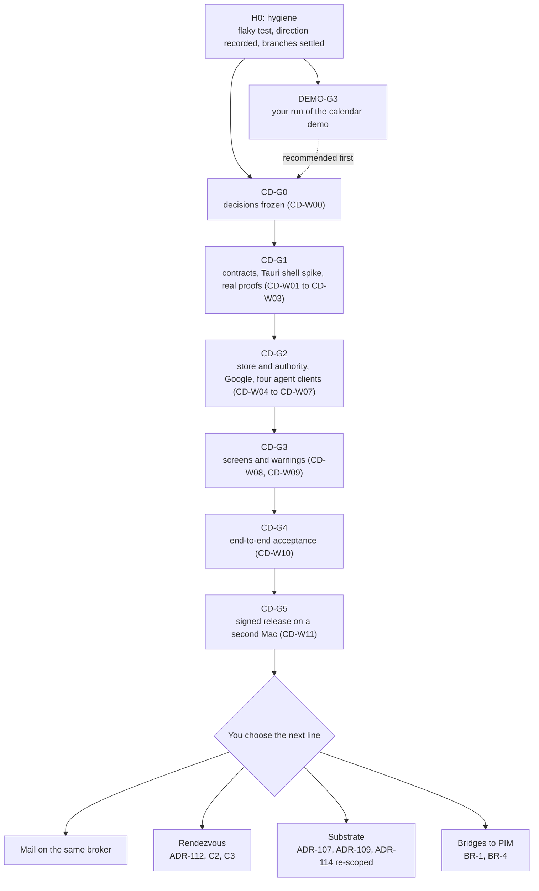

# Fabric Roadmap — Restored on 2026-11-15

**Status:** approved at gate `H0` on 2026-11-15; version 0.5. It records five decisions you made on 2026-11-15 and restores the order of work for this repository. The approval covers the order of work in section 4 and the parking in section 5. It does not cover the ownership table in section 3, the recommended outcomes in section 4.3, the decision defaults in section 7 or the baseline edits in section 10; each of those is put to you separately. It now takes precedence over section 16 of the PRD for the order of work, until the PRD itself is edited. Nothing in the PRD, the architecture document or the calendar specification has been edited, apart from the ADR renumbering of 2026-11-15 (section 3).

**Prepared:** 2026-11-15, from a full re-read of `main` at `4fb3330`, the unmerged branch `codex/calendar-desktop-plan` at `5b310df`, the 2026-11-03 plan "iii in Fabric", and the documents of the PIM repository. Section 11 says how the facts were checked.

**Updated:** 2026-11-15, after gate `H0`, with `main` at `7d12cf5`; 2026-11-15, after gate `DEMO-G3`, with `main` at `5ff0e6b`; and 2026-11-15, after gate `CD-G0`, with `main` at `7a54a5c`.

**Scope:** what Fabric is now, what exists, the order of work with a gate after each step, what is parked or has left this repository, and the decisions still open
**Related:** [Product requirements](PRD.md) · [Technical architecture](architecture.md) · [Calendar vertical](calendar.md) · [Isabelle-gated calendar demo](isabelle-calendar-demo.md) · [Paracels chat prototype](paracels-chat.md) · [Agent Sandbox proposal](agent-sandbox.md) · [Requirements trace](requirements-trace.md) · [ADRs](adr/) · [Calendar Desktop plan](plans/calendar-desktop-plan.md)

**Ids.** Several documents reuse the same numbers for gates, decisions and criteria. This document prefixes them by source:

| Prefix | Source |
|---|---|
| `DEMO-` | The Isabelle-gated calendar demo: `DEMO-G3`, `DEMO-D28`, `DEMO-Q22`. |
| `PCL-` | The paracels chat prototype: `PCL-G6`, `PCL-A10`. |
| `SBX-` | The Agent Sandbox proposal: `SBX-D2`, `SBX-A5`. |
| `CD-` | The Calendar Desktop plan: decisions `CD-C01` to `CD-C13`, work packages `CD-W00` to `CD-W11`, gates `CD-G0` to `CD-G5`, open questions `CD-Q01` to `CD-Q11`. |
| "PIM" | PIM's own series, written "PIM D1", "PIM ADR-008". ADR numbers without "PIM" are Fabric's. |
| (none) | `M0` and `C0` to `C5` are the calendar specification's milestone and slices. They are not the plan's decisions `CD-C01` to `CD-C13`. The system design's slices are written "slice A" to "slice G". |

Ids that are new in this document: `H0` (the hygiene gate), `HYG-` (hygiene items), `DEF-` (defects found in the demo code), `RD-` (decisions this roadmap raises), `BR-` (bridges to PIM), `BASE-1` (the baseline edit work item). `HYG-7` and `HYG-8` belong to gate `DEMO-G3`, the other hygiene items to `H0`. A phase is always named with its document: "PRD Phase 1".

**Terms.** The *permission broker* is a local process that stands between AI agents and your Google account: the agents get tools, the broker holds the credential, proves each action against rules, asks you where the rules say so, and records every call. The *Design Document* is "Sandbox for AI Agents", the source of both the Agent Sandbox proposal and the Calendar Desktop plan; it is not in the repository. Its three goals are to prevent damaging actions, to let you revoke authority at any time, and to make consequences visible.

---

## 1. What Fabric is now

You decided five things on 2026-11-15. Before gate `H0`, no file on `main` recorded decisions 1, 2, 3 or 5; the README and this roadmap now record them. Decision 4 confirms what the demo specification already says.

| # | Decision | Effect on the roadmap |
|---|---|---|
| 1 | **PIM owns the knowledge kernel.** PIM is a separate product in its own repository. It owns capture, knowledge and retrieval. | PRD Phase 1 and the kernel rows of PRD Phase 2 leave this roadmap. Fabric no longer waits for a kernel. |
| 2 | **The 2026-11-03 plan to run Fabric on the iii engine is withdrawn.** | No bus and no `fabric-bus` crate. Fabric stays plain processes with no engine between them. Nothing had been started. |
| 3 | **The permission broker leads**, once hygiene is done. | It is the first product built on the policy gate and the tokens. |
| 4 | **Gate `DEMO-G3` has not been run and stays.** | Your own run of the calendar demo, with Claude driving both agents, was done on 2026-11-15; the gate closed with one exit check not met as written (section 4.2). |
| 5 | **The Calendar Desktop plan governs the broker.** Its decisions `CD-C01` to `CD-C13` are yours. | Its gates `CD-G0` to `CD-G5` are the lead track. The Agent Sandbox proposal becomes its historical input. Mail follows later on the same broker. |

**Fabric is the trust layer:** the agreement protocol (Rendezvous), the policy gate (Isabelle), per-action tokens, messaging and relay, sharing crypto, and the permission broker.

The PRD ordered the work as kernel, then policy and scoped agent access, then sync and sharing, then Rendezvous. Decision 1 removes the first step of that order. Fabric now starts from what it has built: a policy gate that proves each action, and a single-use token for each action.

**Gate `H0` passed on 2026-11-15** (section 4.1): you approved this roadmap and the README change, pull request 9 was merged, and the Calendar Desktop plan was merged to `main`.

**Gate `DEMO-G3` closed on 2026-11-15** (section 4.2), with one exit check not met as written: the dashboard does not name the rule for an action denied when authorizing (`DEF-7`). You chose to close it with that gap.

**Gate `CD-G0` closed on 2026-11-15** (section 4.3): you froze the plan's decisions group by group; they are recorded in the plan and in ADR-108, written as Proposed.

**What you are asked to do, in order.**

1. **`BASE-1`** (section 10): the baseline diffs, shown to you in one pass after you answer `RD-3`, `RD-4` and `RD-12`.
2. **Gate `CD-G1`** (section 4.4): contracts, the Tauri shell spike and real proofs.

One value is still owed by you: the bundle-id prefix, on a domain you own, before work package `CD-W02`.

Outside the gates, three decisions have a deadline set by PIM, not by Fabric: `RD-1`, `RD-2` and `RD-15` (section 7).

## 2. State on 2026-11-15

| Line of work | State | What is open |
|---|---|---|
| M0 agreement simulator (`fabric-core`, `fabric-cli`) | Done. `fabric demo-meeting` reaches `Agreed` on `c3`. The exhaustive selection test is in `crates/fabric-core/tests/two_agent_meeting.rs`. | Nothing. Only the CLI uses `fabric-core`; the demo does not. |
| Isabelle-gated calendar demo (`fabric-policy`, `fabric-token`, `fabric-wire`, `apps/fabric-demo`, the theory) | Built. The spec records Phases 0 to 9 done and gates `DEMO-G1`, `DEMO-G2` closed. The macOS port is on `main`. The theory, the spec and the Rust model hold the same 12 rules; the corpus has 39 cases. `DEMO-G3` closed on 2026-11-15, after two Claude-backed runs on this Mac. Frozen as a record since 2026-11-15, at the annotated tag `demo-g3-2026-11-15` on `7a54a5c` (`RD-11`). | Nothing. `DEF-1` to `DEF-7` stay recorded and not fixed; `DEF-1`, `DEF-2`, `DEF-4` and `DEF-7` become broker acceptance tests. |
| Paracels chat prototype (`apps/paracels`) | Complete. `PCL-G0` and `PCL-G1` closed on 2026-10-22, `PCL-G2` to `PCL-G6` on 2026-10-26. No commit to the app since. | Whether it graduates (ADR-114). Criterion `PCL-A10` (VoiceOver) has no recorded result. |
| ADR-107, ADR-109, ADR-114 | Proposed since 2026-10-26. No decision in them is approved and no code exists for any of them. | Each has gaps the others expose (section 8.3). |
| Agent Sandbox proposal v0.2 | Historical input to the Calendar Desktop plan since 2026-11-15 (`RD-5`). Its section 11 additions are in the PRD and the architecture. | Its decisions `SBX-D1` to `SBX-D13` were never confirmed and are superseded. AIA-009 to AIA-013 are corrected in `BASE-1`. |
| Calendar Desktop plan, with a build audit and `docs/system-design.md` | On `main` since 2026-11-15, through pull request 13: [the plan](plans/calendar-desktop-plan.md), [the build audit](plans/calendar-desktop-build-audit.md) and [the system design](system-design.md). `CD-G0` closed on 2026-11-15: the decisions are in the plan and in ADR-108 (Proposed), and every work package up to `CD-G5` is authorized (section 4.3). `system-design.md` is superseded as implementation baseline and kept as design background (`RD-6`). | `BASE-1`, then `CD-G1`. The bundle-id prefix, before `CD-W02`. |
| Requirements trace | On `main` since 2026-11-10. | Stale: written before the macOS port, before decision 1 and before decision 5. |

**Health, measured today.** `scripts/verify.sh` passes: 93 tests, 0 failed, 11 ignored (8 on Linux, where the three credential-store tests are compiled out). The six Isabelle-gated tests pass on this Mac when run with `--ignored`. `apps/paracels` passes 111 of 111 tests, the typecheck and lint. CI is green on `main` on three runners since 2026-11-15: macos-26, ubuntu-24.04 and windows-2025-vs2026.

**What the checks do not cover.** CI runs only the Cargo workspace. It runs no Isabelle test, nothing in `apps/paracels`, and none of the 11 ignored tests. The demo test that failed by chance was fixed by pull request 12 (`HYG-1`).

**Two local checkouts exist.** Isabelle is installed in the one this roadmap was prepared in. The plan's build audit ran in the other and correctly reports Isabelle missing there.

**PIM today** (read from its repository; nothing there was run):

| | |
|---|---|
| What it is | An Electron application on the iii engine with one unencrypted SQLite vault, in `~/pim`. |
| State | Its README says v0.1 is complete. Its Proposed requirements and execution plan relabel it "feature-complete, acceptance pending"; that relabel awaits your approval. |
| Planned change | A repair plan from the 2026-11-08 review (R0 to R5, all Proposed; R1 has not started in code). On 2026-11-09 you chose a rewrite as one Rust process under a Tauri shell (PIM ADR-008 and PIM ADR-009: Proposed, uncommitted, awaiting your acceptance). |
| Relation to Fabric | PIM D1: no code dependency on Fabric. Its non-goals exclude per-action tokens, policy proofs and agents with write authority. It reserves a `space` concept, with no column yet, and a `sensitivity` column for a later bridge. |
| What it lacks | A rules engine, agents, an MCP surface, sharing, sync, encryption at rest, an operation log, account connectors and a calendar. |

## 3. Who owns what

Proposed; you approve this table as `RD-3` (section 7). By requirement id, across the 58 ids in the PRD and the calendar specification:

| Family | PIM | Fabric | Seam (both) |
|---|---|---|---|
| Capture (CAP, 10) | 10 | | |
| Knowledge (KNO, 11) | 11 | | |
| Retrieval (RET, 7) | 7 | | |
| Automation and AI (AIA, 13) | 5: AIA-001, 002, 003, 005, 007 | 5: AIA-009 to AIA-013 | 3: AIA-004, 006, 008 |
| Sharing (SHR, 5) | 1: SHR-001 | 2: SHR-002, SHR-004 | 2: SHR-003, SHR-005 |
| Calendar (CAL, 12) | | 11: CAL-001 to CAL-010, CAL-012 | 1: CAL-011 |
| **Total (58)** | **34** | **18** | **6** |

- "PIM" means "left Fabric's roadmap", not "done". PIM v0.1 has features toward all four P0 capture rows and meets none of their acceptance criteria in full.
- PIM's documents decline part of the PIM column today: sync between devices or people, agents with write authority, and account connectors. CAP-008 and CAP-010 have no PIM requirement behind them. CAP-005 has one (PIM CAP-5, email import by selected label), but PIM's documents disagree on when: its execution plan keeps email accounts in v0.2, and its non-goals exclude account connectors through v0.2.
- CAL-001 and CAL-002 are Fabric's because the lead plan puts Google access, the encrypted store of provider observations and the normalized calendar domain in the broker. The plan has no calendar view and calls a persisted synchronized replica an optional future, so `CD-G5` does not meet CAL-001's sync criterion.
- Four of the six seam ids need a bridge (section 4.5): AIA-008 needs `BR-1` and `BR-2`; SHR-003 and SHR-005 need `BR-3`; CAL-011 needs `BR-4`. For AIA-004 and AIA-006, Fabric's half is the broker's rules and its allow, ask and block modes.

The old PRD roadmap, phase by phase:

| PRD section 16 | Where it is now |
|---|---|
| M0 | Done, in Fabric. |
| Phase 0, the one-week reality test | Never recorded as run. Its subject is PIM's now. Needs your confirmation that it is closed (`RD-4`). |
| Phase 1, the kernel MVP | PIM. |
| Phase 2 | Kernel rows: PIM. The calendar and time item is Fabric's: the broker builds the provider adapter and part of the time model (`CD-W05`, `CD-W09`). The MCP tools item is delivered, for calendar actions, by the Calendar Desktop plan. |
| Phase 3, first application plus encrypted sharing | Fabric, after the broker. Rendezvous and safe commit are calendar slices C2 and C3. The broker builds safe commit for one owner first (plan section 11). Sync and sharing items are parked with ADR-107 and ADR-109. |
| Phase 4 | Reply drafts and explicit send wait for the mail vertical on the broker. The unified inbox, task extraction, policy-scoped automations and the mail interface are parked: they need ingestion that only PIM would have. |
| ADR-001, 004, 005 (architecture section 19) | Not Fabric's to write. PIM has its own ADR series, which reuses the numbers 001 to 009 for other topics. |
| ADR-002 (encryption at rest), ADR-003 (desktop framework), ADR-006 (connector sandbox and credentials) | The kernel parts are PIM's. Encryption of Fabric's own stores, the broker's desktop shell (`CD-Q01`) and the holding of provider credentials stay with the broker. |
| ADR-108 (agent and MCP permission model), ADR-111 (calendar authority and time model), ADR-113 (projection and commit) | Fabric's. The broker settles their subjects before `CD-G5`. On 2026-11-15 Fabric's own records were renumbered by adding 100 (`RD-18`); PIM's series is untouched. ADR-108 is written as Proposed and holds the `CD-G0` permission-model decisions with the plan. |

Three slice lists now describe calendar work: the calendar specification's C0 to C5, the system design's slices A to G, and the plan's `CD-W00` to `CD-W11`. Decision 5 makes the plan's list the one that is scheduled. Reconciling the other two with it is part of `CD-G0` (`RD-6`).

## 4. The roadmap

Each step ends at a gate you approve. For `CD-G1` to `CD-G5` the plan has a reviewer independent of the implementer accept the evidence first (plan section 13); `CD-G0` named that reviewer: a fresh session from the other model family, which may not edit code or tests. Gates are approved in this order. Work may overlap where the plan's dependencies allow, for example `CD-W02`, `CD-W03` and `CD-W04` once `CD-W01` is done.

If a gate fails, its step is repeated. The plan's section 14 lists two results that reopen a decision instead (the desktop shell, the Google scope design) and four that block release: the audit can fail open; a client cannot use the tools; Isabelle cannot run legally and reliably on a recipient's Mac; an unclear notification outcome leads to a blind resend.

No step through `CD-G5` has an effort estimate: the plan gives none. For the Rendezvous line the calendar specification's indicative efforts stand until re-measured (C2: 4 to 6 weeks; C3: 3 to 4 weeks).

### 4.1 First: hygiene, to gate H0

Only the hygiene needed now. The rest is in section 5.

| Id | Work | Exit check | Status |
|---|---|---|---|
| HYG-1 | Fix the test that fails CI by chance. A test in `apps/fabric-demo/tests/calendar.rs` searches an 800-byte encrypted file for four plaintext strings. One of them, `n1`, is two bytes, so it appears by chance about once in 80 jobs. It has failed CI twice, on two platforms; those are the only `verify` failures in the repository's history. | The test no longer searches for `n1` or any string shorter than 9 bytes (the shortest that remains is `MARKER-ID`); checked once by hand that the test still fails when the store is written unencrypted; CI is green. | Done, pull request 12. |
| HYG-2 | Commit this roadmap on its own branch and open a pull request, as you chose. | The pull request holds only `docs/roadmap.md`. | Done, pull request 10. |
| HYG-3 | Record the direction in `README.md`: a short "Status and direction" section, and links to `agent-sandbox.md`, `requirements-trace.md` and this file. Shown to you as a diff first. | Every file in `docs/` is reachable from the README, and it states decisions 1, 2, 3 and 5. | Done, pull request 11. |
| HYG-4 | Settle the Calendar Desktop plan's branch: open its pull request, and merge it or hold it until `CD-G0`. Its README change adds three links and must be combined with `HYG-3`. | The branch is merged or has an open pull request with a stated reason to wait. | Done, merged as pull request 13. |
| HYG-5 | Decide Dependabot pull request 9 (node-forge 1.4.0 to 1.4.3 in `apps/paracels`). Its green checks tested nothing, because CI has no Node step. | The paracels tests pass locally on the branch, then merge; or close with a reason. | Done, pull request 9, merged after a local run on the branch: 111 of 111 tests and lint pass, and the typecheck passes once the generated `expo-env.d.ts` is present; `npm audit --omit=dev` went from 11 to 10 vulnerabilities. |
| HYG-6 | Restore the file modes of five PowerShell scripts in the working tree. A local change only; no content differs. | `git status` shows no modified file. | Done, locally; nothing to commit. |

**Gate `H0`:** the exit checks above are met, the roadmap and the README change are merged to `main`, and you approve both.

Gate `H0` passed on 2026-11-15. Each of pull requests 9 to 13 had 12 of 12 CI checks green before it was merged. `HYG-7` and `HYG-8` belong to `DEMO-G3` and were not done then; both are done (section 4.2).

### 4.2 Second: close the demo, gate DEMO-G3

| Id | Work | Exit check | Status |
|---|---|---|---|
| HYG-7 | Preflight, with you at the machine: create `.env` from `.env.example` with the Anthropic key; run, by name, the three ignored Keychain tests (`keys` in `fabric-token`; `calendar_command` and `messaging_commands` in `fabric-demo`) and `claude_plans_a_first_turn` (about 3 cents). This is the first Claude call from this Mac. | Those four tests pass. The Ollama test is recorded as not run if Ollama with `qwen3:4b` is not installed. The result is recorded in the demo spec, section 16. | Done, 2026-11-15: the three Keychain tests pass, and `claude_plans_a_first_turn` passes after a first attempt failed on an invalid key in `.env`; the model id was accepted. The Ollama test was not run: `qwen3:4b` is not installed. |
| HYG-8 | Correct the stale lines in the demo spec, shown to you first: `DEMO-D28` and section 20 still say Windows only; one line says CI was never run; section 10.2 says HTTPS is "on Windows only"; `DEMO-D21` says every process runs under "your Windows user"; one line calls Isabelle2025-2 the current release; the Phase 5 heading says the remaining gates were approved automatically, which did not cover `DEMO-G3`. Mark `requirements-trace.md` as stale since 2026-10-26 at its top. | You approve the diff before your run, so the spec matches this Mac. | Done, pull request 15. |
| DEMO-G3 | Your run: `sh scripts/demo.sh` with Claude for both agents and the happy path of the demo spec's section 14; then one run with one fault switch on in the dashboard. The 2026-10-19 rehearsal cost about $0.35. | A meeting is booked at one of the two mutual options only after both owners click yes. Every executed action shows a proof id and a token. With the fault switch on, the faulted action is denied, and the dashboard names the rule (the policy switches), or refused, and the dashboard shows the token error (the token switches). The date, machine, model and cost are in the spec. | Closed on 2026-11-15, with the exit check "the dashboard names the rule" not met as written (`DEF-7`). The other exit checks are met. |

Nothing under `apps/fabric-demo/src` changes before your run. There is one stated exception: if the preflight fails because the model id is no longer accepted, the constant `CLAUDE_MODEL` in `apps/fabric-demo/src/agent/planner.rs` and `DEMO-D25` in the spec are changed, you see both diffs first, and the preflight is repeated. If the dashboard trace shows a gap, read the raw `.jsonl` files before failing the gate (`DEF-1`). If the run fails for another reason, the failure is recorded in the spec and you decide whether to repair the demo or close it as it stands.

**Result, 2026-11-15.** Both runs used Claude for both agents on this Mac. In the happy path the meeting was booked at Thursday 14:30 only after both owners said yes, and all 11 executed actions carry a token and a proof id. In the fault run "Write without consent" was switched on for both agents; Isabelle denied each injected `add_meeting` on the `consent` rule, no token was issued, and the meeting was then booked as before. The two runs cost about $0.78 at $4 and $20 per million input and output tokens, a rate not checked against a current price list. The dashboard showed the switch as fired and the audit row as denied, but not the rule, so the exit check "the dashboard names the rule" was not met as written (`DEF-7`). You were offered to close the demo as it stands with that gap recorded, or to fix the dashboard and run again, and chose the first: "Close it, record the gap". The record is in the demo spec, Phase 9 results and sections 15 and 16.

`DEMO-G3` closes the demo as a demo. It does not close calendar slice C2 or any release gate in the calendar specification.

**Order:** `DEMO-G3` was closed before `CD-G0`, as recommended. `CD-C05` requires a live proof on every broker action, and this run was your first-hand experience of one.

### 4.3 Third: the Calendar Desktop plan, gate CD-G0

`CD-G0` is the plan's work package `CD-W00`: you freeze its policy matrix and defaults and answer the questions the plan dates at this gate (`CD-Q01`, `CD-Q05`, `CD-Q11`). The others keep the plan's dates: `CD-Q06` before `CD-W01`, `CD-Q02` and `CD-Q09` at `CD-G1`, `CD-Q07` at `CD-W02` and `CD-W11`, `CD-Q08` at `CD-W05`, `CD-Q10` at `CD-W07`. The plan has no `CD-Q03` or `CD-Q04`. The plan is the authority for its own content; this roadmap does not restate it. The re-read adds these points for the same gate:

| Id | Finding | What `CD-G0` should record |
|---|---|---|
| RD-5 | `agent-sandbox.md` v0.2 still reads as an open proposal. Its section 11 additions, which you approved and applied on 2026-10-26, put AIA-009 to AIA-013 into the PRD, while the decisions they rest on (`SBX-D1` to `SBX-D13`) were never confirmed. | Its status becomes "historical input to the Calendar Desktop plan". The mail material in it (mail profiles, recipient sets, the send approval card) is carried to the later mail vertical. AIA-009 to AIA-013 are checked against the plan and corrected in the PRD (section 10). |
| RD-6 | [`docs/system-design.md`](system-design.md), merged with the plan, is a "Proposed implementation baseline" from August. Its first-release non-goals exclude native invitations and general agents, which `CD-C07` and `CD-C04` now require. Its working assumptions give one Google account, one write-only pilot calendar and opaque `Busy` events, which `CD-C12`, `CD-C13` and `CD-C07` replace. The calendar specification's CAL-010 keeps provider invitations out of private mode by default. | The status of `system-design.md`, and how its slices A to G and the calendar specification's C0 to C5 map to the plan's work packages. The plan treats invitations as an explicit compatibility mode; its proposed matrix asks every time under one profile and lets the other allow an approved recipient set. The calendar specification needs the frozen rule recorded. |
| RD-7 | `DEMO-D28` keeps Isabelle tests out of CI, and CI runs none today. `CD-C05` makes the prover release-critical, and the plan requires a dedicated live-proof job or a release run that proves the corpus. | Whether `DEMO-D28` is reversed for the broker's theory (a CI job) or kept (a release run), and where it runs. |
| RD-8 | The pinned Isabelle2025-2 has been superseded by Isabelle2026 and is served from one archived URL that has already moved once. The macOS archive is 1.7 GB and unsigned. | With `CD-Q09`: a second source for the pinned archive now; whether the broker moves to Isabelle2026 before `CD-G1`. |
| RD-9 | `fabric-token` and `fabric-wire` both depend on `fabric-policy`, which holds the demo's calendar negotiation model. Any new crate that uses the CBOR and COSE code therefore links that model. The coupling is narrow: the CBOR and COSE modules do not import the policy crate. | Whether `CD-W01` first moves the codec into a crate of its own, or accepts the dependency. |
| RD-10 | The demo's measured cost of a proof: about half a second per authorizing proof on this Mac today (93 proofs, 1.1 seconds at most); the Windows rehearsal measured 1.0 second; the `DEMO-G3` runs on 2026-11-15 measured 0.71 and 0.62 seconds per check on average, screening included (1.39 seconds at most). Starting the gate took 12.6 seconds on 2026-10-26, when it also built the session. The plan proves each request at least twice, and once more before a read result is released. | With `CD-Q11`: whether the plan's proposed targets (progress visible within 500 ms, a 30-second proof timeout) fit two or three proofs per agent read. |
| RD-11 | After `DEMO-G3`, the demo application can be frozen as a record or refactored to share new crates. The plan already keeps the demo's behaviour and puts new semantics in new namespaces. | Recommended: freeze `apps/fabric-demo` after `DEMO-G3` with a tag and a note of its known defects (section 8.1). The three crates it uses stay shared, and its tests are their regression contract. |

**Outcomes at `CD-G0`.**

- **RD-5.** Decided on 2026-11-15: `agent-sandbox.md` is historical input to the plan; `SBX-D1` to `SBX-D13` were never confirmed and are superseded, and the plan's `CD-C01` to `CD-C13` govern. The mail material moves to the later mail vertical. AIA-009 to AIA-013 are corrected in `BASE-1`.
- **RD-6.** Decided on 2026-11-15: `system-design.md` is superseded as implementation baseline and kept as design background; a mapping of slices A to G and C0 to C5 to the work packages goes into the plan. Invitations are a compatibility mode outside CAL-010's private scheduling: Careful asks; Flexible asks by default and allows only for an approved recipient set. The calendar specification's wording follows in `BASE-1`.
- **RD-7.** Date: decided before `CD-W03` starts. Default until then: a release run only. Isabelle stays out of CI, as in the demo; the corpus is proved at release and by hand on policy changes.
- **RD-8.** Dates: a private byte-exact copy of the pinned Isabelle2025-2 archive before `CD-W03` starts, with a fallback URL in the setup script; the broker's Isabelle version is chosen at `CD-G1` with `CD-Q09`. Default: no public mirror until the bundled licences are reviewed.
- **RD-9.** Decided on 2026-11-15: split later. The codec moves to its own crate when a crate that must not link policy code needs it.
- **RD-10.** Decided on 2026-11-15, reworded: within 500 ms a "received, checking" state is visible, and the verdict follows when the proofs finish; a denial keeps its failing rule on screen (`DEF-7`); the 30-second timeout is per Isabelle check, counted from the check's start. `CD-W03` re-measures and reopens this if a mean check exceeds 1.5 seconds.
- **RD-11.** Decided on 2026-11-15: frozen, with the annotated tag `demo-g3-2026-11-15` on `7a54a5c`, pushed. `DEF-1` to `DEF-7` stay unfixed; `DEF-1`, `DEF-2`, `DEF-4` and `DEF-7` become broker acceptance tests.

**Gate `CD-G0`:** as the plan defines it: the decisions are written into the plan or an ADR, with an outcome there for `RD-5`, `RD-6`, `RD-9`, `RD-10` and `RD-11`, and a date for `RD-7` and `RD-8`, which close before `CD-G1c`.

**Result, 2026-11-15.** Gate `CD-G0` closed on 2026-11-15. You gave your decisions group by group; they are recorded in the plan's G0 decision record ([the plan](plans/calendar-desktop-plan.md)) and in ADR-108, written as Proposed, and the outcomes above give one for each `RD-` point. Eleven decisions differ from the recommended default:

- **Desktop shell (`CD-Q01`).** A Tauri application now: static HTML and CSS with a small vanilla TypeScript layer, no framework, whose Rust host launches the broker as a child over private pipes and relays the plan's versioned JSON contract. The plan had recommended SwiftUI over a Rust broker; the process and authority boundary does not change.
- **Reads under Careful.** You approve a grant limited to the requested fields and date window, and reads inside it run for the grant's duration; the default was to ask on each read.
- **Edits to Fabric-created events**, as the plan words them: Flexible allows them inside an accepted scoped grant if there are no new recipients. `CD-W03` must state how this combines with the invitation rule, with negative cases, so that a change of time for existing attendees is caught.
- **Custom profiles** may set any row to Allow except the Block rows, including editing a pre-existing event and responding to an invitation, which stay Ask in Careful and Flexible; saving such a profile shows the expansion first. The default was Flexible as the ceiling.
- **Event deletion:** only events Fabric created, and Ask in every profile; the default was off in version 1.
- **Recurring events:** an agent may ask to accept or decline one occurrence of a recurring invitation, and nothing more on a series; the default was none.
- **Authorization (`CD-W00`):** every work package up to `CD-G5` is authorized, and only your gate approvals stop the work; the default was `CD-W01` only.
- **ADR numbering (`RD-18`):** Fabric's own ADRs are renumbered by adding 100; the default was no renumbering.
- **Isabelle in CI (`RD-7`):** a release run only until the decision is due; the default was a CI job on macos-26.
- **Contacts (`CD-Q06`):** version 1 imports contacts from Google People; the default was manual groups only.
- **The codec (`RD-9`):** split later; the default was to split first.

Three interpretations are stated for you to confirm when you read the diff:

1. Event deletion asks in every profile, custom ones included. So a custom profile can raise every row to Allow except deleting an event (Ask), and deleting a calendar or changing sharing (Block).
2. With People import required, local groups and exact or domain recipient sets remain, and import adds a source for them.
3. "Everything to `CD-G5`" authorizes all work packages, but the plan's dependency order, the single contract owner for schemas, token format and rule theory, the independent reviewer, and your approval at each gate in order all still apply.

One value is open: the bundle-id prefix, on a domain you own. It has not been supplied yet and is due before `CD-W02`.

`CD-G0` authorizes all work packages up to `CD-G5` under the conditions of interpretation 3. Implementation starts from the `main` commit that records these decisions, with one branch and pull request per work package.

**After `CD-G0`: `BASE-1`.** The baseline diffs of section 10 are shown to you in one pass. You answer `RD-3`, `RD-4` and `RD-12` first, because the diffs depend on them. This gate raised these baseline points, in addition to section 10: PRD AIA-006, AIA-009 to AIA-013, and AIA-010; calendar specification CAL-010; architecture section 19 beyond the ids.

### 4.4 Then: CD-G1 to CD-G5

The plan's sections 13 and 14 hold the work packages, their owners, their dependencies and the required scenarios.

| Gate | Work packages | What it shows | What this re-read adds |
|---|---|---|---|
| `CD-G1` (a, b, c) | `CD-W01` contracts; `CD-W02` Tauri shell and Rust broker child round trip, packaging spike; `CD-W03` the broker's rule theory proved by a real Isabelle | The three riskiest choices hold: one contract for TypeScript and Rust, a Tauri shell over private pipes to the broker, live proofs for broker actions. The plan also puts four checks here: the Isabelle runtime strategy for distribution (`CD-Q09`), SQLCipher's build, signing and licence, the signing and Keychain behaviour of the MCP bridge, and the macOS 15 baseline (`CD-Q02`). | The demo's 12-rule theory and its 39-case corpus stay untouched. The plan's proposed layout gives the broker its own theory, and its section 8 said "Extend the theory"; `CD-G0` recorded that the broker's rules are a separate theory, `isabelle/Fabric_Broker`, and section 8 now says so. `RD-7` and `RD-8` close before `CD-G1c`. |
| `CD-G2` (a, b, c, d) | `CD-W04` encrypted store, grants, pause and revoke, audit; `CD-W05` Google sign-in and Calendar; `CD-W06` MCP bridge with Claude Desktop, Claude Code and Codex desktop; `CD-W07` the Ollama runtime | Grants, revocations and used authorizations survive a restart, and session grants end with it; a real Google account works; all four agent clients reach the same tools. | The plan already requires one writer and durable used authorizations, which answers `DEF-1` and `DEF-4`. The re-read adds, from `DEF-2`: configuration is checked before anything starts. `RD-14` settles the envelope before `CD-W04`. This is the first Google code in the repository. |
| `CD-G3` (a, b) | `CD-W08` the screens; `CD-W09` the time and buffer warnings | Every screen scenario; the same warnings for every agent and profile. | `CD-W09` needs time zones, all-day dates and daylight-saving rules; for recurrence the plan allows Google's expanded occurrences in place of an engine. `fabric-core` has only exact UTC intervals, so part of the standards half of calendar slice C0 is built here and in `CD-W05`. |
| `CD-G4` | `CD-W10` integration and independent QA | The plan's acceptance matrix, on real accounts and real agents. | Regenerate the requirements trace here, with an owner column. |
| `CD-G5` | `CD-W11` signing, notarization, the Isabelle runtime, Google production readiness | A clean second Mac runs the released application. | `CD-Q09`, the Isabelle runtime on a recipient's Mac, is the largest release risk (section 6). |

### 4.5 After CD-G5: you choose the next line

Nothing below starts until you choose it. The Needs column lists what must be settled first.

| Line | First step | Needs |
|---|---|---|
| **Mail on the same broker** | The Agent Sandbox proposal's mail material, re-planned on the broker that exists: mail profiles, recipient sets, read, draft and send behind approval. | Gmail scopes and Google verification for them; where "my contacts" come from. |
| **Rendezvous to specification** | ADR-112, the protocol record. ADR-107, ADR-109 and ADR-114 leave pairing and key pinning to it, and slice C2 needs it. If `RD-13` chooses MLS, ADR-112 is written against ADR-109's credential shape, so the substrate re-scope comes first. Then C2 on synthetic calendars, then C3. | `RD-13`; the calendar specification's open decisions on the contact list, the Google representation after agreement, and two-person or group sessions. |
| **Substrate: operation envelope, sharing crypto, relay** | Re-scope ADR-107, ADR-109 and ADR-114 against decision 1 and their known gaps, before any of them is offered for acceptance. | `RD-14`; relay hosting (PRD section 2.2 items 4, 5, 13). |
| **Bridges to PIM** | `BR-1`: an agent reads PIM items only under a Fabric grant. `BR-4`: a committed meeting becomes a record in PIM (CAL-011). | `RD-2` and `RD-12`; PIM has a stable interface, and no unauthenticated local surface reaches the vault. |

`BR-2` (agent writes arrive in PIM as suggestions) and `BR-3` (PIM items shared through Fabric spaces) are parked: PIM's intent document excludes agents with write authority and sync between people.

## 5. Parked, and what un-parks each

| What | Why it is parked | Un-park when |
|---|---|---|
| The Agent Sandbox proposal's own phases and gates (`SBX-G0` to `SBX-G6`): mail first, a web dashboard, a Rust rule evaluator to be measured | Decision 5. The plan's `CD-C02` and `CD-C05`, and its desktop application (a Tauri shell since `CD-G0`), replace them. | Mail returns as the mail vertical (section 4.5). The web dashboard does not return; the owner interface is the plan's Tauri application. The Rust evaluator does not return. |
| ADR-107, ADR-109, ADR-114 (all decisions, stages and action items) | The broker needs none of them accepted. Its store borrows one idea from Proposed ADR-107: the single-device operation envelope, with canonical mutations kept apart from the access audit (plan section 11; `RD-14`). Each has gaps (section 8.3). ADR-107's first stage lost its home to PIM. | A second device, a shared space, or a relay beyond loopback is scheduled. The first step is then a rewrite, not approval as written. |
| Paracels graduation; `PCL-A10`; a CI job, audit clean-up and Node pin for `apps/paracels` | The prototype is closed. The flagged packages are transitive through Expo tooling and are not imported by the app or server code. | You decide to continue mobile messaging; ADR-114 is amended first. |
| Relay hardening (durable storage, dedup, TLS and authentication, WebSocket push, expiry) | The broker is local and has no relay. | With ADR-114. |
| Calendar slices C2 to C5, the 23.17 release gates, the 15.8 pilot steps, the research track, ADR-112, and the Rendezvous parts of ADR-111 and ADR-113 | C2 needs ADR-112. The rest follow in order. | After `CD-G5`, or earlier if you put Rendezvous ahead. |
| The PIM-content half of PRD Phase 3 sharing (SHR-003, SHR-005); PRD Phase 4 inbox, tasks, automations and mail interface; `BR-2`, `BR-3` | They need a vault or ingestion that Fabric no longer owns, or a change to PIM's intent. | A bridge to PIM is defined. |
| Repairs to the demo (section 8.1); tests for its launcher, dashboard and fault wiring | The demo is a record since 2026-11-15 (`RD-11`). | Not planned. |
| The rest of the hygiene: a root instruction file for agents, a compiler update, CI hardening, three merged local branches, remaining README wording | None is needed by a gate before `CD-G1`. The plan's work packages will need the instruction file. | One at a time, when it costs time; the instruction file before `CD-W01`. |

## 6. What you provide, and the main risks

| Gate | What you provide |
|---|---|
| `DEMO-G3` | Provided on 2026-11-15: an Anthropic API key in `.env`, and a sitting at the machine. |
| `CD-G0` | Provided on 2026-11-15: answers to `CD-Q01`, `CD-Q05` and `CD-Q11`, and to `RD-5`, `RD-6`, `RD-9`, `RD-10` and `RD-11`; the reviewer who accepts evidence at the later gates, a fresh session from the other model family. |
| `CD-G1`, `CD-G5` | Settled on 2026-11-15: the product name is Fabric Calendar; an Apple Developer team exists and is used from the shell work package `CD-W02`; you are the distribution owner, as an individual, under your own Apple Developer membership. Still owed: the bundle-id prefix, on a domain you own, before `CD-W02`. Developer ID certificates at release (`CD-Q07`). |
| `CD-G2` | A Google Cloud project with a desktop OAuth client (`CD-C08`, `CD-Q08`); disposable Google accounts, calendars and recipients for live tests; Claude Desktop, Claude Code, Codex desktop and Ollama with a tool-capable model installed (`CD-C04`, `CD-Q10`). |
| `CD-G5` | A clean second Apple Silicon Mac; a Mac or virtual machine on macOS 15.0 for the minimum-version test; Google consent branding, a privacy policy and a support contact for verification (`CD-Q08`). |

| Risk | Where it first applies | Mitigation, or accepted |
|---|---|---|
| The Isabelle runtime on a recipient's Mac (`RD-8`). The plan blocks release if it cannot run there legally and reliably. | `CD-G1`, `CD-G5` | Decided at `CD-G1`, where the plan compares bundling with a verified first-run install (`CD-Q09`). |
| The plan proves each agent request at least twice, and once more before a read result is released. At half a second to a second each, agent reads may feel slow. | `CD-G1c` | `RD-10`. Measured in `CD-W03` before any screen is built. |
| Four agent clients are release gates, and three are products outside your control whose MCP configuration can change. | `CD-G2c`, `CD-G4` | The plan tests the exact installed clients and pins the MCP SDK and the negotiated protocol version. Which client versions to support is open (`CD-Q10`). |
| Real calendar data reaches cloud models through the agents, and text inside events can steer an agent. | `CD-G2`, `CD-G4` | The broker bounds what a steered agent may do; the plan shows a destination notice per agent. The residual risk follows from `CD-C03` and `CD-C04`; you accepted it at `CD-G0` on 2026-11-15, with that notice per agent. |
| One owner decides everything, and PIM's repair plan and rewrite wait on the same person. | Every gate | `H0` is passed, and `DEMO-G3` and `CD-G0` are closed. The plan's later gates rest on evidence a reviewer accepts first. |
| CI cannot see a broken rule: no Isabelle job exists. | Any change to `fabric-policy`, `fabric-token` or a theory | Until `RD-7` is settled, the six Isabelle tests are run by hand on every such change. |

## 7. Decisions you still have to make

Decisions taken inside a gate are in section 4: the README text, the plan's branch and pull request 9 were settled at `H0`; the model-id exception at `DEMO-G3`; `RD-5` to `RD-11` and `RD-18` were decided at `CD-G0` on 2026-11-15, with dates for `RD-7` and `RD-8` (section 4.3). `RD-3`, `RD-4` and `RD-12` are answered with `BASE-1`; they are in the table below with the rest. Defaults are recommendations from the evidence.

| Id | Question | Needed before | Suggested default |
|---|---|---|---|
| RD-1 | Should PIM's next schema reserve the seam: a `space` column and the four-level sensitivity vocabulary of architecture section 10.4? PIM reserves `space` as a concept only. | You accept PIM ADR-006 (its schema record), raised as an amendment while it is still Proposed. | Reserve both now. Reserving costs nothing today. Not reserving costs a migration later. |
| RD-2 | Is Fabric's broker the single door for agents, including any later agent access to PIM's vault? | You accept PIM ADR-009, which defines PIM's interface. | Yes. It matches invariants 4 and 7 of the architecture and PIM's own non-goal. |
| RD-3 | Approve the ownership table in section 3? | Regenerating the trace; `BASE-1`. | Approve. |
| RD-4 | Is PRD Phase 0, the one-week reality test, closed? | The PRD section 16 edit. | Closed as superseded: it was never recorded, and PIM's acceptance work takes its place. |
| RD-12 | The PRD confirms "encrypted at rest", but the vault is PIM's and PIM defers encryption. May Fabric grant an agent read access over an unencrypted vault? | `BR-1`; the PRD section 2.1 edit. | No, until PIM delivers encryption. PIM carries the requirement and the PRD states the limit. Fabric's own stores are encrypted from the first build. |
| RD-13 | Two-party negotiation: one MLS group per negotiation, as the calendar specification requires, or the Noise IK that is built? | C2; ADR-112. | Decide in ADR-112. Proposed ADR-109 points both ways. Keeping Noise IK is an edit to calendar section 23.6. Deterministic availability is already the baseline (CAL-003); the demo's model-computed answers do not carry forward. |
| RD-14 | Does Fabric have an operation log at all, now that the vault is PIM's? Does the envelope gain a signed agent field? | `CD-W04` for the broker's single-device envelope and its agent field; any multi-device work under ADR-107, ADR-109 or ADR-114 for the rest. | Settle the broker's envelope fields in `CD-W01`. Decide the rest after `CD-G2a`, on evidence from the broker's own ledger. |
| RD-15 | Who holds provider credentials when PIM wants email ingestion? | PIM takes email account import into scope (PIM CAP-5; its plan says v0.2, its non-goals say later). | One holder per machine: Fabric's broker. |
| RD-16 | Relay hosting: a home server, self-hosted, or an operated ciphertext relay (PRD section 2.2 items 4, 5, 13)? | Any relay beyond loopback. | No decision now. |
| RD-17 | Licence and product posture, for Fabric and PIM (ADR-010). The repository has no licence of its own. | `CD-G5`: the plan distributes a signed application to other Macs. | Decide once for both products. |
| RD-18 | ADR-001 to ADR-009 mean different things in the two repositories, and `system-design.md` lists eight more records to write. Are the `CD-G0` decisions recorded under the reserved Fabric ADR-108, ADR-111 and ADR-113? | Decided at `CD-G0` on 2026-11-15 (section 4.3). | Decided on 2026-11-15 against the default of no renumbering: Fabric's own ADRs were renumbered by adding 100, so the next free Fabric number is 115; PIM's series is untouched. ADR-108 is written as Proposed and holds the `CD-G0` decisions with the plan. |

Three older open decisions travel with the Rendezvous line and are not asked now: what Google shows after an agreement (PRD section 2.2 item 11), where the Rendezvous contact list comes from (item 12), and two-person or group sessions at launch (calendar section 23.18). PRD section 2.2 items 1, 3, 6 and 7 travel with the kernel to PIM.

## 8. Known defects and gaps, carried forward

Each was found by reading and then checked by a second, independent reader. None is fixed by this document.

### 8.1 In the calendar demo (DEF-1, DEF-2, DEF-4 and DEF-7 are broker acceptance tests since `CD-G0`)

- **DEF-1.** The host and its gateway write one audit file through two handles. Lines can splice, and the dashboard silently drops a line it cannot parse.
- **DEF-2.** The Claude planner fails when `.env` is absent even if the key is in the environment, against `DEMO-Q25`. Every agent-side configuration error, including a misspelled backend name, surfaces only after Isabelle, the relay, both calendars and both hosts have started.
- **DEF-3.** `run.json` is written only after the agents start. Until then a second `up` deletes the first one's run directory.
- **DEF-4.** Used-token nonces and host state live in memory only. After a restart a used token is accepted again until it expires, up to 60 seconds.
- **DEF-5.** The relay drops expired frames only when their mailbox is touched. The mailbox id is the only credential, and it is logged in full and streamed to the dashboard. The spec records this as intended for a loopback demo.
- **DEF-6.** The gateway's delivery list and its set of seen calls never shrink, and any unreadable frame starts a planner turn. Harmless on loopback; a cost once others can reach a relay.
- **DEF-7.** For an action denied when authorizing (the write-without-consent switch), the dashboard shows "fired when authorizing" and an audit row ending in "→ deny", but not the failing rule, and no proof link for the denied action; the rule is only in the raw audit files and the check report. For the two screening switches the rule stays in the plans panel only until the next turn replaces it. Found at `DEMO-G3` on 2026-11-15 by reading `demo/dashboard/app.js` and confirmed by a second reading of that file; you chose to close the demo with it. It matters for the broker: the Calendar Desktop interface should keep the failing rule on screen for a denial.
- **What the demo does not conform to.** The calendar specification requires deterministic code to compute availability; in the demo the language model reads the busy intervals, picks the candidates and answers. The demo uses Noise IK where the specification requires MLS, a configured peer key where it requires a contact list with key pinning, and it carries a free-text note on the wire. Its consent rule checks only that both owners said yes to that slot (`DEMO-Q22`).

### 8.2 Between the demo and the calendar specification

The deterministic logic the calendar specification asks for exists in `fabric-core` (exact-candidate availability, first-unanimous selection), and the demo does not use it. The two negotiation models share no code. CAL-003 already requires deterministic availability, so the `fabric-core` logic is the one that grows into the production profile. ADR-112 records that, and says which of the demo's wire and consent code is kept.

### 8.3 In the three Proposed ADRs

- **Crate graph.** ADR-114's rule that the relay never links the policy crate is false today (`RD-9`). ADR-107's plan to put the operation log in `fabric-core` would end that crate's zero-dependency rule (`DEMO-D27`).
- **ADR-107.** The signed envelope has no agent or actor field. The architecture's illustrative table, which the ADR adopts, has `actor_agent_id`, so the actor would be stored but not signed; the Agent Sandbox proposal cites it as part of the envelope. BLAKE3 and UUIDv7 are specified and neither is in the tree; paracels uses UUID version 4. That table has no `key_epoch` and a nullable signature. Three cursor granularities appear across the documents: per device, per space, and per feed.
- **ADR-109.** The header is authenticated in clear, yet the relay message has no place for it and the relay must not see the space id. No ADR gives the relay the enrolled-device set it would need to keep a message "until every enrolled device has fetched it". A device that missed a key rotation cannot find the feed that carries its new key. Two key paths are described for blob chunks. The option table says HPKE is already in use; it is not.
- **ADR-114.** Its gates say A1 to A9; the paracels spec has `PCL-A1` to `PCL-A11`. Step 1, "the app, unchanged", cannot work: the app takes its API address from the Expo dev server, the step removes those routes, and a client test imports the server code. It defers TLS to step 3 while its own rule requires TLS off loopback. It names two different points for deleting the TypeScript server. `fabric-token` has no iOS key store.

### 8.4 In documents and CI

- `README.md` still calls M0 the current slice, and describes paracels as both being built and complete.
- `architecture.md` section 9.5 says the repository precedes storage, transport and cryptography. It never names the demo crates, which are most of the Rust code. Its stack table names Tauri 2 as the desktop shell, which `CD-G0` chose on 2026-11-15 over the plan's SwiftUI recommendation.
- CI has no dependency check. `actions/checkout` is pinned by tag, not by hash.

## 9. Withdrawn, and built elsewhere

**Withdrawn: "iii in Fabric" (2026-11-03).** The plan proposed a `fabric-bus` crate over the iii engine, the calendar demo started by the engine's compose file, and four phases A to D. It also proposed a new "ADR-014 Process topology and bus", a number already taken, and it relied on engine triggers that the next engine release removed. PIM, the only project that adopted the engine, now proposes removing it.

**Built elsewhere: the knowledge system.** Part 2 of the same plan described the PRD's knowledge system as a second Fabric application around Fabric's trusted core, gate and tokens. It was built instead as PIM, in its own repository, without them.

## 10. Edits the baselines need (not applied)

Your rule is that the PRD, the architecture and the calendar specification change only after you have seen the exact wording. This is the list. The exact diffs are work item `BASE-1`: they are shown to you in one pass after `CD-G0` and applied when you approve them. One edit waits and is shown later: Architecture edit 2, after `CD-G1`. Two edits are worded here because the direction depends on them: PRD edit 2 and Architecture edit 3.

**PRD**

1. Header: bump the version and date; extend "Related".
2. Section 1: add the scope note below, and change the first sentence of the staged strategy's last bullet.
3. Section 2.1: in the privacy row, note that encryption at rest of the vault is PIM's requirement and is deferred there (`RD-12`); in the "First Fabric application" row, add that its first form is the permission broker and that peer scheduling follows.
4. Section 2.2: mark items 1, 3, 6 and 7 as travelling with the kernel. Item 2 is open for ingestion (`RD-15`). After `CD-G0`, replace the "Proposed answer" on item 9 with the plan's frozen policy matrix, and record under item 10 the account type and number (`CD-C03`, `CD-C12`) and the writable calendars (`CD-C07`, `CD-C13`).
5. Section 2.3: retitle as the M0 slice and name the two later slices.
6. Section 6.5, last sentence: point to the plan, not `agent-sandbox.md`. Section 7: an owner per id (PIM, Fabric or Seam), ids unchanged. Correct AIA-009 to AIA-013 against the plan (`RD-5`).
7. Section 16: keep M0; mark PRD Phase 0 closed and PRD Phase 1 and the kernel rows of PRD Phase 2 as PIM's; point to this roadmap for Fabric's order. Redraw the 16.1 graph without the reality test and the encrypted kernel at its head.
8. Sections 17, 20 and 22: mark the kernel metrics, the first six "next artifact" items (ADR-002 and ADR-003 in their kernel parts only) and the kernel's first proof as PIM's. In section 22, note that the first application's first form is the permission broker.

Proposed wording for edit 2, added after the staged strategy in section 1:

> **Scope of this repository, from 2026-11-15.** The evidence vault, the knowledge kernel and the cognitive workspace are built by PIM, a separate product in its own repository. This repository builds the trust part of the capability boundary: the agreement protocol, the policy gate, per-action tokens, messaging and relay, sharing crypto and the permission broker. The rows marked PIM in section 7 remain the shared vision; PIM's requirements carry acceptance only for the rows PIM has adopted. The order of work is in [the roadmap](roadmap.md).

and the first sentence of the last bullet, "Make the calendar the first Fabric application after the kernel.", becomes:

> **Make the calendar the first Fabric application.** It no longer waits for a kernel in this repository: its first form is a permission broker for AI agents on Google Calendar, and private peer scheduling follows.

The bullet's other two sentences stay.

**Architecture**

1. Header: bump the version and date; extend "Related". Add a scope note before section 9 naming the sections that describe PIM's kernel (the kernel rows of 9.3, and 10, 11, 13 apart from its action tiers, the vault-root half of 14.2, 14.4, 14.5, 15) as reference text, not Fabric's plan.
2. Section 9.3: reconcile the desktop shell row and the agent interface row with the plan once `CD-Q01` and `CD-G1` settle them.
3. Section 9.5: retitle it and describe the demo crates as the second executable slice.
4. Section 9.6: say the prototype is closed and ADR-114 is parked.
5. Section 12: "four named product roles" lists five. Sections 12.3 and 19 (ADR-108): the standalone broker deployment is specified by the Calendar Desktop plan; `agent-sandbox.md` is its historical input (`RD-5`).
6. Section 14.3: record that the only implemented peer transport is Noise IK, with the MLS baseline pending ADR-112.
7. Section 19: give each ADR an owner and a state; note that PIM numbers its own ADRs.

Proposed wording for edit 3, replacing the first paragraph of section 9.5:

> The Cargo workspace holds two executable slices. The first is the semantic seam: `fabric-core` and the CLI implement two-agent agreement with no storage, transport or cryptography. The second is the Isabelle-gated calendar demo: `fabric-policy`, `fabric-token`, `fabric-wire` and `apps/fabric-demo` add a policy gate that proves each action, single-use signed tokens, Noise IK sessions with signed messages, and a loopback relay. The second slice is demo-grade and does not use the first; its specification is [isabelle-calendar-demo.md](isabelle-calendar-demo.md).

**Calendar specification**

1. Header: bump the version and date; extend "Related". Replace "the first Fabric application after the kernel" in section 7.6 and "the first executable vertical on the knowledge kernel" in section 23.1. Record the plan's account and calendar answers in section 23.18.
2. Section 23.16: add a row between M0 and C0 for the demo, as a precursor that does not conform to 23.6 or 23.8; add the permission broker as a slice and say which parts of C0, C1 and C3 it delivers (`RD-6`).
3. CAL-010 and section 23.11: record that the broker sends provider invitations (`CD-C07`) as an explicit mode under the approval rule frozen at `CD-G0`, outside the private Rendezvous contract, and reconcile CAL-010's "separate native-invitation confirmation" with that rule.
4. Sections 23.6 and 23.18: record the implemented transport, and that ADR-107, ADR-109 and ADR-114 were drafted before ADR-111 to ADR-113.
5. CAL-011 and pilot step 8: note that both depend on PIM.
6. Small corrections: "three identity layers" lists four; section 23.2 allows three rounds where 23.3 allows one counterproposal; say whether sealing to the coordinator applies to two-person sessions.

**Not baselines, still shown first:** the Calendar Desktop plan (the `CD-G0` answers), `agent-sandbox.md` (status to historical, `RD-5`), `system-design.md` (status, `RD-6`), the requirements trace (regenerated at `CD-G4`), the demo spec's stale lines (`HYG-8`), and the "Related" lines of the three ADRs.

## 11. How this was produced

The re-read was done by AI agents working in parallel, each returning evidence by file and line. Ten readers each read one part in full: the PRD, the architecture, the calendar specification, the demo spec with the Isabelle theory, the demo code, the four crates, paracels, the three ADRs with the Sandbox proposal and the trace, the iii plan with PIM's documents, and the repository's scripts and CI. The last one also ran the verification suites. Nine further readers were told to refute the 52 claims the roadmap rests on: 42 were confirmed, 10 were corrected in part, none was refuted. Four planners then drafted the roadmap independently, and four critics checked the first draft against the repository.

Two of those critics found the branch `codex/calendar-desktop-plan`, pushed while the re-read was running. This version was rewritten around it after you confirmed that it leads, and three further checkers verified the rewrite against the plan, the repository and the first critique.

What was not checked: nothing in PIM was run. The five tests that need you at the machine (three Keychain tests, the Claude planner, the Ollama planner) were not run. The Calendar Desktop plan was read in full, but its claims about Google, Apple and the agent clients were not verified against those products.
