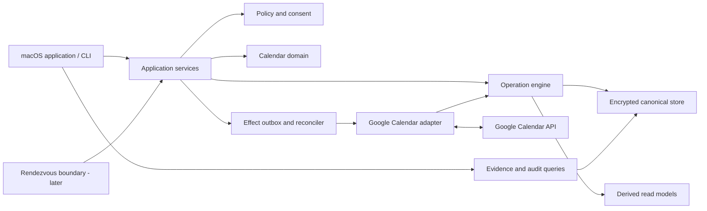
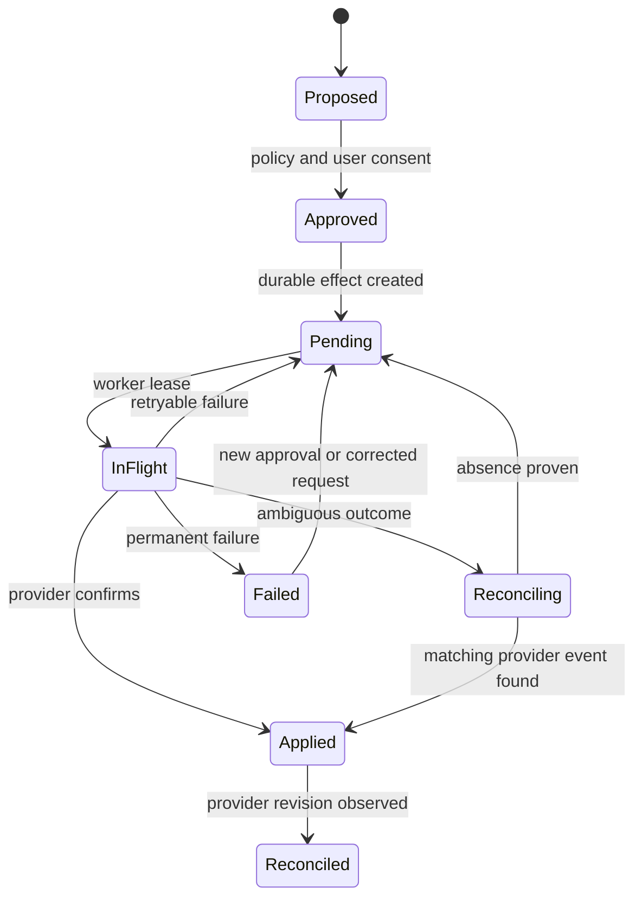

# Fabric System Design — Calendar-Guided Architecture

Status: Proposed implementation baseline  
Scope: local-first encrypted macOS desktop, Apple Silicon first  
Guiding vertical: Google Calendar  
Companion documents: [PRD](PRD.md), [technical background](architecture.md), [calendar specification](calendar.md)

## 1. Executive decision

Fabric will be built as an **encrypted local decision and evidence ledger with capability-bound external effects**. The first proof is calendar: observe a user's calendars, compute safe choices locally, obtain the required consent, and project only an approved result back to Google Calendar.

The initial system is a modular monolith with one canonical writer. It has explicit boundaries for storage, policy, calendar semantics, provider integration, and external effects. The peer-to-peer Fabric Rendezvous protocol is a later boundary, not a prerequisite for the first useful calendar release.

The calendar implements Fabric's reusable control loop:

1. **Observe** Google Calendar into a lossless local replica.
2. **Decide** availability and policy locally using deterministic code.
3. **Approve** the exact proposed external effect.
4. **Commit** through a durable, idempotent outbox.
5. **Reconcile** provider state and preserve an evidence trail.
6. **Coordinate** with another Fabric peer only after the local loop is proven.

## 2. Context, purpose, and boundaries

### 2.1 Purpose and primary operand

Fabric helps one person use private context to make decisions without surrendering that context to a hosted application or an unconstrained agent. It transforms **private evidence and user intent** into locally queryable state, deterministic candidate decisions, explicit consent records, and recoverable external effects.

For the calendar vertical, success means that a user can connect Google Calendar, inspect locally computed availability, create an event safely, and understand exactly what Fabric read, inferred, approved, and wrote.

### 2.2 System boundary

Inside Fabric:

- encrypted canonical state and operation history;
- Google Calendar replica and synchronization cursors;
- normalized calendar semantics;
- availability and scheduling policy;
- approvals, capabilities, and audit evidence;
- durable effect intents and reconciliation state;
- derived search or UI projections; and
- later, encrypted peer negotiation state.

Outside Fabric:

- Google identity, OAuth authorization servers, and Calendar API;
- Google Calendar's authoritative provider copy;
- macOS Keychain and Secure Enclave services;
- operating-system networking and notification facilities;
- an optional untrusted rendezvous relay; and
- another person's independently administered Fabric installation.

### 2.3 Explicit non-goals for the first release

- replacing Google Calendar;
- cross-platform parity;
- multi-user server accounts or a hosted Fabric database;
- general-purpose autonomous agents;
- semantic search, a complete knowledge graph, or every PIM connector;
- multi-party scheduling over real networks;
- native meeting invitations or attendee management; and
- direct EventKit synchronization.

## 3. Working assumptions

These assumptions make the first build concrete while remaining reversible:

| Topic | Initial assumption | Validation point |
|---|---|---|
| Host | Apple Silicon macOS; arm64 binaries | Build and test on `sphynx` |
| Google account | One Google account; personal and Workspace supported where OAuth policy permits | OAuth spike |
| Read scope | User-selected calendars, read-only for observation | First-run consent test |
| Write scope | One dedicated `Fabric Pilot` calendar | External-effect integration test |
| Projection | Private opaque event: title `Busy`, no attendees, notes, location, conference, or shared protocol ID | Provider round-trip test |
| Contacts | Manual Fabric contact records for the MVP | Rendezvous slice |
| Relay | In-process/local test relay before deployment | Rendezvous transport spike |
| Coordination | Two people first; multi-party only as deterministic fixtures | Post-MVP decision |

The product must expose these as policy, not bury them as adapter defaults.

## 4. Obligations and traceability

| ID | Obligation | Architectural response | Verification |
|---|---|---|---|
| O1 | User data remains usable without network access | Canonical encrypted local store; provider state is a replica | Disable network and query existing calendar state |
| O2 | Provider access is least-privilege and revocable | OAuth tokens in Keychain; calendar allowlist; adapter capability | Revoke token and confirm local read-only continuity |
| O3 | Time calculations are deterministic across DST and zones | Calendar domain owns instants, zones, recurrence, and policy | Fixture oracle across DST gaps and folds |
| O4 | No external write occurs without authority | Policy decision and immutable approval gate effect creation | Attempt an unapproved write and verify rejection |
| O5 | Retries do not duplicate provider events | Durable effect ID, stable idempotency key, reconciliation | Crash/retry fault injection |
| O6 | Provider mutation cannot silently rewrite history | Append-only operation/evidence plus superseding projection | Mutate remotely and inspect the trail |
| O7 | Agents cannot bypass policy or provider boundaries | Agents emit typed proposals; deterministic services validate | Adversarial proposal tests |
| O8 | Derived state is disposable | Operations/evidence are separate from indexes and read models | Delete and rebuild the derived DB |
| O9 | Peer scheduling reveals only bounded availability | Separate rendezvous boundary and disclosure-budget policy | Transcript privacy tests |
| O10 | Partial commit is visible and repairable | Effect state machine, compensation policy, recovery surface | Fail after provider acceptance |

## 5. Concept derivation

### 5.1 Required attributes and functions

The dominant attributes are privacy, provenance, deterministic behavior, recoverability, and evolvability. Low-latency local interaction matters, but not at the expense of hidden authority or lossy synchronization.

The system must capture evidence without losing provider identity, normalize only what the domain must reason about, evaluate policy reproducibly, distinguish a proposal from an authorized effect, execute external effects safely, reconcile local and provider truth, explain decisions, and disclose the minimum needed for peer coordination.

### 5.2 Concept alternatives

| Alternative | Strength | Failure mode | Decision |
|---|---|---|---|
| Knowledge graph first | General model from day one | Calendar correctness and recovery become incidental; too much schema before learning | Reject initially |
| Calendar-specific desktop app | Fastest apparent path | Bespoke storage, policy, and write logic cannot support later Fabric verticals | Reject |
| Local kernel with calendar bounded context | Proves reusable observe–decide–effect loop while keeping temporal rules cohesive | Requires disciplined interfaces and early contract tests | Adopt |

The adopted concept treats Fabric as a local control plane. Domain modules own meaning; the kernel owns durable authority, evidence, and effects.

## 6. Logical architecture



All modules run in one local process initially. The arrows are dependency and message boundaries, not a mandate for processes or network services.

### 6.1 Authority and ownership

| Boundary | Owns | Must not own |
|---|---|---|
| Operation engine | ordering, operation IDs, concurrency, canonical append | calendar policy or provider APIs |
| Encrypted store | canonical records, evidence references, migrations | business decisions |
| Calendar domain | time values, recurrence, busy intervals, candidates | OAuth, SQL, UI, network retries |
| Policy and consent | capabilities, disclosure budgets, approval snapshots | provider transport |
| Google adapter | OAuth use, API envelopes, sync tokens, error translation | scheduling decisions or approval |
| Effect outbox | durable intent, retry, idempotency, lifecycle | deciding whether an event should exist |
| Read models | disposable query projections | canonical authority |
| Rendezvous | peer messages and session state | provider credentials |

These boundaries follow different rates and reasons for change. Google API details change independently from temporal semantics; consent policy independently from persistence; peer cryptography independently from the useful single-user loop.

## 7. Canonical state and invariants

### 7.1 Canonical record families

- `source_account`: provider identity and granted scopes, excluding secret tokens;
- `source_collection`: an allowlisted Google calendar;
- `evidence_item`: lossless provider envelope, revision metadata, and encrypted payload reference;
- `calendar_item`: normalized event projection used by temporal reasoning;
- `operation`: append-only accepted local transition;
- `policy_snapshot`: immutable inputs and policy result;
- `approval`: actor, object, scope, expiry, and exact effect digest;
- `effect`: requested provider mutation and lifecycle;
- `effect_attempt`: each transport attempt and provider response evidence;
- `sync_checkpoint`: provider cursor and reconciliation watermark; and
- `peer_session`: later rendezvous state, isolated from provider state.

### 7.2 Invariants

1. There is one canonical writer transaction at a time.
2. Canonical mutations and durable follow-up work commit atomically.
3. Every normalized item points to the exact evidence revision that produced it.
4. Provider identifiers are namespaced by account and collection.
5. An effect references one immutable proposal digest, policy snapshot, and approval.
6. The adapter cannot construct an effect; it can only execute one.
7. A completed effect records provider identity and observed revision before reconciliation completes.
8. Read models and indexes are rebuildable from canonical state.
9. Secrets never enter operation payloads, logs, fixtures, or peer messages.
10. An agent proposal has no authority until deterministic validation accepts it.

## 8. Core interface grammar

Interfaces should be Rust traits and versioned serializable messages where useful, even while all modules are linked into one binary.

### 8.1 Observe and reconcile

```text
pull_changes(account, collection, checkpoint?)
  -> page<ProviderEnvelope>, next_checkpoint

accept_observation(provider_envelope)
  -> accepted | duplicate | superseded | conflict

reconcile(collection)
  -> reconciliation_report
```

`ProviderEnvelope` carries provider ID, revision or etag, status, observed time, raw payload, and normalized extraction result. Page acceptance and checkpoint advancement occur in one canonical transaction. A malformed item is quarantined with evidence; it does not block unrelated items or advance invisibly.

Delivery is at-least-once. Duplicate detection uses provider identity plus revision, not payload similarity.

### 8.2 Decide

```text
compute_availability(window, calendars, policy_snapshot)
  -> busy_intervals, explanation

propose_candidates(schedule_intent, availability, policy_snapshot)
  -> ordered_candidates, decision_digest
```

Inputs are immutable snapshots. Instants are stored in UTC with original zone identifiers preserved. Recurrence expansion is bounded by the requested window. Ambiguous or nonexistent local times return typed errors and require explicit resolution policy.

The same input digests and engine version must yield the same candidate order.

### 8.3 Approve and effect

```text
approve(proposal_digest, actor, capability, expiry)
  -> approval_id

request_effect(approved_proposal, destination)
  -> effect_id

claim_effect(worker, lease)
  -> executable_effect?

record_attempt(effect_id, request_digest, provider_result)
  -> pending | applied | ambiguous | terminal_failure
```

The idempotency key derives from the stable Fabric effect ID, not an attempt number. Workers use bounded leases; expired leases may be reclaimed. Rate limits and transient failures schedule retry with jitter and provider guidance. An ambiguous timeout enters reconciliation before another create call is allowed.

Backpressure is explicit: queues have limits, worker concurrency is bounded per account, and the UI surfaces delay rather than spawning unbounded work.

### 8.4 Agent proposals

```text
parse_schedule_request(untrusted_text)
  -> DraftScheduleIntent

validate_draft(draft, user_context)
  -> ScheduleIntent | ValidationErrors
```

The model may extract participants, duration, ranges, or preferences. It does not expand recurrence, compute availability, authorize disclosure, select provider scopes, or call adapters. Unknown or contradictory fields remain unresolved rather than guessed.

### 8.5 Peer rendezvous boundary

The later peer protocol consumes a `ScheduleIntent` plus bounded candidates and produces either a mutually approved candidate or a typed failure. It does not receive raw calendars. Its application interface is independent of MLS, HPKE, or relay choices until a protocol spike passes.

## 9. Calendar domain model

### 9.1 Temporal primitives

- `Instant`: an unambiguous UTC point.
- `TimeZoneId`: an IANA identifier retained from the source or user policy.
- `ZonedDateTime`: instant plus zone and original local representation.
- `Interval`: half-open `[start, end)` range.
- `RecurrenceSet`: rule, inclusions, exclusions, and provider exceptions.
- `BusyClass`: opaque busy, free, tentative, out-of-office, or policy-specific unknown.
- `ScheduleIntent`: duration, allowed windows, participants, constraints, and preference weights.
- `Candidate`: exact interval plus deterministic score and explanation.

### 9.2 Normalization and candidate order

Fabric preserves the provider envelope and creates the smallest normalized representation required for decisions. Lossy normalization is a derived projection, never the evidence record.

All-day events retain local-date semantics and source zone policy. Cancelled instances and moved recurrence exceptions remain addressable. Unknown provider states default conservatively according to explicit policy.

Candidate generation performs bounded recurrence expansion, normalization to half-open UTC intervals, policy-aware busy classification, interval union, subtraction from allowed windows, duration and buffer filtering, deterministic scoring, and stable tie-breaking by start instant and candidate digest. It emits an explanation object so the UI and tests do not reconstruct reasons from logs.

## 10. Google Calendar adapter

### 10.1 Responsibilities

- initiate OAuth with minimum configured scopes;
- load tokens by opaque Keychain reference;
- enumerate calendars for explicit selection;
- perform full and incremental synchronization;
- preserve raw event envelopes and revisions;
- translate provider errors into stable categories;
- execute only validated effects; and
- query provider state to resolve ambiguous outcomes.

### 10.2 Stable error categories

- `unauthenticated`: token missing, unusable, or revoked;
- `unauthorized`: scope or calendar ACL is insufficient;
- `rate_limited`: retry according to provider hint and local budget;
- `transient`: retryable transport or server failure;
- `invalid_checkpoint`: discard only the collection checkpoint and perform bounded full resync;
- `conflict`: provider revision no longer matches the precondition;
- `ambiguous`: outcome is unknown and must be reconciled; and
- `permanent`: invalid request or unsupported representation.

Provider payloads remain evidence but do not leak through the domain interface.

### 10.3 Pilot projection policy

Fabric writes only to the selected pilot calendar. The initial event is private and opaque: `Busy`, start, end, and owner-default reminders. Protocol metadata stays local unless a provider-supported private property is proven not to leak through sharing or export; no such property is assumed initially.

## 11. External-effect state machine



An effect is never deleted to hide failure. A corrected attempt is a new operation linked to the previous effect. Compensation is another explicit effect, not a database rollback pretending that an external call never occurred.

## 12. Failure histories

### 12.1 Crash after provider accepted a create

The worker sends a create with a stable effect identity. If Google accepts it and the process crashes before success is recorded, the expired lease moves the effect to ambiguous reconciliation. Fabric searches using the safe correlation mechanism selected during the provider spike. If found, it records the provider revision and does not create again. If absence is proven, the same effect may retry; otherwise the user resolves it.

Release gate: no duplicate event under repeated crash injection.

### 12.2 Incremental sync checkpoint expires

Existing evidence remains available. Fabric starts a bounded full resync into a new reconciliation generation, accepts items idempotently, marks missing items only after the generation completes, and atomically installs the new checkpoint.

Release gate: no silent deletion or duplicate normalization.

### 12.3 Token revoked while offline

Local data and decisions over existing evidence continue. Provider freshness is visibly stale, and effects are blocked in an authentication-required state. Reauthorization replaces the Keychain reference without rewriting history.

### 12.4 User edits Fabric's provider event

The next observation records a new revision. Reconciliation classifies the difference by field authority. Provider/user edits win for provider-owned presentation fields; Fabric does not overwrite them automatically without a new proposal and approval.

### 12.5 Peer accepts but one provider commit fails

This belongs to the later rendezvous slice. Each owner writes only their own calendar. The session records `partially_committed`, retains each approval, and offers retry or explicit cancellation. One peer never receives another peer's provider credential.

## 13. Security and privacy

### 13.1 Trust zones

1. **Local trusted core:** canonical store, domain engines, policy, and effect coordinator.
2. **Restricted local adapter:** only the provider capability and contracts it needs.
3. **Untrusted content zone:** provider text, imported content, and model output.
4. **External services:** Google and later an untrusted relay.
5. **Remote peer:** authenticated for bounded scheduling, not trusted with raw evidence.

### 13.2 Keys, capabilities, and disclosure

- Generate the vault master key locally and wrap it with a key protected by macOS Keychain.
- Keep OAuth tokens in Keychain; store only opaque references and non-secret grant metadata in the database.
- Version encryption keys so rotation does not alter logical identities.
- Exclude titles, attendees, tokens, raw payloads, and peer plaintext from logs.
- Encrypt backup/export before it leaves the device and test restoration.
- Model provider reads, provider writes, user approval, agent proposal, and peer scheduling as distinct, revocable capabilities.
- Give rendezvous only an approved window, duration, bounded candidates, and the minimum response needed to converge.

## 14. Deployment and process shape

The first implementation is one signed macOS application process with helper workers scheduled inside it. SQLite/SQLCipher and encrypted blobs live in the user's Application Support directory; secrets live in Keychain. A CLI remains for fixtures, diagnostics, migrations, and recovery exercises.

Process separation is deferred until containment evidence justifies IPC and lifecycle complexity. Module boundaries and narrow traits preserve the option. Networking is deny-by-default at the application boundary: only the Google adapter, OAuth flow, and later rendezvous transport receive network capabilities.

## 15. Proposed Rust workspace form

The existing Rust scaffold is preserved and evolved incrementally:

```text
apps/
  fabric-cli/             # fixtures, diagnostics, recovery, developer flows
  fabric-desktop/         # macOS UI when the core loop is proven
crates/
  fabric-core/            # application services and composition root initially
  fabric-types/           # stable IDs, time and contract types
  fabric-storage/         # migrations, transactions, projections
  fabric-crypto/          # vault and key interfaces; no domain policy
  fabric-policy/          # capabilities, approvals, disclosure budgets
  fabric-calendar/        # recurrence, availability, candidates, semantics
  fabric-google-calendar/ # provider API and OAuth adapter
  fabric-effects/         # durable outbox, leases, retries, reconciliation
  fabric-testkit/         # fake clock, provider simulator, fault fixtures
```

Crates should be extracted only as contracts stabilize. Initially, modules may live in `fabric-core`; dependency rules matter before package count.

Forbidden dependencies:

- calendar domain to Google client, SQL, UI, or model SDK;
- provider adapter to policy internals or canonical database connection;
- UI directly to provider adapter;
- agent/model integration to effect executor or credentials; and
- derived read model to canonical write API.

## 16. Calendar-guided delivery slices

### Slice A — Deterministic calendar kernel

Deliver temporal types, recurrence fixtures, availability, policy inputs, stable scoring, and explanations. Use frozen fixtures; no OAuth or UI dependency.

Exit gate: deterministic results across runs, zones, DST gaps/folds, cancellations, exceptions, and all-day events.

### Slice B — Encrypted canonical store

Deliver migrations, operation append, evidence envelopes, calendar projection, disposable read model, and backup/restore smoke test.

Exit gate: crash-safe transactions and logically equivalent derived-state rebuild.

### Slice C — Google observation

Deliver OAuth/Keychain integration, explicit calendar selection, full and incremental sync, checkpoint reset, freshness display, and provider simulator.

Exit gate: revoke, rate-limit, expired-checkpoint, pagination, and remote-edit tests pass without evidence loss.

### Slice D — Local decision experience

Deliver availability inspection, typed schedule intent, candidate explanations, approval preview, and policy controls. A model parser may sit behind the typed proposal boundary.

Exit gate: every candidate is reproducible and every unresolved input is visible.

### Slice E — Safe Google commit

Deliver pilot-calendar creation, exact approval binding, effect outbox, idempotency/reconciliation, opaque projection, and recovery UI/CLI.

Exit gate: fault injection at every transition produces no silent loss or duplicate event.

### Slice F — Fabric Rendezvous laboratory

Deliver manual contacts, device identity, bounded two-peer contracts, disclosure tests, and an in-process untrusted relay over synthetic calendars.

Exit gate: transcript inspection proves raw events, titles, attendees, and complete free/busy maps are absent.

### Slice G — Two-peer calendar commit

Integrate rendezvous with each peer's local effect coordinator. Test partial commit, retry, cancellation, expiry, replay, and concurrent sessions before considering a hosted relay.

Exit gate: both peers recover independently without credential or private-context transfer.

## 17. Validation strategy

### 17.1 Architectural bets

| Bet | Earliest evidence |
|---|---|
| SQLite single-writer throughput is sufficient | Replay a year of dense fixtures while UI queries run |
| Provider identity and revision support idempotence | Google spike and ambiguous-create experiments |
| Calendar semantics remain provider-independent | Run identical domain fixtures through Google and synthetic envelopes |
| Opaque projection is usable | Pilot on a dedicated calendar and inspect all Google surfaces |
| Proposal/effect separation blocks authority escalation | Property tests and adversarial agent output |
| Peer privacy is meaningful with bounded candidates | Transcript and traffic-shape review before network deployment |

### 17.2 Test layers and operability

- pure domain property tests for intervals, recurrence, and candidate order;
- migration and transaction tests against the encrypted store;
- contract tests shared by real and simulated Google adapters;
- deterministic replay and projection rebuild tests;
- crash-point tests around every effect transition;
- security tests for secret redaction and capability denial;
- golden audit and explanation fixtures; and
- end-to-end tests using a disposable Google test calendar.

Diagnostics report sync freshness, checkpoint state, queue depth, oldest pending effect, adapter health, schema version, key-wrapping health, and last successful backup verification. They do not expose private calendar content by default.

## 18. Decisions and executable guardrails

Create ADRs as the associated slice begins:

1. local modular monolith and single canonical writer;
2. canonical operations/evidence versus derived projections;
3. SQLCipher plus Keychain key wrapping;
4. temporal representation and recurrence library;
5. Google OAuth scopes and pilot projection;
6. effect idempotency and ambiguous-result reconciliation;
7. agent proposal boundary; and
8. rendezvous protocol and cryptography after the spike.

Enforce the architecture with workspace dependency checks, schema migration and replay tests in CI, secret-scanning and structured-log tests, adapter conformance suites, write/rendezvous feature flags disabled by default, and release checklists tied to slice gates.

## 19. Deferred decisions

Keep these open until their evidence-producing slice: desktop UI framework, local model/runtime, EventKit, contact import, deployed relay topology, multi-device operation merge, multi-party rendezvous, metadata-hiding transport, and helper-process extraction.

None is required to prove the calendar-guided local kernel.

## 20. First credible release

The release is credible when one user on macOS can:

1. unlock an encrypted local Fabric vault;
2. connect Google with explicit scopes;
3. select calendars for observation and one pilot calendar for writes;
4. synchronize and inspect freshness without losing evidence;
5. receive deterministic, explained candidate times;
6. approve one exact opaque event projection;
7. survive retries, crashes, token revocation, and remote edits without duplication or silent loss; and
8. inspect an audit trail linking observation, policy, approval, effect, and provider revision.

That validates Fabric's essential architecture. Peer rendezvous then tests the same kernel under a second trust boundary rather than defining the kernel prematurely.
